# Antes de empezar

Esta guía explica cómo usar el panel de Centinela en el día a día. Está escrita para quien lo consulta u opera (Lectores y Operadores) y para los administradores en lo que toca a la pantalla: crear usuarios, organizaciones o ajustes. Cada función se describe con lo mismo: qué es, para qué sirve, cómo se usa paso a paso y qué significan sus colores y estados.

No trata la instalación, el contenedor, las variables de entorno ni la API. Para eso consulta el "Manual de usuario y configuración".

## Cómo leer esta guía

| Si eres… | Empieza por… |
|---|---|
| Lector (solo consultas) | Capítulos 1, 2, 3 y 4. Después, el capítulo 10 cuando algo no salga como esperas. |
| Operador (das de alta servicios) | Todo, en especial los capítulos 5, 6, 7 y 9. |
| Administrador | Todo, y el capítulo 8 para gestionar personas. |

> **Nota:** las capturas de pantalla son ilustrativas. Muchas se tomaron en modo demostración (con datos simulados) o con fechas anteriores; los nombres de servicios y las cifras de tu panel serán distintos.

# 1. Primeros pasos

## 1.1 Entrar e iniciar sesión

Para entrar necesitas la dirección del panel (te la da quien lo administra, por ejemplo `http://192.168.1.20:9595`), tu usuario y tu contraseña.

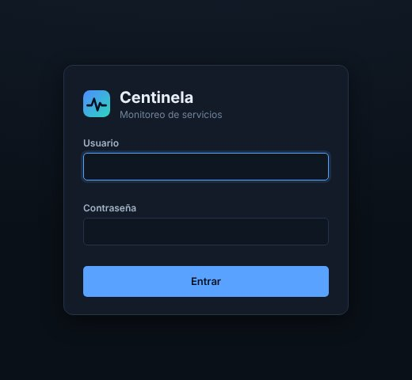

1. Abre la dirección del panel en tu navegador.
2. Escribe tu **Usuario** y tu **Contraseña**.
3. Pulsa **Entrar** (o la tecla Intro).
4. Si todo es correcto aparece el Panel. La insignia de arriba a la derecha debe decir **En vivo**.

El nombre de usuario no distingue mayúsculas de minúsculas; la contraseña sí.

| Mensaje | Qué significa | Qué hacer |
|---|---|---|
| Escribe tu usuario y contraseña. | Dejaste un campo vacío. | Completa ambos campos. |
| Usuario o contraseña incorrectos | Algún dato está mal, la cuenta está deshabilitada o la contraseña cambió. El mensaje es el mismo en todos los casos a propósito. | Revisa mayúsculas y espacios. Si sigue fallando, pide a un administrador que revise tu cuenta. |
| Demasiados intentos. Espera N s. | Fallaste 5 veces seguidas con ese usuario desde ese equipo. | Espera los segundos que indica (hasta un minuto) y vuelve a intentar con calma. |
| Demasiados intentos desde esta dirección. Espera unos minutos. | Hubo muchos intentos fallidos desde tu equipo o red. | Espera unos minutos. |
| Servidor ocupado, intenta de nuevo en unos segundos. | Hay muchos inicios de sesión a la vez. | Reintenta en unos segundos. |
| Tu sesión terminó. Inicia sesión de nuevo. | Tu sesión caducó o un administrador la cerró. | Vuelve a escribir tus datos. |

## 1.2 Cambio de contraseña obligatorio

Si tu cuenta es nueva, o un administrador te asignó la contraseña, el panel puede exigirte cambiarla antes de seguir. Lo notarás por dos señales:

- Un aviso ámbar arriba que dice "Tu contraseña es temporal. Es la inicial o la asignó un administrador: cámbiala ahora…".
- Una ventana llamada **Debes cambiar tu contraseña** que no se puede cerrar. Solo puedes cambiarla o pulsar **Cerrar sesión**.

Para cambiarla:

1. Escribe tu **Contraseña actual**.
2. Escribe la **Contraseña nueva** (mínimo 8 caracteres y distinta de la actual).
3. Repítela en **Repite la contraseña nueva**.
4. Pulsa **Cambiar contraseña**. Verás el aviso "Contraseña cambiada".

Si las dos contraseñas nuevas no coinciden, el panel lo dice ("La contraseña nueva y su repetición no coinciden.") y no cambia nada. Esa ventana puede aparecer incluso con el panel ya abierto, si un administrador marca tu cuenta mientras trabajas.

> **Consejo:** elige una contraseña larga que solo tú conozcas y no la compartas. Cada persona debe tener su propio usuario.

## 1.3 Recorrido por la pantalla

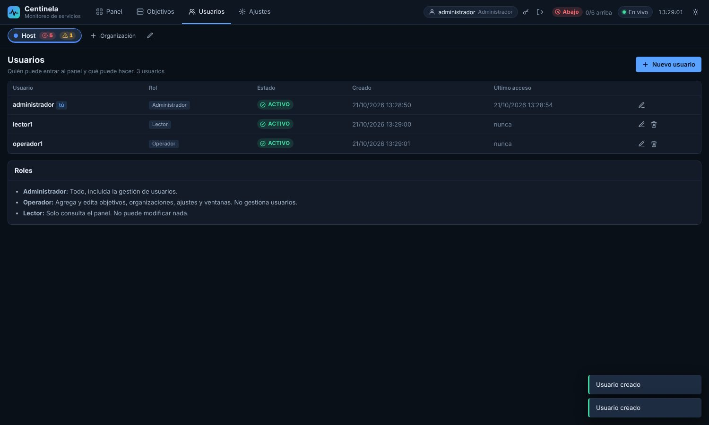

La barra superior es la misma en todas las secciones.

| Elemento | Qué muestra o hace |
|---|---|
| Panel, Objetivos, Ajustes | Cambian de sección. La sección actual queda subrayada. En pantallas angostas solo se ven los íconos. |
| Usuarios | Solo la ven los administradores. |
| Tu usuario y rol | Un recuadro con tu nombre y rol (Administrador, Operador o Lector). Solo aparece cuando el panel exige inicio de sesión. |
| Llave | Cambia tu propia contraseña (sección 8.4). |
| Flecha de salida | Cierra tu sesión (sección 1.4). |
| Indicador global | El peor estado entre todos los servicios y cuántos están arriba, por ejemplo "Abajo · 6/11 arriba". |
| Insignia de modo | Dice si los datos son en vivo, simulados o si se perdió la conexión. Ver abajo. |
| Reloj | La hora de tu navegador. |
| Sol o luna | Cambia entre tema oscuro y claro (sección 1.5). |

Bajo la barra superior hay una segunda barra con las **organizaciones** (capítulo 6).

### Indicador global: Arriba, Degradado, Abajo

El indicador global y la pestaña del navegador te avisan sin que tengas que mirar el panel. El título de la pestaña cambia a "(1 DOWN) Centinela…" cuando hay servicios caídos, o "(2 degradado) Centinela…" si solo hay degradados. Así lo ves aunque el panel esté en una pestaña de fondo. Los números cuentan los servicios de todas las organizaciones juntas.

| Indicador | Color | Significado |
|---|---|---|
| Arriba | Verde | Todo lo que se mide está bien. Muestra cuántos están arriba, por ejemplo "6/6 arriba". |
| Degradado | Ámbar | Algo responde pero fuera de lo normal o con una alerta. |
| Abajo | Rojo | Al menos un servicio no está disponible. |
| Sin objetivos | Gris | Todavía no hay nada que monitorear. |

### Insignia de modo: En vivo, Demostración y pausa

| Insignia | Significado | Qué hacer |
|---|---|---|
| **En vivo** (verde) | Estás conectado al servidor y ves mediciones reales. | Nada: es lo normal. |
| **Demostración** (ámbar) | Datos simulados; no se mide nada real. Aparece también un aviso amarillo que puedes cerrar con **Entendido**. | Abre la dirección correcta del panel. Pregunta a quien lo administra. |
| **Sin conexión con el servidor** | Se cortó el enlace. El panel intenta reconectarse solo. | Espera unos segundos. Si no vuelve, avisa a quien administra el servidor. |
| **En vivo en otra pestaña** (pausa) | Tienes demasiadas pestañas o equipos abiertos con tu usuario. El panel de esta pestaña quedó en pausa y no se actualiza. | Haz clic en la insignia (o pulsa Intro) para reconectar aquí. Cierra pestañas que no uses. |

Mientras la insignia no diga **En vivo**, no confíes en los números de la pantalla: pueden estar desactualizados o ser simulados.

## 1.4 Cerrar sesión

1. Pulsa la flecha de salida, junto a la llave, en la barra superior.
2. El panel recarga y te lleva a la pantalla de inicio de sesión.

Hazlo siempre en equipos compartidos. Tu sesión también termina sola tras 12 horas sin actividad o 7 días desde que entraste; el panel te pedirá entrar de nuevo. Si un administrador te deshabilita o cambia tu contraseña, el panel también te devuelve a la pantalla de entrada.

## 1.5 Tema claro u oscuro

1. Pulsa el botón sol o luna de la barra superior. Con el tema oscuro verás un sol (para pasar a claro) y con el claro, una luna.
2. El cambio es inmediato.

Es el mismo ajuste que **Ajustes → Tema** (sección 7.1). Usa el oscuro en salas con poca luz y el claro en oficinas iluminadas.

> **Nota:** si tu rol es Lector puedes cambiar el tema en tu pantalla, pero el cambio puede no guardarse para los demás.

# 2. Conceptos en lenguaje sencillo

## 2.1 Objetivo

Un **objetivo** es cada cosa que quieres vigilar: un servidor (por su IP o nombre) o una página o servicio web (por su URL). Tiene un nombre, un intervalo de medición y una lista de comprobaciones: ping, puertos, página web, certificado o salud interna del servidor.

## 2.2 Los estados: UP, DEGRADADO y DOWN

El panel resume cada objetivo en un estado. Los estados siempre llevan un ícono y un texto, no solo color.

| Estado | Color | Qué significa | Ejemplos |
|---|---|---|---|
| **UP** (Arriba) | Verde | Todo está dentro de lo esperado. | Responde rápido, sin pérdidas, certificado vigente. |
| **DEGRADADO** | Ámbar | El servicio responde pero algo no está bien. | Latencia alta, pérdida de paquetes, certificado por vencer, disco lleno, el agente no responde. |
| **DOWN** (Abajo) | Rojo | El servicio no está disponible. | El nombre no se resuelve, un puerto está cerrado, la web responde con error, un servicio del sistema está apagado, el certificado venció. |
| **SIN DATOS** | Gris | Aún no hay ninguna medición (recién agregado). | Espera un ciclo de medición. |
| **PAUSADO** | Gris | El monitoreo está desactivado. | Objetivo con "Activo" desmarcado. |

> **Importante:** que un valor llegue a "crítico" (en rojo) no convierte el servicio en DOWN: sigue DEGRADADO, pero el valor se pinta en rojo. DOWN se reserva para fallas de disponibilidad, así una línea lenta no se confunde con una caída.

> **Nota:** si el ping falla pero la página o un puerto sí responden, Centinela supone que un firewall bloquea el ping. Lo informa con una nota y no marca DOWN.

## 2.3 Umbrales: aviso y crítico

Cada métrica (latencia, pérdida, jitter, etc.) tiene dos límites configurables en Ajustes:

- **Degradado (aviso):** al superarlo, el valor se pinta en ámbar y el servicio pasa a DEGRADADO.
- **Crítico:** al superarlo, el valor se pinta en rojo y la etiqueta dice CRÍTICO.

Los umbrales valen para todos los objetivos. En los certificados SSL se miden días restantes, así que funcionan al revés (menos días es peor). Los valores se explican en la sección 7.3.

## 2.4 Historial y eventos

- **Historial:** cada medición queda guardada como un punto. Las gráficas y las tiras de colores (verde, ámbar, rojo) del Estado de servicios se dibujan con esos puntos. El tiempo que cubren depende de cuántos puntos se guardan y de cada cuánto se mide: 360 puntos a 10 segundos son aproximadamente una hora.
- **Eventos:** cada vez que un servicio cambia de estado se anota un evento con fecha, nombre y motivo, que ves en la ventana **Eventos y alertas**.

> **Importante:** el historial y los eventos viven en la memoria del servidor. Si el servidor se reinicia, las gráficas empiezan de cero. Tus objetivos, ajustes y disposición de ventanas sí se conservan.

# 3. El Panel

El Panel es una cuadrícula de **ventanas**. Cada ventana es un módulo independiente: un resumen, una tabla o una gráfica. Tú decides cuáles tener, dónde van y qué tan grandes son.

## 3.1 Barra de herramientas


| Botón | Qué hace | Cuándo usarlo |
|---|---|---|
| **Agregar ventana** | Abre la galería de tipos de ventana. | Para ver otra métrica, o repetir una ventana con otro objetivo. |
| **Disposición libre / Disposición bloqueada** | Alterna entre poder mover, redimensionar y quitar ventanas, o congelarlas. | Bloquéala en pantallas de pared para evitar cambios accidentales. |
| **Restablecer** | Vuelve a la disposición original con las 14 ventanas. Pide confirmación. No toca objetivos ni ajustes. | Si desordenaste todo o quitaste una ventana sin querer. |

Los Lectores no ven estos botones: su disposición queda fija.

## 3.2 Agregar una ventana

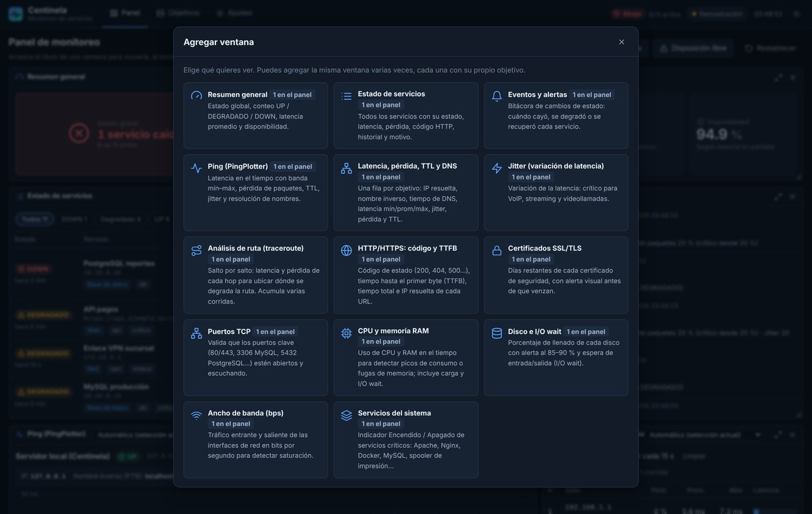

1. Pulsa **Agregar ventana**.
2. En la galería elige el tipo que quieras. Cada tarjeta explica qué muestra y cuántas hay ya en el panel.
3. La ventana se coloca en el primer hueco libre y el panel se desplaza hasta ella.

Puedes repetir un tipo. Por ejemplo, agrega dos ventanas Ping y asigna a cada una un objetivo distinto para compararlos. Si la disposición estaba bloqueada, se desbloquea sola al agregar.

## 3.3 Mover, redimensionar, ampliar y cerrar


| Acción | Cómo se hace | Detalle |
|---|---|---|
| Mover | Arrastra la barra de título. | Aparece un recuadro punteado con el destino. Las demás ventanas se apartan solas. |
| Cambiar tamaño | Arrastra el borde derecho, el inferior o la esquina inferior derecha. | Cada ventana tiene un tamaño mínimo. |
| Ampliar | Pulsa el botón de flechas de la barra de título. | La ventana ocupa casi toda la pantalla y el resto se atenúa. Se cierra con el mismo botón, con un clic fuera o con la tecla Esc. |
| Quitar | Pulsa la X. | Solo con la disposición libre. Quitar una ventana no borra datos: puedes volver a agregarla. |

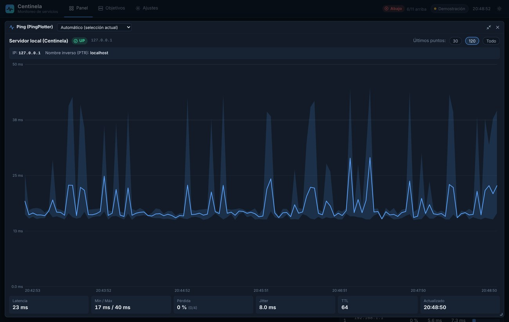

> **Nota:** la disposición se guarda sola unos instantes después de cada cambio. Cada organización tiene la suya. En el modo en vivo, todos los usuarios comparten la misma disposición de una organización. En pantallas de menos de 760 píxeles de ancho las ventanas se apilan en una columna y no se pueden arrastrar.

## 3.4 Rangos de las gráficas

Las ventanas con gráfica tienen tres botones: **30**, **120** y **Todo**. Indican cuántas mediciones recientes se dibujan. Con mediciones cada 10 segundos, 30 puntos son 5 minutos y 120 son 20 minutos.

- Usa **30** para ver qué pasó hace un momento.
- Usa **Todo** (hasta 360 puntos) para detectar tendencias.
- Pasa el ratón sobre la gráfica: aparece una cruz con el valor exacto y la hora de cada punto.

## 3.5 Elegir el objetivo de cada ventana

Algunas ventanas muestran todos los objetivos (Resumen, Estado de servicios, Eventos, Latencia/pérdida/TTL/DNS, Certificados SSL/TLS, Puertos TCP). Otras trabajan sobre uno solo y tienen una lista desplegable junto al título:

- **Automático (selección actual):** la ventana sigue al objetivo que hayas seleccionado haciendo clic en una fila de cualquier tabla (Estado de servicios, Eventos, Latencia/pérdida/TTL/DNS, HTTP, Certificados, Puertos). Así, un solo clic cambia a la vez el Ping, el Jitter, el CPU y el Traceroute de todo el panel. Sin selección, usa el primer objetivo activo compatible.
- **Un objetivo concreto:** la ventana queda fija en él. Úsalo para tener, por ejemplo, un Ping de la base de datos y otro del portal, siempre a la vista.

La lista solo ofrece objetivos compatibles. Ping, Jitter y Traceroute listan los que tienen Ping; CPU, Disco, Ancho de banda y Servicios, los que tienen agente; la gráfica HTTP, las URL. Si ninguno es compatible la ventana dice "No hay objetivos compatibles".

## 3.6 Pantalla de pared

Centinela no tiene un "modo pared" aparte: lo armas con las funciones anteriores. Ver la receta de la sección 9.5.

# 4. Catálogo de ventanas

Hay 14 tipos de ventana, agrupados en cuatro familias. Para cada una: qué muestra, cómo leerla y cuándo preocuparse.

## 4.1 Estado general

### Resumen general

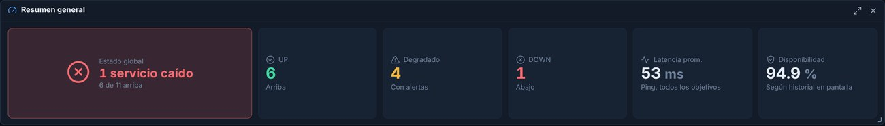

- **Qué muestra:** una tarjeta grande con el peor estado de todos los servicios ("1 servicio caído", "Todos los servicios operan con normalidad"), contadores UP, Degradado y DOWN, la latencia promedio de todos los pings y la disponibilidad.
- **Cómo leerla:** el color de la tarjeta grande (verde, ámbar, rojo) es la respuesta rápida a "¿todo bien?". La disponibilidad es el porcentaje de mediciones que no fueron DOWN, según el historial que hay en pantalla. Los objetivos pausados no cuentan.
- **Cuándo preocuparte:** en cuanto la tarjeta deje de ser verde.

### Estado de servicios

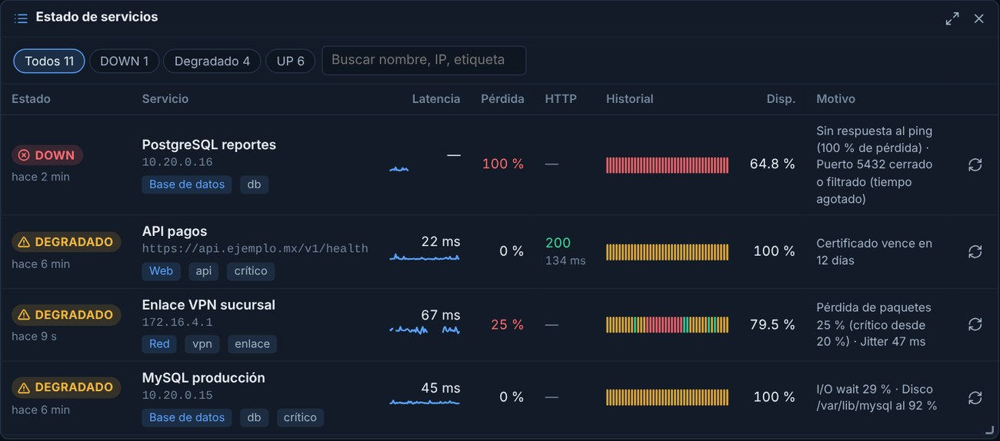

- **Qué muestra:** una fila por servicio con su estado y desde cuándo, nombre, dirección, grupo y etiquetas, latencia con mini gráfica, pérdida, código HTTP y TTFB, un historial de colores, disponibilidad y el motivo del estado.
- **Cómo leerla:** el historial son celdas de colores, una por medición (verde UP, ámbar degradado, rojo DOWN). Una tira con rojo intermitente indica un servicio que "parpadea". La columna Motivo explica en palabras por qué no está UP (hasta dos razones).
- **Orden:** primero DOWN, luego degradados, sin datos, UP y pausados; dentro de cada estado, por orden alfabético.
- **Filtros y búsqueda:** los botones Todos, DOWN, Degradado y UP muestran cuántos hay en cada estado. El cuadro de búsqueda filtra por nombre, IP, grupo o etiqueta.
- **Verificar ahora:** el botón de flechas circulares de cada fila mide ese servicio al instante (límites en la sección 5.4).
- **Seleccionar:** un clic en una fila selecciona ese servicio para las ventanas en modo Automático.
- **Cuándo preocuparte:** cualquier fila en DOWN, o degradada durante mucho rato. Úsala después de aplicar una corrección para confirmar la recuperación.

### Eventos y alertas

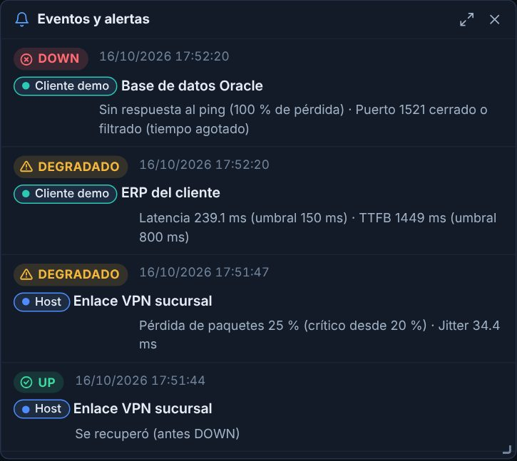

- **Qué muestra:** la bitácora de cambios de estado, la más reciente primero (hasta 80 visibles): fecha y hora, servicio, nuevo estado y motivo ("Se recuperó (antes DOWN)", "Puerto 5432 cerrado…", "Certificado vence en 12 días").
- **Cómo leerla:** el color indica el estado nuevo. Si tienes varias organizaciones, cada fila lleva la etiqueta de la suya con su color. Si aparece muchas veces el mismo servicio, está inestable.
- **Seleccionar:** un clic en un evento selecciona ese servicio. Si es de otra organización, el panel cambia a ella.
- **Cuándo preocuparte:** ante caídas repetidas del mismo servicio o ante eventos nuevos mientras estás mirando otra organización.

## 4.2 Red

### Ping (PingPlotter)

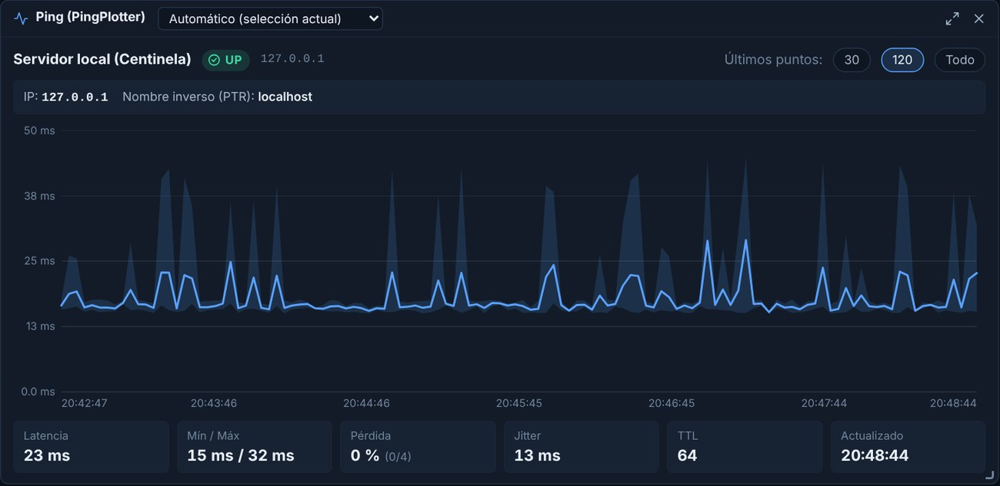

- **Qué muestra:** el nombre, estado y dirección del objetivo; una caja con la resolución de nombres (para una URL, a qué IP resuelve; para una IP, su nombre inverso); seis tarjetas (Latencia, Mín/Máx, Pérdida, Jitter, TTL y hora de actualización) y una gráfica.
- **Cómo leer la gráfica:** la línea azul es la latencia promedio de cada ciclo; la banda azul clara, el rango mínimo a máximo; las barras rojas, ciclos con pérdida de paquetes; el sombreado rojo, periodos en DOWN; la línea punteada ámbar, el umbral de aviso. Un hueco es un ciclo sin respuesta.
- **Colores de las tarjetas:** ámbar al pasar el aviso, rojo al pasar el crítico.
- **Requiere:** un objetivo con la casilla Ping.
- **Cuándo preocuparte:** picos aislados suelen ser congestión momentánea; una meseta alta indica una ruta saturada; barras rojas repetidas, un enlace inestable. Si el panel dice "Ping no disponible", el servidor de monitoreo no puede hacer ping (avisa a quien lo administra) y conviene vigilar con puertos o HTTP.

### Latencia, pérdida, TTL y DNS

- **Qué muestra:** una fila por objetivo con IP resuelta, nombre (DNS o inverso), tiempo de DNS, latencia mínima, promedio y máxima, jitter, pérdida y TTL.
- **Cómo leerla:** los valores se pintan en ámbar o rojo según los umbrales. Si un nombre no se resuelve, el error aparece en rojo en la columna de IP. Un clic en una fila selecciona el servicio.
- **Cuándo preocuparte:** cuando varios enlaces suben a la vez (problema común) o cuando una URL cambia de IP sin que lo esperes.

### Jitter

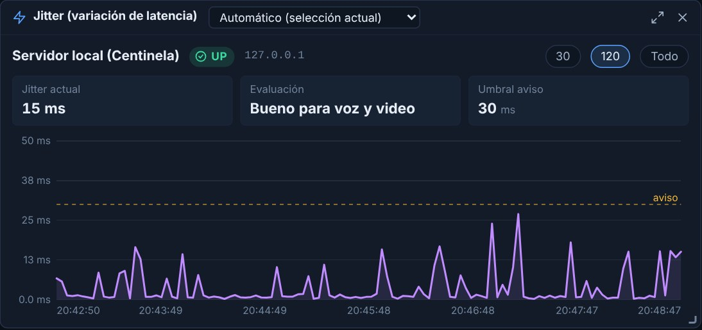

- **Qué muestra:** el jitter actual (la variación de la latencia entre mediciones consecutivas), una evaluación, el umbral de aviso y una gráfica.
- **Cómo leerla:** la evaluación dice "Bueno para voz y video" (sin color), "Marginal" (ámbar) o "Malo" (rojo).
- **Cuándo preocuparte:** en voz sobre IP, videollamadas o transmisiones, donde un jitter alto corta la comunicación aunque la latencia promedio parezca buena.

### Análisis de ruta (traceroute)

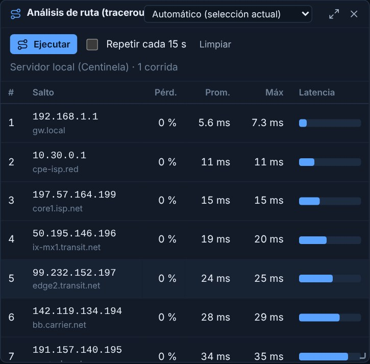

- **Qué muestra:** cada salto entre el servidor de monitoreo y el destino: número, IP y nombre, pérdida, latencia promedio y máxima, y una barra de latencia.
- **Cómo usarla, paso a paso:**
  1. Elige el objetivo (o déjalo en Automático).
  2. Pulsa **Ejecutar**. Puede tardar hasta un minuto; mientras tanto dice "Rastreando…".
  3. Para vigilar durante un incidente, marca **Repetir cada 15 s**: acumula mediciones por salto, como PingPlotter.
  4. **Limpiar** borra lo acumulado. Cambiar de objetivo reinicia el análisis.
- **Cómo leerla:** la barra es ámbar sobre 100 ms y roja sobre 250 ms o con pérdida de 30 % o más. El panel marca en rojo el "posible origen del problema": el primer salto donde la latencia sube 80 ms o más, o donde empieza una pérdida sostenida hasta el final.
- **Cuándo preocuparte:** un salto "sin respuesta" intermedio no es problema si los siguientes sí responden: muchos routers no contestan. Preocúpate por el salto marcado en rojo: dice si el problema está en tu red, en tu proveedor o en el destino.
- **Límites:** si ya tienes un traceroute en curso verás "Ya tienes un traceroute en curso"; espera a que termine. Si faltan los comandos en el servidor aparece un mensaje; avisa a quien lo administra.

## 4.3 Aplicación

### HTTP/HTTPS: código y TTFB

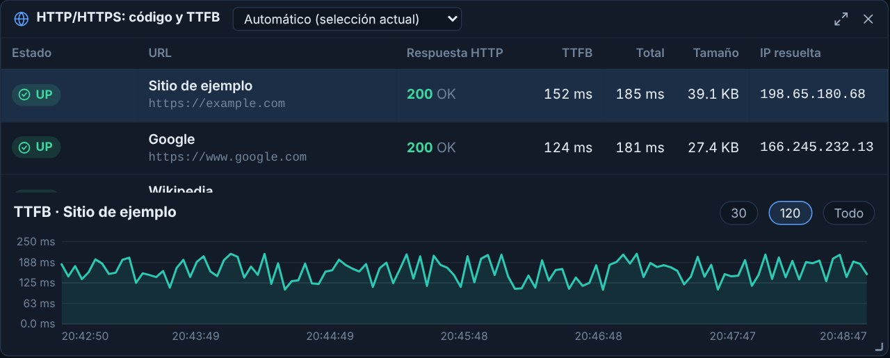

- **Qué muestra:** una tabla con todas las URL monitoreadas: estado, URL, código de respuesta, tiempo hasta el primer byte (TTFB), tiempo total, tamaño e IP resuelta. Abajo, la gráfica de TTFB de la URL seleccionada.
- **Cómo leerla:** el código es verde si es el esperado y rojo si no ("error" si no hubo respuesta). El TTFB es lo que tarda el servidor en empezar a responder; se pinta ámbar o rojo según los umbrales. Una etiqueta "N redir." indica redirecciones (al pasar el cursor ves la cadena) y "sin texto esperado" significa que la página respondió pero no contiene el texto que se espera.
- **Cuándo preocuparte:** códigos 500, 503, 404 donde no deben estar, página sin el texto esperado, o un TTFB que va subiendo: te avisa antes de que los usuarios se quejen.

### Certificados SSL/TLS

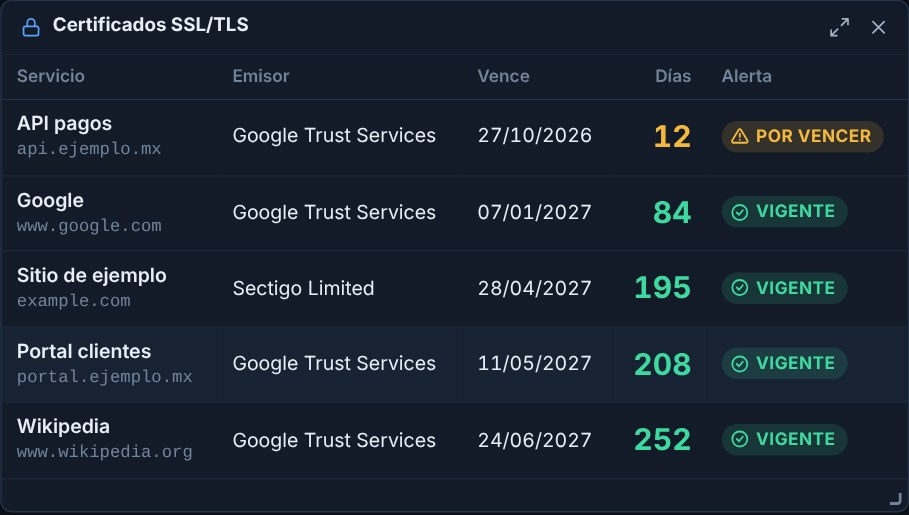

- **Qué muestra:** los certificados de los sitios https, del que vence antes al que vence después: servicio, emisor, fecha de vencimiento, días restantes y una etiqueta.
- **Cómo leerla:**

| Etiqueta | Color | Significado |
|---|---|---|
| VIGENTE | Verde | Faltan más días que el umbral de aviso (30 por defecto). |
| POR VENCER | Ámbar | Faltan los días del aviso o menos. |
| CRÍTICO | Rojo | Faltan 7 días o menos (valor por defecto). |
| VENCIDO | Rojo | Ya venció: el servicio pasa a DOWN. |
| SIN LECTURA | Ámbar | No se pudo leer el certificado. |

  Una nota "no confiable" indica un certificado autofirmado, de una entidad interna o con la cadena incompleta.
- **Cuándo preocuparte:** al ver POR VENCER, porque aunque el sitio responda 200 los usuarios verán una advertencia cuando venza.

### Puertos TCP

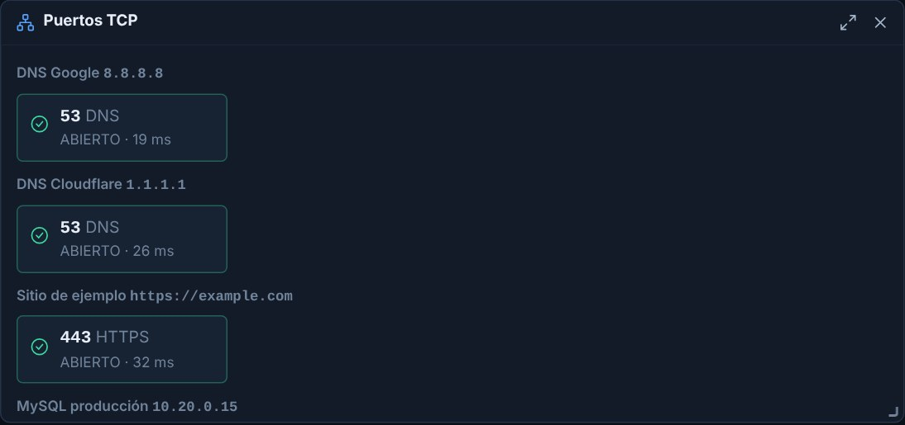

- **Qué muestra:** por cada objetivo con puertos configurados, una ficha por puerto con su número, el nombre del servicio conocido (HTTPS, MySQL, SSH…) y el resultado.
- **Cómo leerla:** **ABIERTO** con el tiempo de conexión (verde) o **CERRADO** con el motivo (rojo, por ejemplo "tiempo agotado" o "conexión rechazada"). Un puerto cerrado pone el servicio en DOWN.
- **Cuándo preocuparte:** cuando el servidor responde ping pero el puerto de su aplicación (base de datos, correo, web) está cerrado: el equipo está vivo pero el servicio no.

## 4.4 Infraestructura

> **Importante:** estas cuatro ventanas solo tienen datos de objetivos con **Salud del servidor (agente)** activada. En servidores remotos, esa función requiere que alguien instale un pequeño programa (el agente) en el equipo; consulta el capítulo 11 del "Manual de usuario y configuración". Si ningún objetivo la tiene, la ventana dice "No hay objetivos compatibles". Si el agente no responde, la ventana dice "El agente no responde" y el servicio pasa a DEGRADADO.

### CPU y memoria RAM

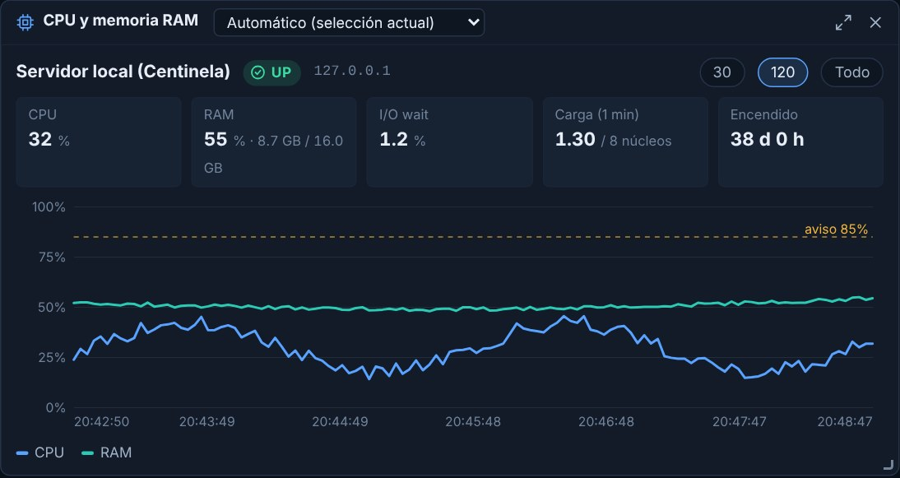

- **Qué muestra:** tarjetas de CPU, RAM (con GB usados y totales), I/O wait, carga y tiempo encendido, y una gráfica de CPU (azul) y RAM (verde azulado) con la línea de aviso.
- **Cómo leerla:** los valores se pintan ámbar o rojo al pasar los umbrales (por defecto 85 % y 95 %).
- **Cuándo preocuparte:** una CPU pegada al máximo mucho rato, o una RAM que sube sin bajar nunca (posible fuga de memoria).

### Disco e I/O wait

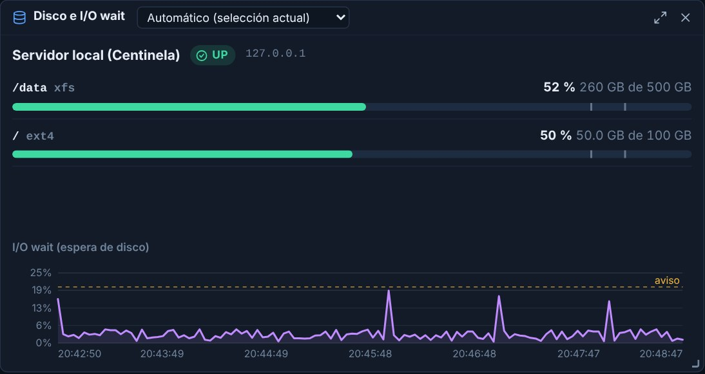

- **Qué muestra:** cada disco o partición con una barra de uso, GB usados y totales, y marcas en los umbrales. Debajo, una gráfica de I/O wait (el tiempo que el equipo espera al disco).
- **Cómo leerla:** la barra cambia de verde a ámbar con la etiqueta **ALTO** (85 % por defecto) y a rojo con **CRÍTICO** (90 %). El I/O wait solo existe en servidores Linux.
- **Cuándo preocuparte:** un disco lleno detiene bases de datos y registros sin avisar. Actúa al ver ALTO, no al llegar a CRÍTICO.

### Ancho de banda

- **Qué muestra:** el tráfico entrante (RX) y saliente (TX) de las interfaces de red, en bits por segundo, como valores actuales y gráfica de áreas.
- **Cómo leerla:** compara con la capacidad de tu enlace. Solo la reportan servidores Linux; en otros dice "Sin datos de tráfico".
- **Cuándo preocuparte:** ante picos sostenidos que ahogan el enlace, copias de seguridad en horario laboral o tráfico saliente anormal.

### Servicios del sistema

- **Qué muestra:** una ficha por cada servicio que se pidió vigilar (nginx, docker, mysqld…).
- **Cómo leerla:** **ENCENDIDO** (verde) o **APAGADO** (rojo). Un servicio apagado pone el objetivo en DOWN, aunque el servidor siga prendido.
- **Si dice "No hay servicios configurados":** edita el objetivo y escribe los nombres en "Servicios a vigilar" (sección 5.3).

# 5. Objetivos

La sección **Objetivos** es donde se administra todo lo que se monitorea. Muestra la lista de la organización activa (su nombre aparece junto al título). Se permiten hasta 500 objetivos por organización.

> **Nota:** los Lectores ven la lista y pueden exportarla, pero no ven los botones de agregar, importar, editar ni eliminar, y no pueden cambiar la casilla Activo.

## 5.1 La tabla de objetivos

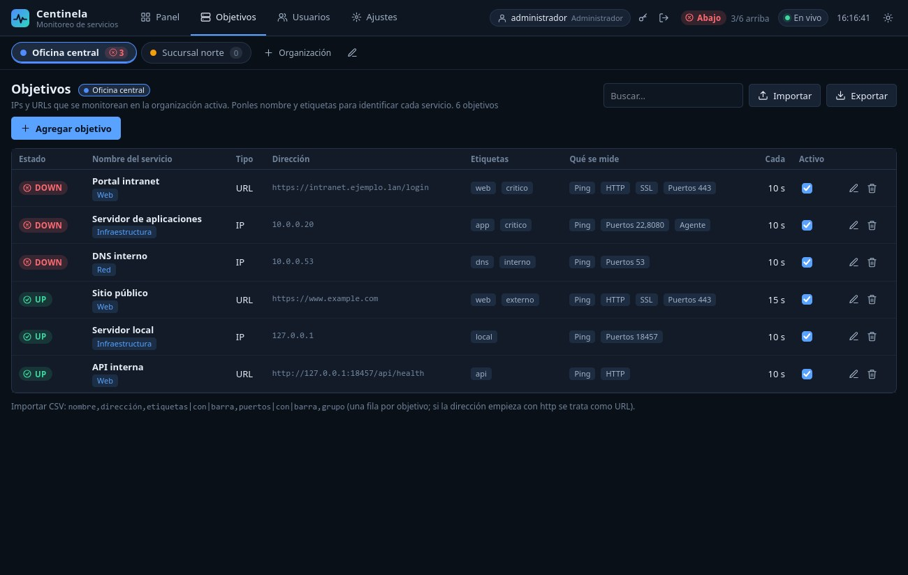

| Columna | Contenido |
|---|---|
| Estado | UP, DEGRADADO, DOWN, SIN DATOS o PAUSADO en este momento. |
| Nombre del servicio | El nombre que le diste y, debajo, su grupo. |
| Tipo | URL, IP o Host. |
| Dirección | La IP, nombre o URL que se mide. |
| Etiquetas | Palabras para clasificar. |
| Qué se mide | Ping, HTTP, SSL, Puertos (con los números) y Agente. |
| Cada | Cada cuántos segundos se mide. |
| Activo | Casilla para pausar o reanudar sin borrar; se guarda al instante. |
| Acciones | Lápiz para editar y papelera para eliminar. |

Arriba, el cuadro **Buscar** filtra mientras escribes por nombre, dirección, grupo o etiqueta. Junto al título verás cuántos objetivos hay. Si aún no hay ninguno, un botón **Agregar objetivo** te invita a crear el primero.

## 5.2 Agregar un objetivo, paso a paso

1. Pulsa **Agregar objetivo**.
2. Escribe el **Nombre del servicio** y elige el **Tipo de objetivo**: **IP o host** (equipos) o **URL (web / API)**.
3. Escribe la dirección.
4. Marca lo que quieras medir.
5. Pulsa **Agregar**. Verás "Objetivo agregado" y, tras la primera medición, el estado.

Para **editar**, pulsa el lápiz de la fila; el botón dice **Guardar cambios**. Si hay un error, el formulario muestra una lista en rojo arriba.

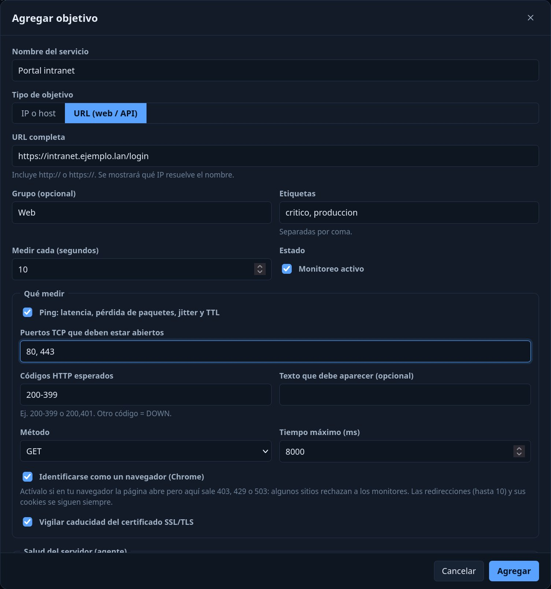

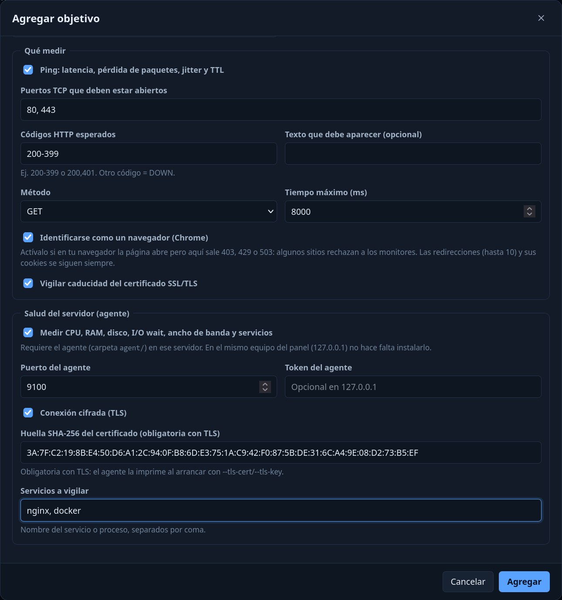

### Datos generales

| Campo | Qué hace | Límites | Consejo |
|---|---|---|---|
| Nombre del servicio | El nombre que verás en todas las ventanas y eventos. | Obligatorio, hasta 80 caracteres. | Usa el nombre que reconoce el equipo ("MySQL producción"), no la IP. |
| Tipo de objetivo | IP o host: ping, puertos y agente. URL: además HTTP, certificado y la IP a la que resuelve. | IP o host, o URL. | URL cuando importa que la aplicación responda; IP o host para equipos de red o bases de datos. |
| Dirección IP o nombre de host / URL completa | Lo que se mide. | Host: sin `http://` ni espacios. URL: debe empezar con `http://` o `https://`. | Para URL, apunta a una página liviana de salud o de inicio de sesión. |
| Grupo | Agrupa servicios relacionados; sugiere los grupos que ya usas. | Opcional, hasta 40 caracteres. | Por sistema, sede o capa ("Web", "Base de datos"). |
| Etiquetas | Palabras para clasificar y buscar. | Separadas por coma. Hasta 10, de 24 caracteres. | "critico", "produccion". |
| Medir cada (segundos) | Cada cuánto se repiten las comprobaciones. | 2 a 3600. Por defecto, el de Ajustes. | 5 a 15 s para servidores y enlaces críticos; 30 a 60 s para sitios externos; más para certificados. |
| Monitoreo activo | Si lo desmarcas, el objetivo se pausa. | Marcado por defecto. | Para mantenimientos programados. |

### Qué medir

| Campo | Qué hace | Límites | Consejo |
|---|---|---|---|
| Ping | Latencia, pérdida, jitter y TTL. | Marcado por defecto. | Desmárcalo si el equipo bloquea ping. |
| Puertos TCP que deben estar abiertos | Un puerto cerrado pone el servicio en DOWN. | Números del 1 al 65535, separados por coma, hasta 20. | 443 web, 22 SSH, 3306 MySQL, 5432 PostgreSQL. |
| Códigos HTTP esperados | Solo URL. Cualquier otro código es DOWN. | `200-399`, `200,401` o mezclas. Por defecto 200-399. | Si tu API responde 401 sin credenciales: `200-399,401`. |
| Texto que debe aparecer | Solo URL. Si la página no lo contiene, DOWN. | Hasta 100 caracteres; distingue mayúsculas. Requiere método GET. | Una palabra que solo exista cuando la aplicación funciona. |
| Método | Solo URL. GET descarga la página; HEAD pide solo encabezados. | GET o HEAD. | GET, salvo páginas muy pesadas. |
| Tiempo máximo (ms) | Solo URL. Cuánto se espera la respuesta. | 1000 a 30000, por defecto 8000. | Sube el valor en servicios lentos por diseño. |
| Identificarse como un navegador (Chrome) | Solo URL. Envía cabeceras de navegador en vez de la identificación de Centinela. | Desmarcado por defecto. | Actívalo si en tu navegador la página abre pero aquí sale 403, 429 o 503. |
| Vigilar caducidad del certificado SSL/TLS | Calcula los días que faltan. Alimenta la ventana de Certificados. | Se activa sola con URL https. | Actívala en todo sitio con https. |

### Salud del servidor (agente)

Esta parte solo se usa para servidores donde se instaló el agente (lo hace quien administra el servidor; ver capítulo 11 del "Manual de usuario y configuración").

| Campo | Qué hace | Detalle |
|---|---|---|
| Medir CPU, RAM, disco, I/O wait, ancho de banda y servicios | Activa las ventanas de Infraestructura para este objetivo. | Desmarcado por defecto. En el mismo equipo del panel (127.0.0.1) no hace falta instalar nada. |
| Puerto del agente | Puerto donde escucha el agente de ese servidor. | 1 a 65535; por defecto 9100. Debe coincidir con el del agente. |
| Token del agente | La contraseña compartida con el agente. | Obligatorio en servidores remotos. Nunca se muestra de nuevo: al editar, dejarlo vacío conserva el guardado. |
| Conexión cifrada (TLS) | Consulta al agente por una conexión cifrada. | Solo si el agente se configuró con certificado. Al marcarla aparece el campo de la huella. |
| Huella SHA-256 del certificado | Identifica el certificado del agente. El panel solo envía el token si el certificado tiene exactamente esa huella. | Obligatoria con TLS: 64 caracteres hexadecimales, con o sin ":" entre pares (AA:BB:…). Pídesela a quien administra el agente, que la ve al arrancarlo. |
| Servicios a vigilar | Servicios o procesos que deben estar encendidos; si uno se apaga, el objetivo pasa a DOWN. | Hasta 20, separados por coma, por ejemplo `nginx, docker`. Cada nombre empieza con letra o número. |

### Cuándo se descarta el token del agente

Por seguridad, el token guardado se **descarta** si cambias cualquiera de estos datos del objetivo:

- La dirección (incluso solo la ruta de una URL).
- El puerto del agente.
- La huella del certificado.
- Si desmarcas Conexión cifrada (TLS).

El formulario te avisa antes de guardar, con este texto bajo el campo del token: "Al cambiar la dirección o el puerto, al cambiar la huella o desactivar TLS, se descarta el token guardado del agente; vuelve a escribirlo." Si guardas sin escribirlo, el agente responderá "token rechazado" y el servicio quedará DEGRADADO. Escribe el token de nuevo antes de guardar.

> **Importante:** con "Conexión cifrada (TLS)" la huella es obligatoria. Si falta o está mal escrita, el formulario no te deja guardar. Un objetivo ya guardado con TLS y sin huella muestra "Falta la huella TLS del agente" y no se comunica con el agente.

## 5.3 Errores de validación frecuentes

| Mensaje | Qué significa | Qué hacer |
|---|---|---|
| El nombre es obligatorio. | Falta el nombre. | Escribe un nombre. |
| La dirección es obligatoria. | Falta la dirección. | Escribe la IP, el nombre de host o la URL. |
| La URL debe empezar con http:// o https:// | Elegiste tipo URL sin protocolo. | Escribe la URL completa o cambia el tipo a IP o host. |
| La URL no es válida (ejemplo: https://sitio.com/ruta). | La URL está mal formada. | Revisa protocolo, dirección y espacios. |
| Escribe una IP o un nombre de host válido (sin http:// ni espacios) | Pusiste una URL, espacios o caracteres no permitidos en el tipo host. | Quita el protocolo y la ruta, o cambia el tipo a URL. |
| Códigos HTTP esperados no válidos | Formato incorrecto. | Usa `200-399`, `200,401` o mezclas. |
| Nombre de servicio no válido | Un servicio vigilado tiene espacios o símbolos, o no empieza con letra o número. | Escribe solo el nombre, separado por comas. |
| Con TLS activado, la huella SHA-256 del certificado es obligatoria… | Marcaste Conexión cifrada y dejaste la huella vacía. | Pega la huella o desmarca TLS. |
| Huella TLS no válida (64 caracteres hexadecimales) | La huella no tiene 64 caracteres hexadecimales o tiene ":" mal puestos. | Cópiala completa. |

## 5.4 Verificar ahora

Normalmente cada objetivo se mide solo, según su intervalo. **Verificar ahora** fuerza una medición inmediata: útil tras arreglar algo, para confirmar la recuperación sin esperar el siguiente ciclo.

1. En la ventana **Estado de servicios**, busca la fila del servicio.
2. Pulsa el botón de flechas circulares al final de la fila.
3. En unos segundos la fila se actualiza.

Hay límites para evitar saturar el servidor. Si los superas verás un aviso rojo con el mensaje:

| Mensaje | Qué significa | Qué hacer |
|---|---|---|
| Ya hay una verificación en curso para este objetivo (409) | Ese objetivo ya se está midiendo. | Espera a que termine. |
| Espera unos segundos antes de volver a verificar este objetivo (429) | Pasaron menos de 5 segundos desde la última verificación manual de ese objetivo. | Espera unos segundos y reintenta. |
| Demasiadas verificaciones manuales; espera un momento (429) | Más de 3 a la vez o más de 30 en un minuto. | Espera un momento. |

Si la medición excede su plazo máximo, el objetivo queda en DOWN con el motivo "La verificación excedió el tiempo máximo": revisa si el destino está colgado.

## 5.5 Pausar y eliminar

- **Pausar:** desmarca la casilla **Activo** de la fila. Deja de medirse y queda PAUSADO, sin perder la configuración. Vuelve a marcarla para reanudar.
- **Eliminar:** pulsa la papelera, lee el aviso ("Se pierde su historial") y confirma con **Eliminar**. Quedará el aviso "Objetivo eliminado". No se puede deshacer.

## 5.6 Importar y exportar

**Exportar:** pulsa **Exportar** para descargar `objetivos-centinela.json` con todos los objetivos de la organización activa. Sirve de respaldo o para copiarlos a otra instalación. El archivo no incluye los tokens de los agentes.

**Importar:** pulsa **Importar** y elige un archivo JSON (como el exportado) o CSV. Después elige:

- **Agregar a los actuales:** conserva lo que ya tienes y suma lo nuevo.
- **Reemplazar los actuales:** borra los objetivos actuales y su historial, y deja solo los del archivo.
- **Cancelar:** no hace nada.

Formato CSV: una fila por objetivo, con separador coma, punto y coma o tabulador. La primera fila puede ser un encabezado que empiece con "nombre".

```
nombre,direccion,etiquetas,puertos,grupo
Portal clientes,https://portal.empresa.com/login,critico|web,443,Web
MySQL produccion,10.20.0.15,db|critico,3306,Base de datos
Enlace sucursal norte,172.16.4.1,vpn,,Red
```

- Etiquetas y puertos de la misma fila se separan con la barra vertical `|`.
- Si la dirección empieza con `http://` o `https://` se crea como URL (con HTTP y, si es https, certificado); si no, como IP o host. Todos nacen con Ping.
- Si alguna fila tiene errores no se importa nada y se muestra la lista ("Fila 3: …") para que corrijas el archivo. Si el archivo está vacío o no se puede leer, también lo avisa.

> **Importante:** importar con **Reemplazar** elimina los objetivos actuales y su historial. Exporta antes un respaldo. La importación afecta solo a la organización activa.

# 6. Organizaciones

Una **organización** es un espacio de trabajo independiente dentro del mismo Centinela. Sirve para vigilar, desde un solo lugar, los servicios de varios clientes, sedes o equipos sin mezclarlos. La organización **Host** es la principal: ya existe, no se puede eliminar y es siempre la primera pestaña.

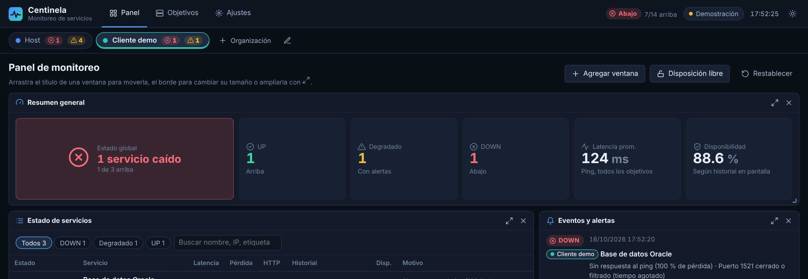

## 6.1 La barra de organizaciones

| Elemento | Qué hace |
|---|---|
| Pestaña de organización | Cambia el Panel y la sección Objetivos a esa organización. La activa se resalta con su color y el navegador la recuerda. Al pasar el cursor ves su nota. |
| Insignias en la pestaña | Resumen sin abrirla: ícono rojo con el número de servicios DOWN, ámbar con los DEGRADADOS o, si todo está bien, verde con cuántos están UP. Siempre llevan ícono y número, no solo color. |
| + Organización | Crea una organización nueva. |
| Lápiz | Edita la organización activa. |

Cuando solo existe Host, la barra se ve más compacta.

## 6.2 Crear una organización

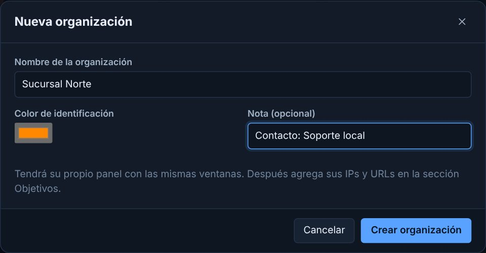

1. Pulsa **+ Organización**.
2. Escribe el **Nombre de la organización** (obligatorio, hasta 60 caracteres, sin repetir otro).
3. Elige un **Color de identificación**: sirve para reconocerla de reojo. No sustituye a los colores de estado.
4. Si quieres, escribe una **Nota** (hasta 200 caracteres), por ejemplo un contacto de guardia.
5. Pulsa **Crear organización**. El panel pasa a ella.
6. Ve a **Objetivos** y agrega sus IPs y URL.

## 6.3 Cambiar, editar y eliminar

- **Cambiar:** haz clic en su pestaña.
- **Editar:** abre la organización, pulsa el lápiz, modifica nombre, color o nota y pulsa **Guardar**.
- **Eliminar:** pulsa el lápiz y luego **Eliminar** (no aparece en Host). El aviso indica cuántos objetivos se perderán. Se borran sus objetivos, su historial y su disposición de ventanas, y no se puede deshacer. Si la estabas viendo, el panel vuelve a Host.

Límite: hasta 50 organizaciones. Los Lectores no ven los botones para crear o editar.

## 6.4 Qué es independiente por organización

| Elemento | Alcance |
|---|---|
| Objetivos (IPs y URL) | Por organización. Agregar, editar, importar o exportar actúa sobre la activa. |
| Disposición de ventanas | Por organización. Una nueva arranca con la disposición original. |
| Eventos y alertas | Global: reúne las alertas de todas, cada fila con la etiqueta de su organización. Al pulsar uno de otra organización, el panel cambia a ella. |
| Indicador de la barra superior y título de la pestaña | Global: cuentan los servicios de todas. |
| Umbrales, intervalo por defecto, tema y puntos de historial | Global: son los de Ajustes. |
| Mediciones | Siempre activas en todas, aunque no las estés viendo. |

> **Importante:** separar por organizaciones es solo visual. No restringe el acceso: quien entra al panel ve todas las organizaciones, sea cual sea su rol.

# 7. Ajustes

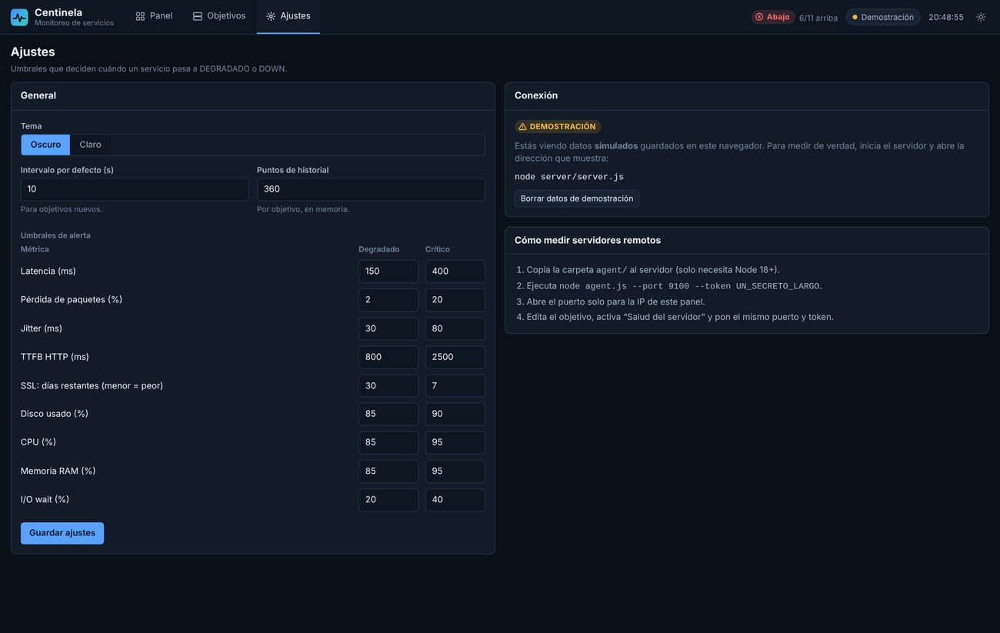

Los Operadores y Administradores pueden cambiarlos; los Lectores los ven, pero los campos están bloqueados. Los cambios valen para todo el panel y para todas las organizaciones.

## 7.1 General

| Ajuste | Qué hace | Valores |
|---|---|---|
| Tema | Oscuro o claro; se aplica al instante. | Oscuro (por defecto) o Claro. |
| Intervalo por defecto (s) | Valor inicial de "Medir cada" al crear objetivos nuevos. No cambia los existentes. | 2 a 3600; por defecto 10. |
| Puntos de historial | Cuántas mediciones guarda cada objetivo para las gráficas. | 30 a 2000; por defecto 360. Más puntos = más tiempo visible. |

## 7.2 Guardar

1. Cambia los valores que quieras.
2. Pulsa **Guardar ajustes**.
3. Verás "Ajustes guardados". Si algo no es válido, aparece una lista de errores sobre el botón y no se guarda nada.

Un campo vacío no vale 0: se omite y se conserva el valor anterior.

## 7.3 Umbrales de alerta

Cada fila tiene dos casillas: **Degradado** (aviso, ámbar) y **Crítico** (rojo).

| Métrica | Aviso / Crítico (por defecto) | Qué compara |
|---|---|---|
| Latencia (ms) | 150 / 400 | Latencia promedio de la medición. |
| Pérdida de paquetes (%) | 2 / 20 | Porcentaje de paquetes perdidos. Con 4 paquetes por medición solo puede ser 0, 25, 50, 75 o 100 %. |
| Jitter (ms) | 30 / 80 | Variación entre respuestas consecutivas. |
| TTFB HTTP (ms) | 800 / 2500 | Tiempo hasta el primer byte de la página. |
| SSL: días restantes | 30 / 7 | Días que faltan para vencer; aquí menos días es peor. |
| Disco usado (%) | 85 / 90 | El disco más lleno del servidor. |
| CPU (%) | 85 / 95 | Uso de CPU. |
| Memoria RAM (%) | 85 / 95 | Memoria en uso. |
| I/O wait (%) | 20 / 40 | Tiempo de espera de disco (solo Linux). |

> **Consejo:** sube los umbrales en enlaces lentos por naturaleza (satélite, VPN lejana) para no vivir en alerta, y bájalos en redes locales o voz para detectar cualquier degradación.

### Mensajes de error al guardar

| Mensaje | Qué significa | Qué hacer |
|---|---|---|
| En "Latencia (ms)" el aviso (500) debe ser menor que el crítico (400). | En las métricas normales, el aviso debe ser menor que el crítico. | Pon un aviso menor que el crítico. |
| En "SSL: días restantes (menor = peor)" el aviso (7) debe ser mayor que el crítico (30): se avisa con más días de margen. | En SSL es al revés: el aviso debe ser mayor que el crítico (por ejemplo 30 y 7). | Invierte los valores. |
| … debe ser mayor que 0 | Un aviso en 0 daría alertas permanentes (no vale en latencia, pérdida, jitter, TTFB, disco, CPU, RAM ni I/O wait). | Escribe un valor mayor que 0. |
| Un valor no numérico o fuera de 0 a 1 000 000 | El valor no es válido. El mensaje nombra el umbral, por ejemplo "Pérdida de paquetes (aviso)". | Corrige ese campo. |

El intervalo y los puntos de historial, en cambio, se ajustan solos al límite permitido.

## 7.4 Conexión y servidores remotos

- **Conexión:** dice si estás **En vivo** (con el nombre del servidor de monitoreo) o en **Demostración**. En demostración aparece el botón **Borrar datos de demostración**, que borra lo guardado en tu navegador y recarga; no afecta a un servidor real. El detalle del equipo servidor solo lo ven los administradores.
- **Cómo medir servidores remotos:** es una ayuda con los pasos para instalar el agente. Para ti, como usuario, significa: *si quieres ver CPU, RAM, disco o servicios de un servidor remoto, alguien con acceso a ese servidor debe instalar el agente, abrirle un puerto solo para el panel y darte el puerto, el token y, si usa conexión cifrada, la huella del certificado*. Tú solo completas esos datos en la parte "Salud del servidor" del objetivo (sección 5.2). Los comandos y su explicación están en el capítulo 11 del "Manual de usuario y configuración".

# 8. Usuarios y roles

## 8.1 Qué puede hacer cada rol

| Capacidad | Administrador | Operador | Lector |
|---|---|---|---|
| Ver paneles, estados, eventos y gráficas | Sí | Sí | Sí |
| Ver todas las organizaciones | Sí | Sí | Sí |
| Verificar ahora y ejecutar traceroute | Sí | Sí | Sí (traceroute solo sobre objetivos existentes) |
| Cambiar su propia contraseña | Sí | Sí | Sí |
| Mover, agregar y quitar ventanas | Sí | Sí | No |
| Agregar, editar, pausar y eliminar objetivos | Sí | Sí | No |
| Importar objetivos | Sí | Sí | No |
| Exportar objetivos | Sí | Sí | Sí |
| Crear, editar y eliminar organizaciones | Sí | Sí | No |
| Cambiar Ajustes y umbrales | Sí | Sí | No |
| Gestionar usuarios (sección Usuarios) | Sí | No | No |

Un Lector no ve los botones de edición, y el servidor rechaza cualquier cambio aunque lo intente por otra vía. Si necesitas más permisos, pide a un administrador que cambie tu rol. Los roles no se limitan por organización.

## 8.2 La sección Usuarios (solo administradores)


La tabla muestra, por usuario: nombre (con la marca "tú" en el tuyo), rol, estado, fecha de creación y último acceso ("nunca" si no ha entrado). El estado es **ACTIVO** (verde) o **DESHABILITADO** (gris), y una etiqueta ámbar "debe cambiar la contraseña" indica un cambio obligatorio pendiente. Bajo la tabla, el cuadro **Roles** resume cada rol. Se admiten hasta 200 usuarios.

### Crear un usuario

1. Entra a **Usuarios** y pulsa **Nuevo usuario**.
2. Escribe el **Usuario** (3 a 32 caracteres: letras, números y `. _ @ -`, sin repetir).
3. Elige el **Rol**. Debajo aparece una descripción de lo que puede hacer.
4. Escribe una **Contraseña** (mínimo 8 caracteres).
5. Decide si marcas **Obligar a cambiar la contraseña al entrar** (viene desmarcada al crear). Márcala si tú escogiste la contraseña.
6. Pulsa **Crear usuario**.

Entrega la contraseña por un canal seguro. Crea un usuario por persona; evita cuentas compartidas.

### Editar, restablecer contraseña y obligar a cambiarla

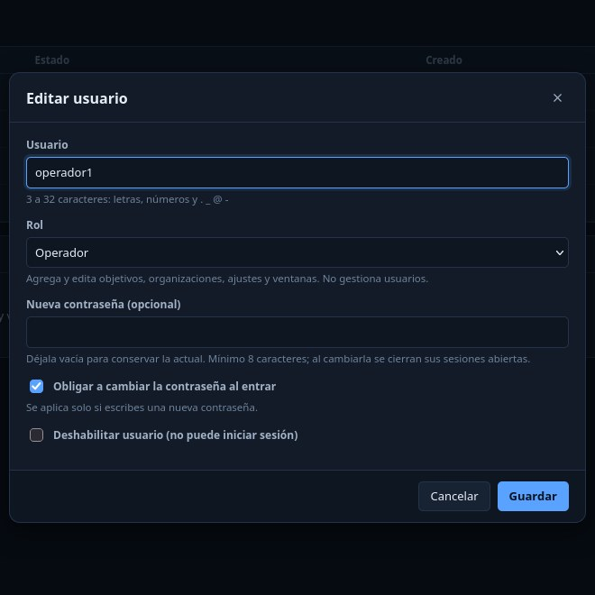

1. Pulsa el lápiz de la fila.
2. Cambia el **Rol** o el nombre si hace falta.
3. Para **restablecer la contraseña**, escribe una **Nueva contraseña (opcional)**; vacía no cambia nada. Al cambiarla se cierran las sesiones abiertas de esa persona.
4. **Obligar a cambiar la contraseña al entrar** viene marcada al editar y solo se aplica si escribes una nueva contraseña. No aparece al editar tu propio usuario. Si esa persona ya tiene el panel abierto, verá la ventana "Debes cambiar tu contraseña" sin cerrar sesión.
5. Pulsa **Guardar**.

### Deshabilitar y eliminar

- **Deshabilitar:** en el editor, marca **Deshabilitar usuario (no puede iniciar sesión)**. Se cierran sus sesiones y se puede revertir. Úsalo para ausencias o revisiones.
- **Eliminar:** pulsa la papelera y confirma. Se cierran sus sesiones y no puede volver a entrar. No se puede deshacer.

No puedes deshabilitarte ni eliminarte a ti mismo, y siempre debe quedar al menos un administrador activo: el sistema no permite eliminar, deshabilitar ni cambiar de rol al último.

## 8.3 Qué hacer si olvidaste tu contraseña

Pide a un administrador que la restablezca (sección 8.2) y que marque la obligación de cambiarla. Si olvidaron la contraseña todos los administradores, la recuperación la hace quien administra el servidor; consulta el "Manual de usuario y configuración".

## 8.4 Cambiar la propia contraseña

1. Pulsa la **llave** de la barra superior.
2. Escribe tu contraseña actual, la nueva (mínimo 8 caracteres y distinta) y repítela.
3. Pulsa **Cambiar contraseña**.

Se cierran tus otras sesiones abiertas (por ejemplo, en otro equipo); la actual sigue activa. Si te equivocas 5 veces seguidas con la contraseña actual, el panel cierra tu sesión ("Demasiados intentos fallidos. Se cerró la sesión."): espera un minuto, entra de nuevo y vuelve a intentarlo.

## 8.5 Sesiones

- Tu sesión dura 12 horas desde tu última actividad y, en todo caso, caduca a los 7 días.
- Puedes tener varias sesiones (hasta 10 por usuario); al abrir una más se cierra la más antigua.
- Cada pestaña abierta consume una conexión en vivo. Si abres demasiadas con el mismo usuario, la más antigua queda en pausa con la insignia "En vivo en otra pestaña" (sección 1.3).
- Si reinician el servidor, todos deben iniciar sesión de nuevo.
- Si un administrador te deshabilita, te elimina o cambia tu contraseña, el panel te devuelve a la pantalla de entrada.

## 8.6 Bloqueo por intentos fallidos

Para impedir que alguien adivine contraseñas, el sistema limita los intentos:

| Situación | Qué ocurre |
|---|---|
| 5 fallos seguidos con el mismo usuario desde el mismo equipo | Ese inicio de sesión se bloquea 60 segundos. "Admin", "admin" y " admin " cuentan como el mismo usuario. |
| Más de 20 fallos desde un mismo equipo en 10 minutos | Se rechazan los intentos de ese equipo durante unos minutos, aun con la contraseña correcta. |
| 5 fallos al escribir tu contraseña actual al cambiarla | Se cierra tu sesión. |

Un acceso correcto reinicia el contador. Si compartes una conexión o red con otros, podrías verte bloqueado por intentos ajenos: espera unos minutos.

# 9. Tareas frecuentes

Recetas cortas. Los valores son puntos de partida.

## 9.1 Vigilar un sitio web

1. Ve a **Objetivos** y pulsa **Agregar objetivo**.
2. Nombre: "Portal clientes". Tipo: **URL (web / API)**. URL: `https://portal.ejemplo.com/login`.
3. Mantén Ping, escribe el puerto `443` y deja los códigos esperados en `200-399`.
4. Opcional: en **Texto que debe aparecer** pon una palabra de la página ("Iniciar sesión") para detectar páginas de error disfrazadas.
5. Confirma que **Vigilar caducidad del certificado SSL/TLS** esté marcada.
6. Pon **Medir cada** en 30 segundos y pulsa **Agregar**.
7. En el Panel mira **HTTP/HTTPS** (código y TTFB), **Certificados SSL/TLS** y **Estado de servicios**.

Si en tu navegador abre pero aquí sale 403, 429 o 503, edita el objetivo y activa **Identificarse como un navegador (Chrome)**.

## 9.2 Un servidor que no responde al ping

Muchos firewalls bloquean el ping; el servidor funciona pero no contesta.

1. Edita el objetivo (lápiz).
2. **Desmarca Ping** (así no habrá avisos por ping).
3. En **Puertos TCP** escribe los de su servicio real (por ejemplo `22, 443`).
4. Guarda. El estado dependerá de que los puertos respondan.
5. Mira la ventana **Puertos TCP**: ABIERTO en verde es buena señal.

Si dejas Ping activo y el equipo responde por puerto o web, no se marca DOWN, pero la ventana de Ping se queda vacía.

## 9.3 Certificados que vencen

1. Agrega una URL https por sitio con **Vigilar caducidad del certificado SSL/TLS** marcada.
2. Mide cada 300 a 3600 segundos: los certificados no cambian cada segundo.
3. Agrega la ventana **Certificados SSL/TLS**: los ordena del que vence antes al que vence después.
4. Actúa en cuanto veas **POR VENCER** (ámbar), sin esperar al **CRÍTICO** (rojo).
5. Si tus certificados se renuevan solos a los 30 días, baja el aviso en **Ajustes → SSL** a 14 para evitar alertas normales (el aviso debe seguir siendo mayor que el crítico).

## 9.4 Un servidor con agente

1. Pide a quien administra el servidor que instale el agente y te dé el puerto, el token y, si usa conexión cifrada, la huella (capítulo 11 del "Manual de usuario y configuración").
2. Edita el objetivo del servidor (o créalo).
3. En **Salud del servidor (agente)** marca **Medir CPU, RAM, disco, I/O wait, ancho de banda y servicios**.
4. Escribe el **Puerto del agente** y el **Token del agente**.
5. Si usa cifrado, marca **Conexión cifrada (TLS)** y pega la **Huella SHA-256**.
6. En **Servicios a vigilar** escribe, por ejemplo, `nginx, docker`.
7. Guarda. En unos segundos las ventanas **CPU y memoria RAM**, **Disco e I/O wait**, **Ancho de banda** y **Servicios del sistema** muestran datos.

Si aparece "El agente no responde", revisa el puerto, el token y la huella. Recuerda: si cambias la dirección, el puerto o la huella, hay que reescribir el token.

## 9.5 Un monitor de pared

1. Pide a un administrador un usuario con rol **Lector** exclusivo para esa pantalla.
2. En el equipo de la pantalla, inicia sesión con ese usuario.
3. Deja en el Panel solo lo importante, por ejemplo **Resumen general** arriba y debajo **Estado de servicios** y **Eventos y alertas**, más dos o tres gráficas clave. (Si entras con un Operador, quita el resto de ventanas y luego pulsa **Disposición libre** para bloquear.)
4. Pon el tema **Oscuro** y pulsa **Disposición libre** para dejarla **bloqueada**. Un Lector ya la tiene bloqueada.
5. Pon el navegador en pantalla completa con F11.
6. Usa etiquetas ("critico") y el buscador de **Estado de servicios** para centrarte en lo importante.

Revisa que la insignia diga **En vivo**. Alguien deberá volver a iniciar sesión de vez en cuando, porque la sesión caduca. No abras con el mismo usuario más pestañas o equipos de los necesarios: si lo haces, la pantalla puede quedar en pausa ("En vivo en otra pestaña") y no se recupera sola; un clic en la insignia la reconecta.

# 10. Preguntas frecuentes y mensajes comunes

## 10.1 Preguntas frecuentes

| Pregunta | Respuesta |
|---|---|
| ¿Por qué un servicio con valores en rojo no está DOWN? | Rojo significa "crítico", pero DOWN se reserva para fallas de disponibilidad. Sigue DEGRADADO (sección 2.2). |
| ¿Por qué mi servicio sale DOWN con código 401, 403 o 404 si funciona? | Ese código no está entre los esperados. Edita **Códigos HTTP esperados** (por ejemplo `200-399,401`) o apunta a una página pública de salud. |
| El sitio abre en mi navegador pero aquí sale DOWN | Algunos sitios rechazan a los monitores. Activa **Identificarse como un navegador (Chrome)** en el objetivo. |
| ¿Por qué no veo la sección Usuarios, o los botones de editar? | Tu rol es Operador o Lector. Pídele a un administrador que cambie tu rol si lo necesitas. |
| ¿Se pierden mis datos al recargar la página? | No. Tu configuración y disposición se guardan. Solo se reinician las gráficas si se reinicia el servidor. |
| ¿Dónde se mide? | Desde el equipo del servidor de monitoreo, no desde tu navegador: la latencia que ves es la de ese equipo hacia el objetivo. |
| ¿Envía correos o mensajes cuando algo cae? | No. Las alertas son visuales: colores, insignias, eventos y el título de la pestaña. |
| ¿Los umbrales son por servicio? | No, son globales y valen para todos los objetivos y organizaciones. |
| ¿Puedo ver solo una organización? | No se restringe por rol: quien entra ve todas. |

## 10.2 Mensajes y qué hacer

| Mensaje o síntoma | Qué significa | Qué hacer |
|---|---|---|
| Insignia **Demostración** | Datos simulados; no estás conectado al servidor real. | Abre la dirección del servidor, no un archivo local. |
| **Sin conexión con el servidor** | Se perdió el enlace. | Espera: se reconecta solo. Si persiste, avisa a quien administra. |
| **En vivo en otra pestaña** | Esta pestaña quedó en pausa por tener demasiadas abiertas. | Haz clic en la insignia para reconectar. |
| No se pudo cargar el panel (botón Reintentar) | El servidor respondió pero falló al cargar los datos. | Pulsa **Reintentar**. Si persiste, avisa a quien administra. |
| No se pudo iniciar el panel | Falló el arranque de la pantalla. | Recarga la página (F5). |
| Debes cambiar tu contraseña | Tu cuenta tiene un cambio obligatorio. | Cámbiala (sección 1.2). |
| Tu sesión terminó. Inicia sesión de nuevo. | Sesión caducada o cerrada. | Entra de nuevo. |
| Esperando la primera medición… | Aún no termina el primer ciclo. | Espera un intervalo o usa **Verificar ahora**. |
| Ping no disponible | El servidor de monitoreo no puede hacer ping. | Avisa a quien administra; mientras, vigila con puertos o HTTP. |
| No hay objetivos compatibles | Ninguno cumple lo que pide la ventana (por ejemplo, ninguno tiene agente). | Agrega o edita un objetivo (sección 5.2). |
| El agente no responde | El panel no logra hablar con el agente del servidor. | Revisa puerto, token y huella; confirma que el agente está encendido. |
| Falta la huella TLS del agente | Hay TLS activado sin huella. | Edita el objetivo y pega la huella. |
| La huella TLS del agente no coincide (posible suplantación) | El certificado del agente cambió o responde otro equipo. | Si renovaron el certificado, copia la huella nueva y reescribe el token; si no, avisa a seguridad. |
| El agente tardó demasiado en responder | La consulta pasó el plazo de 10 s. | Revisa el agente y la red. |
| token rechazado por el agente | El token no coincide o se descartó al cambiar dirección, puerto o huella. | Edita el objetivo y escribe el token correcto. |
| La verificación excedió el tiempo máximo | El objetivo tardó demasiado en responder. | Revisa si el destino está colgado. |
| Certificado "no confiable" | Autofirmado, de una entidad interna o con cadena incompleta. | Pide instalar la cadena completa, o acéptalo si es un entorno interno conocido. |
| Ya tienes un traceroute en curso | Solo se permite uno por usuario. | Espera a que termine. |
| Esta ventana tuvo un error | Fallo al dibujar con datos inesperados. | Recarga la página; si persiste, quítala y vuelve a agregarla. |
| Los cambios de disposición no se conservan | La disposición está bloqueada o eres Lector. | Pulsa **Disposición bloqueada** para desbloquear (si tu rol lo permite). |
| Sin I/O wait ni ancho de banda | El servidor remoto es Windows o macOS. | Es un límite: solo Linux entrega esas métricas. |
| Los ajustes no se guardan y aparece una lista | Un valor no es válido. | Corrige lo que dice la lista (sección 7.3). |

# Anexo A. Glosario

| Término | Significado |
|---|---|
| Objetivo | Cada IP, host o URL monitoreada. |
| UP, DEGRADADO, DOWN | Estados: todo bien, funciona con alertas o no está disponible. |
| Umbral (aviso y crítico) | Valores a partir de los cuales una métrica pasa a ámbar y a rojo. |
| Historial | Las últimas mediciones guardadas de cada objetivo. |
| Evento | Anotación de un cambio de estado de un servicio. |
| Ventana | Cada módulo del Panel (resumen, gráfica, tabla). |
| Organización | Espacio de trabajo independiente, con sus propios objetivos y disposición. |
| Host | La organización principal; no se puede eliminar. |
| Latencia | Tiempo que tarda un paquete en ir y volver, en milisegundos. Menos es mejor. |
| Pérdida de paquetes | Porcentaje de paquetes que no regresan. |
| Jitter | Variación de la latencia; alto significa comunicación entrecortada. |
| TTL | Contador que baja en cada salto; ayuda a deducir el sistema del destino. |
| Ping | Prueba de eco que mide si un equipo responde y cuánto tarda. |
| DNS | Servicio que traduce nombres a direcciones IP. El nombre inverso (PTR) hace lo contrario. |
| Traceroute / salto | Lista de los routers por los que pasa un paquete hasta el destino. |
| Puerto TCP | "Puerta" numerada por donde escucha un servicio (443 web segura, 3306 MySQL, 22 SSH). |
| Código HTTP | Respuesta de una página: 200 correcto, 3xx redirección, 401 y 403 sin autorización, 404 no encontrada, 5xx error del servidor. |
| TTFB | Tiempo hasta recibir el primer byte de la respuesta web. |
| SSL/TLS | Cifrado de las conexiones https; el certificado caduca y debe renovarse. |
| I/O wait | Porcentaje de tiempo que el equipo espera al disco. |
| Agente | Programa instalado en un servidor remoto que entrega sus métricas internas al panel. |
| Token | Contraseña compartida entre el panel y el agente. |
| Huella (SHA-256) | Resumen del certificado del agente; el panel la compara antes de enviar el token. |
| Disponibilidad | Porcentaje de mediciones en que el servicio no estuvo DOWN. |
| Sesión | Periodo en que tu navegador permanece identificado tras iniciar sesión. |

# Anexo B. Qué rol puede hacer qué

| Acción | Administrador | Operador | Lector |
|---|---|---|---|
| Iniciar y cerrar sesión | Sí | Sí | Sí |
| Cambiar su propia contraseña | Sí | Sí | Sí |
| Cambiar el tema | Sí | Sí | Sí, en su pantalla |
| Ver Panel, estados, eventos y gráficas | Sí | Sí | Sí |
| Ampliar una ventana y elegir su objetivo | Sí | Sí | Sí |
| Elegir rango de gráfica (30, 120, Todo) | Sí | Sí | Sí |
| Verificar ahora | Sí | Sí | Sí |
| Ejecutar traceroute | Sí | Sí | Sí, solo sobre objetivos existentes |
| Cambiar de organización | Sí | Sí | Sí |
| Agregar, mover, redimensionar y quitar ventanas | Sí | Sí | No |
| Bloquear o restablecer la disposición | Sí | Sí | No |
| Agregar, editar, pausar y eliminar objetivos | Sí | Sí | No |
| Importar objetivos | Sí | Sí | No |
| Exportar objetivos | Sí | Sí | Sí |
| Crear, editar y eliminar organizaciones | Sí | Sí | No |
| Cambiar Ajustes y umbrales | Sí | Sí | No |
| Ver la sección Usuarios | Sí | No | No |
| Crear, editar, deshabilitar y eliminar usuarios | Sí | No | No |
| Ver los datos del equipo servidor en Ajustes | Sí | No | No |
