# 1. Introducción

Centinela es un panel de monitoreo (dashboard) que muestra en una sola pantalla si tus servicios están funcionando: servidores identificados por IP o nombre de host, y servicios web o APIs identificados por URL. Se inspira en herramientas como PingPlotter y Zabbix: no solo dibuja gráficas, también dice con una leyenda clara si cada servicio está UP (Arriba), DEGRADADO o DOWN (Abajo) y explica el motivo.

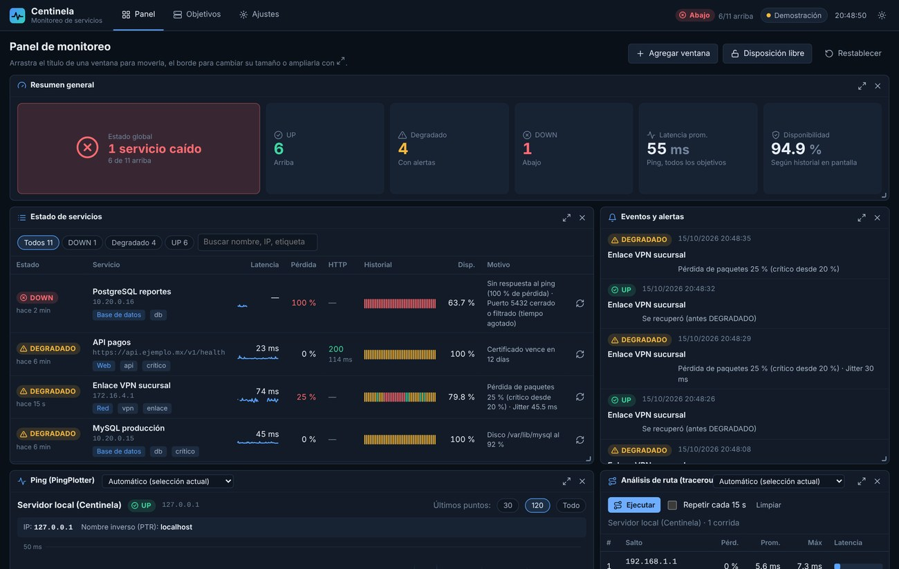

## 1.1 Qué puede medir

| Capa | Qué se mide | Dónde se ve |
|---|---|---|
| Aplicación (capa 7) | Código HTTP/HTTPS, tiempo al primer byte (TTFB), caducidad del certificado SSL/TLS, puertos TCP abiertos | HTTP/HTTPS, Certificados SSL/TLS, Puertos TCP |
| Infraestructura | CPU, RAM, espacio en disco, I/O wait, servicios del sistema (nginx, docker, mysqld…) | CPU y RAM, Disco e I/O wait, Servicios del sistema |
| Red | Latencia, pérdida de paquetes, TTL, jitter, resolución de nombres (DNS/PTR), ancho de banda, ruta salto por salto | Ping, Latencia/pérdida/TTL/DNS, Jitter, Ancho de banda, Traceroute |
| Estado general | Resumen UP/DEGRADADO/DOWN, historial por servicio, bitácora de eventos | Resumen, Estado de servicios, Eventos |

## 1.2 Cómo está construido

El sistema tiene tres piezas. Entender para qué sirve cada una evita la confusión más común: un navegador por sí solo no puede hacer ping, leer TTL ni ejecutar traceroute; por eso las mediciones reales las hace un pequeño servidor.

| Pieza | Qué es | Cuándo la necesitas |
|---|---|---|
| Panel (navegador) | Las carpetas index.html, assets/ y js/. Dibuja ventanas, gráficas y formularios. | Siempre. |
| Servidor de monitoreo | Programa Node.js (server/server.js). Cada cierto intervalo mide tus objetivos y envía los resultados al panel en vivo. Guarda la configuración en data/. | Para medir de verdad. Sin él el panel funciona en modo demostración. |
| Agente | Programa Node.js (agent/agent.js) que se instala en un servidor remoto y expone CPU, RAM, disco, red y servicios. | Solo para ver la salud interna de servidores remotos. En el equipo donde corre el servidor no hace falta. |

## 1.3 Modo real y modo demostración

| Aspecto | Modo real (En vivo) | Modo demostración |
|---|---|---|
| Cómo se activa | Ejecutar node server/server.js y abrir la dirección que muestra (por defecto http://127.0.0.1:8080). | Abrir index.html directamente (doble clic) o cuando el servidor no responde a la comprobación inicial. |
| Datos | Mediciones reales de tus IPs y URLs. | Simulados (incluye casos caídos y degradados para ver cómo se ve cada estado). |
| Dónde se guarda lo que configuras | Carpeta data/ del servidor (compartida por todos los que abren el panel). | En el navegador (localStorage); solo lo ve esa persona en ese navegador. |
| Indicador en pantalla | Insignia verde En vivo. Si se pierde la conexión: Sin conexión con el servidor. | Insignia ámbar Demostración y un aviso amarillo que se puede cerrar. |
| Úsalo para | Operación diaria. | Conocer la interfaz, mostrarla o probar la disposición sin medir nada. |

> **Importante:** si el servidor responde pero falla al cargar los datos (por ejemplo, un error interno), el panel ya no pasa a demostración por su cuenta: muestra el mensaje “No se pudo cargar el panel” con un botón **Reintentar**. Así no se confunden datos simulados con datos reales.

# 2. Instalación y arranque

## 2.1 Requisitos

- Node.js 18 o superior en el equipo que hará de servidor de monitoreo (Windows o Linux; también funciona en macOS). No se instalan paquetes adicionales: el proyecto no tiene dependencias. La imagen de contenedor (capítulo 14) ya incluye Node 22.
- Un navegador moderno (Chrome, Edge, Firefox, Safari).
- Linux: el comando ping normalmente ya existe. Para el traceroute instala traceroute (Debian/Ubuntu: `sudo apt install traceroute`; el sistema usa tracepath como respaldo).
- Windows: usa los comandos ping y tracert que ya trae el sistema.

## 2.2 Arranque paso a paso

1. Descomprime el proyecto (carpeta `centinela-monitor`) en el servidor que hará las mediciones.
2. Abre una terminal en esa carpeta y ejecuta: `node server/server.js` (también sirve `npm start`).
3. La terminal muestra la dirección, por ejemplo `Centinela 2.2.0 → http://127.0.0.1:8080`, el número de usuarios, la carpeta de datos usada y, solo en el primer arranque, el usuario inicial con su contraseña (sección 9.1).
4. Abre esa dirección en el navegador e inicia sesión con el usuario `administrador` y la contraseña inicial (sección 9.1). Si la contraseña era la aleatoria del registro, el panel te pedirá cambiarla antes de continuar. La insignia de arriba debe decir En vivo.
5. Ve a Objetivos y agrega tus IPs y URLs (capítulo 6). En el primer arranque el sistema crea data/ con objetivos de ejemplo (DNS Google, DNS Cloudflare, Google, Wikipedia, Sitio de ejemplo y el servidor local); puedes borrarlos.

## 2.3 Variables de entorno del servidor

| Variable | Por defecto | Para qué sirve y cuándo cambiarla |
|---|---|---|
| PORT | 8080 | Puerto donde escucha el panel. Cámbialo si 8080 está ocupado (error EADDRINUSE) o si ya usas ese puerto para otra aplicación. Ej.: PORT=9000 node server/server.js |
| HOST | 127.0.0.1 | Interfaz donde escucha. Con el valor por defecto solo ese equipo puede abrir el panel. Usa HOST=0.0.0.0 para que otros equipos de la red lo abran; el acceso siempre exige usuario y contraseña (capítulo 9); aun así, limita con el firewall quién llega (capítulo 12). |
| CENTINELA_ADMIN_USER | administrador | Nombre del primer administrador. Solo se usa cuando todavía no existe data/users.json (primer arranque). Después los usuarios se gestionan en la sección Usuarios (capítulo 9). |
| CENTINELA_ADMIN_PASSWORD | (vacía: se genera una aleatoria) | Contraseña del primer administrador, mínimo 8 caracteres, con el mismo alcance. Si no la defines, el servidor genera una contraseña aleatoria de 16 caracteres y la muestra una sola vez en el registro de arranque (sección 9.1). Ya no existe una contraseña fija. |
| CENTINELA_AUTH | activada | El valor off desactiva el inicio de sesión. Solo para entornos aislados; no lo uses en una red compartida. |
| CENTINELA_ALLOWED_HOSTS | (vacía) | Lista, separada por comas, de nombres o IP que el servidor acepta en la cabecera Host (por ejemplo 192.168.1.10,centinela.lan). Frena el DNS rebinding; una petición con otro Host recibe 421. Vacía y con inicio de sesión activo, no se filtra; vacía y con CENTINELA_AUTH=off, solo se aceptan localhost, el nombre del equipo y sus IP. Con la variable definida, localhost, 127.0.0.1 y ::1 se aceptan siempre. Se recomienda definirla en una LAN y, en contenedor, en el archivo .env (capítulo 14). |
| CENTINELA_COOKIE_SECURE | desactivado | Con el valor 1 la cookie de sesión lleva el atributo Secure. Úsalo solo detrás de un proxy con HTTPS: sin HTTPS el navegador no enviaría la cookie y no podrías iniciar sesión. |
| CENTINELA_DATA | carpeta data/ del proyecto | Ruta alternativa donde guardar targets.json, settings.json, layout.json, orgs.json, users.json y orgs/. Útil para separar los datos del código, tener respaldos en otro disco o correr varias instancias. |
| CENTINELA_CONCURRENCY | 16 | Mediciones que pueden correr al mismo tiempo (2 a 64), compartidas por todas las organizaciones. Súbela si monitoreas muchos objetivos y las gráficas se actualizan más despacio que el intervalo (ver capítulo 7). |
| CENTINELA_CHECK_TIMEOUT_MS | 120000 | Plazo máximo, en milisegundos, de una verificación completa de un objetivo (mínimo 5000). Si se excede, el objetivo pasa a DOWN con el motivo “La verificación excedió el tiempo máximo” (sección 3.5). Súbelo solo si tienes verificaciones legítimamente muy lentas. Una sonda que no termina se libera como máximo a 2 veces este plazo (sección 3.5). |
| CENTINELA_TRUST_PROXY | (vacía) | Lista, separada por comas, de IP de proxies inversos de confianza (por ejemplo 127.0.0.1,10.0.0.5). Solo sirve si pones un proxy delante del panel: con ella el servidor lee la cabecera X-Forwarded-For para saber la IP real de cada cliente y el bloqueo de intentos deja de ser compartido por todos (sección 12.1). Solo IP literales, sin rangos CIDR ni nombres: una entrada que no sea una IP se ignora y el servidor lo avisa al arrancar. Vacía = X-Forwarded-For se ignora. |

Ejemplos de arranque con variables:

```
Linux / macOS:      PORT=9000 HOST=0.0.0.0 node server/server.js
Windows (cmd):      set PORT=9000 && set HOST=0.0.0.0 && node server\server.js
PowerShell:         $env:PORT=9000; $env:HOST="0.0.0.0"; node server/server.js
```

> **Nota:** para que el servidor arranque solo con el equipo, regístralo con el mecanismo habitual de tu sistema (servicio de systemd en Linux, tarea programada o un administrador de servicios en Windows). Centinela no instala ese servicio por ti.

## 2.4 Estructura de carpetas

| Carpeta / archivo | Contenido |
|---|---|
| index.html | Página principal; carga estilos y scripts en orden. |
| assets/css/ | Estilos separados: tokens.css (colores y tema), base.css, components.css, grid.css (ventanas), widgets.css, views.css. |
| assets/img/ | Logo e ícono (favicon). |
| js/config/ | defaults.js (valores por defecto y disposición inicial) y seed.js (objetivos de ejemplo). |
| js/core/ | Lógica compartida: evaluate.js (decide UP/DEGRADADO/DOWN), validate.js, store.js, util.js, bus.js. |
| js/services/ | Fuentes de datos: source-live.js (servidor real), source-demo.js (simulación) y data.js (elige una u otra); auth.js (sesión del usuario). |
| js/ui/ | ui.js (íconos, modales, avisos), charts.js (gráficas SVG), grid.js (motor de ventanas). |
| js/widgets/ | Un archivo por familia de ventanas: status, network, application, infrastructure; registry.js las registra. |
| js/views/ | Las pantallas: dashboard.js (Panel), targets.js (Objetivos), settings.js (Ajustes), orgs.js (barra de organizaciones), login.js (inicio de sesión) y users.js (usuarios). |
| server/ | server.js (API y archivos estáticos), lib/ (planificador, almacenamiento, validación, usuarios y sesiones) y probes/ (ping, dns, http, tls, tcp, traceroute). |
| agent/ | agent.js y sysmetrics.js: se copian a los servidores remotos. |
| data/ | targets.json, settings.json y layout.json del Host, orgs.json, users.json (usuarios y contraseñas cifradas) y la carpeta orgs/ con los datos de cada organización (se crean solos). Respáldala: ahí está tu configuración. |
| docs/ | Documentación del proyecto: este manual, la guía de despliegue seguro y la bitácora. |
| test/ | Pruebas automáticas (se ejecutan con `npm test`, sin dependencias). |
| Dockerfile, compose.yml, .dockerignore | Despliegue en contenedor (capítulo 14). |

# 3. Conceptos clave

## 3.1 Objetivo

Un objetivo es cada IP, host o URL que decides monitorear. Tiene un nombre de servicio, etiquetas, un intervalo de medición y una lista de verificaciones (ping, puertos, HTTP, SSL, agente). Cada verificación activa produce datos y puede cambiar el estado.

## 3.2 Los tres estados

| Estado | Significado | Se activa cuando… |
|---|---|---|
| UP / Arriba | Todo lo medido está dentro de lo esperado. | Ninguna regla de DOWN ni de DEGRADADO se cumple. |
| DEGRADADO | El servicio responde, pero fuera de los umbrales o con alertas. | La pérdida de paquetes, latencia, jitter o TTFB superan el umbral de aviso; el certificado vence pronto, no es confiable o no se pudo leer; CPU, RAM, I/O wait o disco superan el aviso; el agente no responde. |
| DOWN / Abajo | Falla de disponibilidad: el servicio no está operando. | El nombre no se resuelve; 100 % de pérdida de ping sin que otra señal (puerto o HTTP) demuestre que está vivo; un puerto configurado está cerrado o filtrado; no hay respuesta HTTP o el código no es el esperado; falta el texto esperado; el certificado está vencido; un servicio del sistema está detenido; la verificación completa excede el tiempo máximo (motivo “La verificación excedió el tiempo máximo”). |
| Sin datos | Aún no hay ninguna medición (recién agregado). | Se resuelve solo tras la primera medición. |
| Pausado | El objetivo está desactivado (solo se muestra en la interfaz). | Se desmarca “Activo” en Objetivos. |

> **Importante:** superar el umbral crítico de latencia, pérdida, jitter, TTFB, CPU, RAM o disco no convierte el servicio en DOWN: sigue siendo DEGRADADO, pero el valor se pinta en rojo y la insignia dice CRÍTICO. DOWN se reserva para fallas de disponibilidad, así una línea lenta no se confunde con una caída.

> **Nota:** si el ping falla pero un puerto o la página HTTP responden, el sistema lo trata como un firewall que bloquea ICMP: muestra una nota informativa y no marca DOWN. Para servidores que bloquean ping desactiva la casilla Ping en el objetivo y vigila puertos o HTTP.

## 3.3 Umbrales: aviso y crítico

Cada métrica tiene dos valores en Ajustes: Degradado (aviso) y Crítico. Son globales: se aplican a todos los objetivos. Se explican uno por uno en el capítulo 8.

## 3.4 Historial y eventos

- Cada medición se guarda como un punto del historial del objetivo. Cuántos puntos se conservan lo define Puntos de historial (Ajustes, 360 por defecto). El tiempo que cubre es puntos × intervalo: 360 puntos a 10 s ≈ 1 hora.
- El historial vive en la memoria del servidor: se reinicia al reiniciar el servidor. La configuración, en cambio, sí es permanente.
- Cada vez que un objetivo cambia de estado se registra un evento (hasta 300) con fecha, nombre y motivo; se muestra en la ventana Eventos y alertas.

## 3.5 Cómo se hace cada medición

| Verificación | Cómo funciona | Detalles |
|---|---|---|
| Nombre (DNS) | Resuelve el nombre del host. Para una IP consulta el nombre inverso (PTR). | Tiempo de espera 3 s. En URLs muestra la IP resuelta, y la medición usa esa misma IP. |
| Ping | Envía 4 paquetes ICMP con el comando del sistema y calcula mínimo, promedio, máximo, pérdida, jitter y TTL. | Espera 2 s por paquete. Jitter = promedio de la diferencia entre respuestas consecutivas del ciclo. TTL = el de la primera respuesta. Una muestra solo cuenta como recibida si es un número finito: una ausente, NaN o Infinity cuenta como pérdida. El porcentaje de pérdida se redondea a 1 decimal. El panel y el servidor lo calculan con el mismo módulo, así que muestran el mismo valor. |
| Puertos | Intenta una conexión TCP a cada puerto y mide el tiempo. | Espera 3 s. Abierto = la conexión se establece. |
| HTTP/HTTPS | Pide la URL (GET o HEAD), sigue hasta 10 redirecciones (también a otro dominio, con sus cookies), mide TTFB y tiempo total, y revisa el código. | Tiempo máximo configurable. Con GET puede leer hasta 256 KB para buscar el texto esperado. Si el plazo vence con la respuesta a medias, se informa tiempo agotado. Identifica al monitor como Centinela-Monitor (sin número de versión). |
| SSL/TLS | Lee el certificado del servidor: vigencia, emisor, protocolo y si la cadena es confiable. | No rechaza certificados inválidos (para poder reportarlos). Solo URLs https, o puerto 443 de un host. |
| Agente | Pide las métricas del servidor al agente por HTTP o, si el objetivo tiene “Conexión cifrada (TLS)”, por HTTPS comprobando la huella del certificado. | Espera 6 s de inactividad, con un plazo absoluto de 10 s por consulta (“El agente tardó demasiado en responder”), y acepta respuestas de hasta 1 MB. Si el objetivo es 127.0.0.1/localhost se leen directamente, sin agente. |

> **Importante:** además de los tiempos de cada sonda, toda la verificación de un objetivo (todas sus sondas juntas) tiene un plazo global de 120 s, ajustable con CENTINELA_CHECK_TIMEOUT_MS (sección 2.3). Si se excede, el objetivo se marca DOWN con el motivo “La verificación excedió el tiempo máximo” y se libera su cupo de medición; mientras la verificación colgada no termine, no se lanza otra del mismo objetivo. Al pulsar “verificar ahora”, si se vence el plazo, el servidor responde con éxito y el resultado es el objetivo en DOWN con ese motivo. Si ya hay una verificación en curso de ese objetivo, responde 409 “Ya hay una verificación en curso para este objetivo”.

### Verificaciones colgadas

Si la sonda de una verificación sigue viva después del plazo global, se llama huérfana. Centinela la trata así:

- Una huérfana se libera como máximo a los 2 × CENTINELA_CHECK_TIMEOUT_MS (por defecto, 240 s), aunque no haya terminado.
- Mientras haya huérfanas vivas, la capacidad de mediciones simultáneas baja (hasta la mitad de CENTINELA_CONCURRENCY), para que una sonda atascada no sature el servidor.
- La consola del servidor avisa: `[scheduler] verificación huérfana: "Nombre" excedió el plazo; huérfanas vivas: N` y, al liberarla, otra línea con el motivo. Si ves estos avisos con frecuencia, revisa el destino o el agente del objetivo que se nombra.

### Límites de “verificar ahora”

El botón “verificar ahora” (en la API, POST /api/targets/{id}/check) tiene límites para que no se use para saturar el servidor. Se evalúan en este orden:

| Situación | Respuesta | Qué hacer |
|---|---|---|
| Ya hay una verificación en curso de ese objetivo | 409 “Ya hay una verificación en curso para este objetivo” | Espera a que termine. |
| Pasaron menos de 5 s desde la última verificación manual de ese objetivo | 429 “Espera unos segundos antes de volver a verificar este objetivo”, con la cabecera Retry-After (segundos) | Reintenta tras el tiempo indicado. |
| Más de 3 verificaciones manuales simultáneas o 30 en un minuto, por usuario (por IP si el inicio de sesión está desactivado) | 429 “Demasiadas verificaciones manuales; espera un momento”, con Retry-After | Espera un momento; el límite por minuto es una ventana móvil de 60 s. |

> **Nota:** las mediciones se hacen desde el equipo del servidor de monitoreo, no desde tu navegador. La latencia que ves es la de ese equipo hacia el objetivo. Si quieres saber cómo se ve el servicio desde otra sucursal, instala otra copia de Centinela allá.

# 4. Recorrido por la interfaz

La aplicación tiene tres secciones, que se cambian desde la barra superior: Panel, Objetivos y Ajustes. Los administradores ven además la sección Usuarios (capítulo 9).

| Elemento de la barra superior | Qué muestra o hace |
|---|---|
| Panel / Objetivos / Ajustes | Cambian de sección. La sección actual se subraya. En pantallas angostas solo se ven los íconos. |
| Insignia de estado global | El peor estado entre todos los objetivos activos y cuántos están arriba (por ejemplo “Abajo · 6/11 arriba”). El título de la pestaña del navegador también avisa: “(1 DOWN) Centinela”, útil si dejas el panel en una pestaña de fondo. |
| Insignia de modo | En vivo (servidor conectado), Demostración (datos simulados) Sin conexión con el servidor (se perdió el enlace; el panel se reconecta solo y recarga el estado) o En vivo en otra pestaña (se superó el número de flujos en vivo y esta pestaña quedó en pausa; haz clic en la insignia para recuperarlo, sección 9.4). |
| Reloj | Hora local del navegador. |
| Botón de tema (sol/luna) | Cambia entre tema oscuro y claro. Es el mismo ajuste que en Ajustes → Tema. |
| Usuario, llave y salida | Con el servidor real: tu nombre y rol, la llave para cambiar tu contraseña y el ícono de salida para cerrar sesión (sección 9.4). |

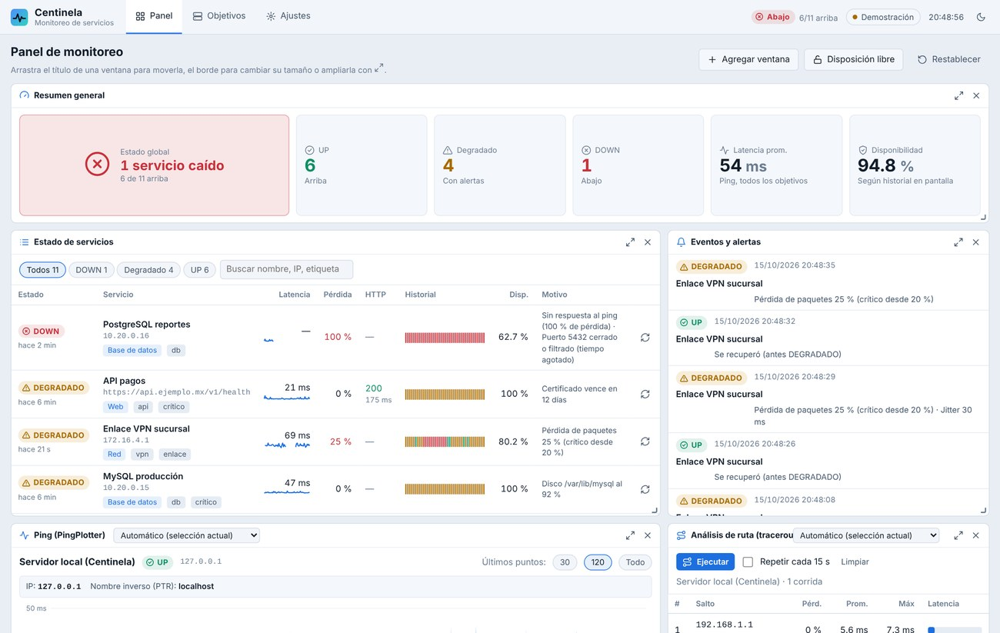

# 5. Sección Panel: las ventanas

El Panel es una cuadrícula de ventanas. Cada ventana es un módulo independiente (un resumen, una gráfica, una tabla…). Tú decides cuáles tener, dónde van y qué tan grandes son. El catálogo completo de ventanas, una por una, está en el capítulo 10.


## 5.1 Barra de herramientas del Panel

| Botón | Qué hace | Cuándo usarlo |
|---|---|---|
| Agregar ventana | Abre la galería con los 14 tipos de ventana. Al elegir una se coloca en el primer hueco libre y se desplaza hasta ella. Puedes repetir un tipo. | Para ver otra métrica o para comparar dos servicios: agrega dos “Ping” y asigna a cada uno un objetivo distinto. |
| Disposición libre / bloqueada | Alterna entre poder mover, redimensionar y quitar ventanas, o congelarlas. Bloqueada oculta el botón ✕ y los tiradores. | Bloquéala al dejar el panel en una pantalla de pared (NOC) para evitar cambios accidentales. |
| Restablecer | Vuelve a la disposición original de 14 ventanas. No toca objetivos ni ajustes. Pide confirmación. | Si desordenaste todo o quitaste una ventana sin querer. |

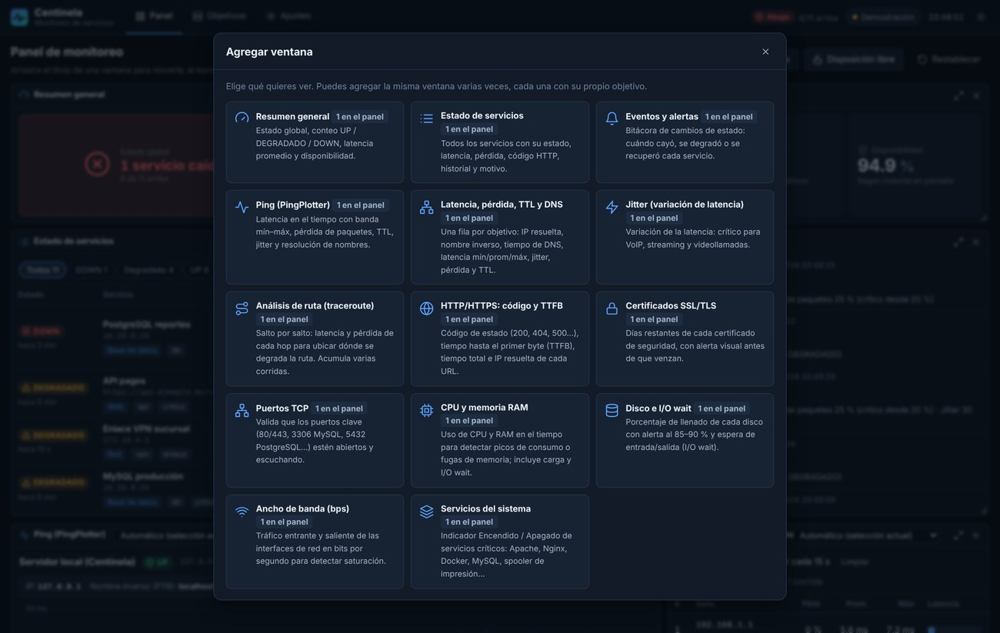

## 5.2 Trabajar con una ventana


| Acción | Cómo se hace | Detalle |
|---|---|---|
| Mover | Arrastra la barra de título. | Aparece un recuadro punteado con el destino. Las demás ventanas se apartan y se compactan hacia arriba para no dejar huecos. |
| Cambiar tamaño | Arrastra el borde derecho, el borde inferior o la esquina inferior derecha. | La cuadrícula tiene 12 columnas y filas de 34 px. Cada ventana tiene un tamaño mínimo (anexo A). |
| Ampliar | Botón de flechas en la barra de título. | La ventana ocupa casi toda la pantalla con el fondo atenuado. Se cierra con el mismo botón, haciendo clic fuera o con la tecla Esc. Ideal para estudiar una gráfica o un traceroute. |
| Quitar | Botón ✕. | Solo con la disposición libre. Quitar una ventana no borra datos; puedes volver a agregarla. |
| Elegir objetivo | Lista desplegable junto al título (solo en ventanas que trabajan sobre un objetivo). | Ver sección 5.3. |

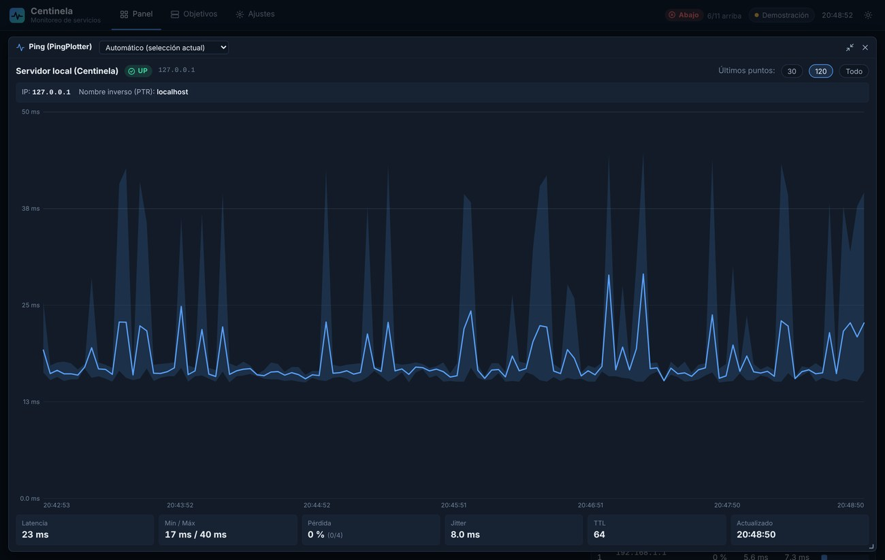

> **Nota:** la disposición se guarda sola unos instantes después de cada cambio: en la carpeta data/ del servidor (modo real; layout.json para el Host y orgs/<id>/layout.json para cada organización) o en el navegador (demostración). Cada organización tiene su propia disposición. En el modo real todos los usuarios comparten la misma disposición. En pantallas de menos de 760 px de ancho las ventanas se apilan en una columna y no se pueden arrastrar.

## 5.3 Qué objetivo muestra cada ventana

Algunas ventanas muestran todos los objetivos (Resumen, Estado de servicios, Eventos, Latencia/pérdida/TTL/DNS, Certificados SSL, Puertos). Otras trabajan sobre un objetivo (Ping, Jitter, Traceroute, CPU y RAM, Disco, Ancho de banda, Servicios, y la gráfica inferior de HTTP). Para esas, la lista desplegable ofrece:

- Automático (selección actual): la ventana sigue al objetivo que hayas seleccionado haciendo clic en una fila de cualquier tabla (Estado de servicios, Eventos, Latencia/pérdida/TTL/DNS…). Si no hay selección, usa el primer objetivo activo compatible. Así un solo clic cambia a la vez el Ping, el Jitter, el CPU y el Traceroute de todo el panel.
- Un objetivo concreto: la ventana queda fija en él. Úsalo para tener, por ejemplo, un Ping de la base de datos y otro del portal, siempre a la vista.

Solo aparecen objetivos compatibles: Ping y Jitter listan los que tienen Ping activo; CPU, Disco, Ancho de banda y Servicios listan los que tienen Agente activo; la gráfica HTTP, las URLs.

## 5.4 Controles de rango en las gráficas

Las ventanas con gráfica tienen los botones 30, 120 y Todo (hasta 360 puntos): cuántas mediciones recientes se dibujan. Con 10 s de intervalo, 30 puntos son 5 minutos y 120 son 20 minutos. Usa 30 para ver “qué pasó hace un momento” y Todo para detectar tendencias. Al pasar el ratón sobre una gráfica aparece una cruz con el valor exacto y la hora de cada punto.

# 6. Sección Objetivos: IPs y URLs a monitorear

Aquí se administra todo lo que se monitorea, separado del Panel. Se puede agregar, editar, pausar, eliminar, etiquetar, buscar, importar y exportar. Se permiten hasta 500 objetivos por organización; la lista mostrada es la de la organización activa (ver capítulo 7).

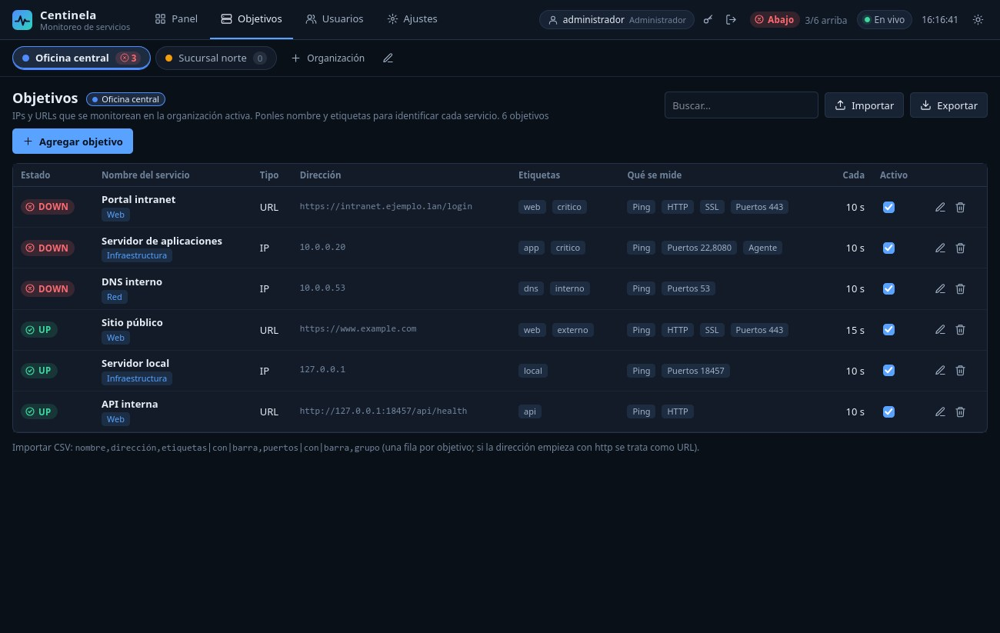

## 6.1 La tabla de objetivos

| Columna | Contenido |
|---|---|
| Estado | UP, DEGRADADO, DOWN, SIN DATOS o PAUSADO en este momento. |
| Nombre del servicio | El nombre que tú le diste y, debajo, su grupo. |
| Tipo | URL, IP o Host (se deduce de la dirección). |
| Dirección | IP, nombre o URL que se mide. |
| Etiquetas | Etiquetas libres para clasificar. |
| Qué se mide | Resumen de verificaciones activas: Ping, HTTP, SSL, Puertos (con la lista) y Agente. |
| Cada | Intervalo de medición en segundos. |
| Activo | Casilla para pausar/reanudar sin borrar (el cambio se guarda al instante). |
| Acciones | Lápiz = editar; papelera = eliminar (pide confirmación y avisa que se pierde el historial). |

El cuadro Buscar filtra por nombre, dirección, grupo o etiqueta mientras escribes.

## 6.2 Formulario “Agregar objetivo” / “Editar objetivo”

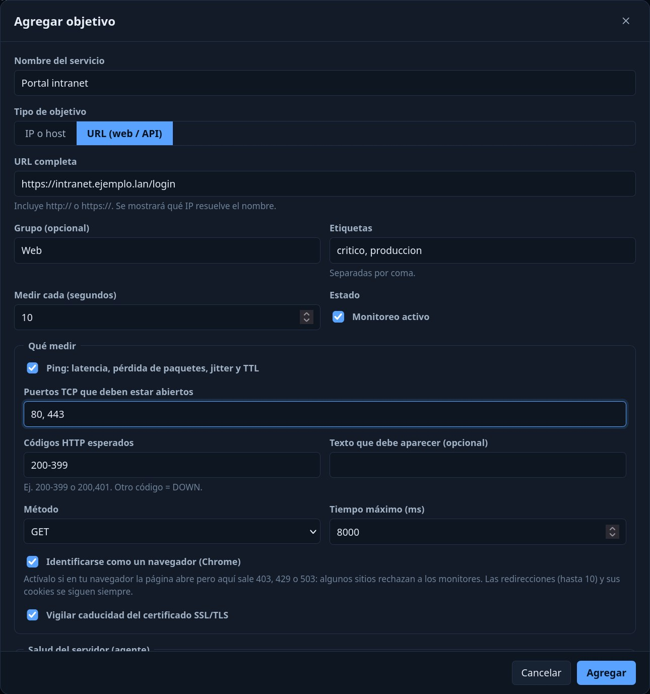

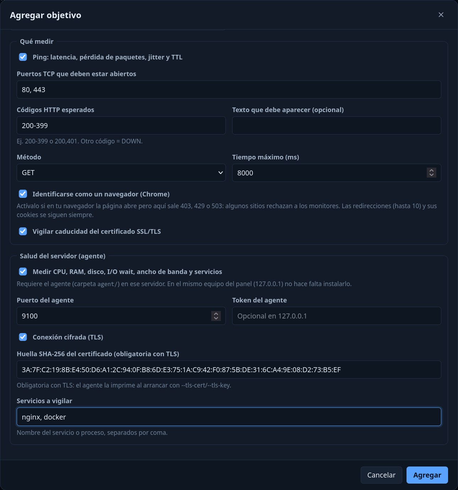

### Datos generales

| Parámetro | Qué hace | Valores y límites | Cuándo / cómo usarlo |
|---|---|---|---|
| Nombre del servicio | Nombre que verás en todas las ventanas, eventos y listas. | Obligatorio. Hasta 80 caracteres. | Usa el nombre que el operador reconoce (“MySQL producción”, “Portal clientes”), no la IP. En una emergencia es lo que se leerá primero. |
| Tipo de objetivo | Define qué se puede medir. IP o host: ping, puertos, agente. URL: además HTTP/HTTPS, SSL y la IP resuelta. | IP o host, o URL (web / API). | Elige URL cuando importe que la aplicación responda, no solo que el servidor esté encendido. Elige IP o host para equipos de red, bases de datos, DNS, enlaces. |
| Dirección IP o nombre de host / URL completa | Lo que se mide. | Host: IPv4, IPv6 o nombre, sin http:// ni espacios. URL: debe empezar con http:// o https://. Hasta 2048 caracteres. | La URL puede llevar puerto y ruta: https://app.empresa.com:8443/salud. Apunta a una página de salud o login liviana en lugar de la portada pesada. |
| Grupo | Agrupa servicios relacionados; se muestra como etiqueta azul y el campo sugiere los grupos ya usados. | Opcional. Hasta 40 caracteres. | Por sistema, sucursal o capa (“Base de datos”, “Web”, “Red”). |
| Etiquetas | Palabras libres para clasificar y buscar. | Separadas por coma. Hasta 10, de 24 caracteres. | Prioridad o entorno: “crítico”, “produccion”, “ivr”. Luego las usas en el buscador del Panel y de Objetivos. |
| Medir cada (segundos) | Cada cuánto se repiten todas las verificaciones de este objetivo. | 2 a 3600. Por defecto el valor de Ajustes (10). | 5 s para enlaces críticos o voz; 10–15 s para servidores; 30–60 s para sitios externos, certificados o cuando hay muchos objetivos. Cada ciclo de ping dura cerca de 1 s por paquete; no uses intervalos muy cortos con cientos de objetivos (se miden hasta 16 a la vez, compartidas por todas las organizaciones). |
| Monitoreo activo | Si está desmarcado el objetivo se pausa: deja de medirse y aparece como PAUSADO. | Marcado por defecto. | Para mantenimientos programados o equipos temporalmente fuera de servicio, sin perder la configuración. |

### Qué medir

| Parámetro | Qué hace | Valores y límites | Cuándo / cómo usarlo |
|---|---|---|---|
| Ping | Mide latencia, pérdida de paquetes, jitter y TTL con 4 paquetes ICMP por ciclo. | Marcado por defecto. | Casi siempre. Desmárcalo si el equipo bloquea ICMP (firewalls, algunas nubes): se evitan falsos avisos y se vigila con puertos o HTTP. |
| Puertos TCP que deben estar abiertos | Prueba la conexión a cada puerto. Un puerto cerrado o filtrado pone el servicio en DOWN. | Números 1–65535 separados por coma. Hasta 20. | Valida el servicio real, no solo el equipo: 80/443 web, 22 SSH, 53 DNS, 3306 MySQL, 5432 PostgreSQL, 1433 SQL Server, 1521 Oracle, 3389 RDP, 6379 Redis, 8080/8443 Tomcat/aplicaciones. |
| Códigos HTTP esperados | (Solo URL.) Lista de códigos que consideras “correctos”. Cualquier otro (404, 500, 503…) pone el servicio en DOWN. | Formato 200-399 (rango), 200,401 (lista) o mezcla: 200-299,401. Por defecto 200-399. | APIs que responden 401 sin credenciales: 200-399,401. Raíz que devuelve 404 pero está sana: 404. Aplicaciones que devuelven 200 incluso al fallar: combínalo con el texto esperado. |
| Texto que debe aparecer | (Solo URL.) Busca ese texto en la respuesta. Si no aparece, DOWN aunque el código sea 200. | Hasta 100 caracteres. Distingue mayúsculas. Solo con método GET; se revisan los primeros 256 KB. | Detecta páginas de error “disfrazadas” de 200: pon una palabra que solo exista cuando la aplicación funciona (“Iniciar sesión”, “status":"ok”). |
| Método | (Solo URL.) GET descarga la página; HEAD solo pide encabezados. | GET o HEAD. Por defecto GET. | HEAD consume menos ancho de banda, pero no sirve para el texto esperado y algunos servidores no lo admiten. Usa GET salvo que la página sea muy pesada. |
| Tiempo máximo (ms) | (Solo URL.) Cuánto espera la respuesta HTTP antes de darla por fallida. | 1000 a 30000. Por defecto 8000. | Sube el valor para servicios lentos por diseño (reportes, aplicaciones heredadas); bájalo si quieres detectar lentitud como falla. |
| Identificarse como un navegador (Chrome) | (Solo URL.) Envía cabeceras de un navegador real en lugar de la identificación de Centinela. | Desmarcado por defecto. | Actívalo si en tu navegador la página abre pero aquí sale 403, 429 o 503: algunos sitios rechazan a los monitores. Las redirecciones (hasta 10, también a otro dominio) y sus cookies se siguen siempre; la ventana HTTP/HTTPS muestra el número de redirecciones y, al pasar el cursor, la cadena completa. |
| Vigilar caducidad del certificado SSL/TLS | Lee el certificado y calcula los días que faltan. Alimenta la ventana Certificados SSL/TLS. | Se activa solo para URLs https. En hosts mide el puerto 443. | Siempre en sitios y APIs con https. También en servicios con TLS que no son web (correo, VPN) si usan el puerto 443. |

### Salud del servidor (agente)

| Parámetro | Qué hace | Valores y límites | Cuándo / cómo usarlo |
|---|---|---|---|
| Medir CPU, RAM, disco, I/O wait, ancho de banda y servicios | Activa la consulta de métricas internas del servidor. | Desmarcado por defecto. | En servidores que administras. En el mismo equipo del panel (127.0.0.1) no requiere instalar nada; en servidores remotos sí (capítulo 11). |
| Puerto del agente | Puerto donde escucha el agente de ese servidor. | 1–65535. Por defecto 9100. | Cámbialo si el 9100 ya está en uso; debe coincidir con --port del agente. |
| Conexión cifrada (TLS) | Consulta al agente por HTTPS en lugar de HTTP. El token y las métricas viajan cifrados. | Desmarcado por defecto. Solo funciona si el agente se arrancó con --tls-cert y --tls-key (sección 11.4). | Actívala para agentes fuera de tu red de gestión o en redes que no controlas del todo. Al marcarla aparece el campo de la huella, que es obligatoria. |
| Huella SHA-256 del certificado | Identifica el certificado del agente. El panel solo envía el token si el certificado que presenta el agente tiene exactamente esta huella; así un servidor falso no recibe el secreto. | Obligatoria con TLS. 64 caracteres hexadecimales, sin separadores o con “:” solo entre pares completos (AA:BB:…:FF; no se admiten otros separadores ni “:” sueltos). El formulario y el servidor aplican exactamente el mismo formato. Se guarda con “:” y en mayúsculas. Sin TLS se descarta. | Cópiala de lo que imprime el agente al arrancar (“Huella SHA-256 del certificado (cópiala al dashboard)”). Si renuevas el certificado del agente, la huella cambia: actualízala aquí. |
| Token del agente | Contraseña compartida con el agente (se envía como Authorization: Bearer). | Hasta 200 caracteres. Opcional solo en 127.0.0.1. Nunca se muestra de nuevo: al editar, dejarlo vacío conserva el guardado. | Obligatorio en servidores remotos. Usa una cadena larga y distinta por servidor. Si cambias la dirección del objetivo (incluso solo la ruta de una URL), el puerto del agente o la huella, o desactivas TLS, el token guardado se descarta para no enviarlo a otro destino: el formulario te lo avisa y debes escribirlo de nuevo. |
| Servicios a vigilar | Servicios o procesos que deben estar encendidos; si uno está detenido el objetivo pasa a DOWN. | Hasta 20, separados por coma. Cada nombre: debe empezar con letra o número y puede contener letras, números y . _ @ : - (máx. 64). | Nombre del servicio en el sistema: nginx, apache2, httpd, docker, sshd, mysqld, postgresql, tomcat, cups (spooler de impresión) o el nombre en Windows (Spooler, W3SVC). |

> **Importante:** si editas un objetivo que ya tiene token guardado y cambias su dirección, el puerto del agente o la huella, o desmarcas “Conexión cifrada (TLS)”, aparece bajo el campo del token el aviso “Al cambiar la dirección o el puerto, al cambiar la huella o desactivar TLS, se descarta el token guardado del agente; vuelve a escribirlo.” Si guardas sin escribir el token, el agente quedará sin él y responderá “token rechazado”.

> **Importante:** con “Conexión cifrada (TLS)” la huella es obligatoria. El formulario no deja guardar sin ella (“Con TLS activado, la huella SHA-256 del certificado es obligatoria: 64 caracteres hexadecimales, con o sin “:”.”) y el servidor tampoco la acepta. Un objetivo guardado con TLS y sin huella (por ejemplo, por una versión anterior) no envía el token y muestra “Falta la huella TLS del agente”.

## 6.3 Errores de validación frecuentes

| Mensaje | Causa | Solución |
|---|---|---|
| El nombre es obligatorio. | Campo vacío. | Escribe un nombre de servicio. |
| La dirección es obligatoria. | Dirección vacía. | Escribe la IP, el nombre de host o la URL. |
| La URL debe empezar con http:// o https:// | Tipo URL sin protocolo. | Escribe la URL completa o cambia el tipo a IP o host. |
| La URL no es válida (ejemplo: https://sitio.com/ruta). | La URL está mal formada. | Revisa la dirección, el protocolo y los espacios. |
| Escribe una IP o un nombre de host válido (sin http:// ni espacios) | Tipo host con una URL, espacios o caracteres no permitidos. | Quita el protocolo y la ruta, o cambia el tipo a URL. |
| Códigos HTTP esperados no válidos | Formato incorrecto. | Usa 200-399, 200,401 o mezclas. |
| Nombre de servicio no válido | Un servicio tiene espacios, otros símbolos o empieza con un carácter que no es letra ni número. | Usa solo el nombre del servicio, separado por comas. |
| Con TLS activado, la huella SHA-256 del certificado del agente es obligatoria | Marcaste “Conexión cifrada (TLS)” y dejaste la huella vacía. | Pega la huella que imprime el agente al arrancar, o desmarca TLS. |
| Huella TLS no válida (64 caracteres hexadecimales) | La huella no tiene 64 caracteres hexadecimales, o lleva “:” fuera de su sitio (solo se admite entre pares: AA:BB:…). El formulario y el servidor usan la misma regla. | Cópiala completa de la salida del agente. |

## 6.4 Importar y exportar

Exportar descarga objetivos-centinela.json con todos los objetivos (sin tokens de agentes). Sirve de respaldo o para copiarlos a otra instalación. Importar acepta ese JSON o un CSV y pregunta si quieres agregar a los actuales o reemplazarlos.

Formato CSV (una fila por objetivo; separador coma, punto y coma o tabulador; la primera fila puede ser un encabezado que empiece con “nombre”):

```
nombre,direccion,etiquetas,puertos,grupo
Portal clientes,https://portal.empresa.com/login,critico|web,443,Web
MySQL produccion,10.20.0.15,db|critico,3306,Base de datos
Enlace sucursal norte,172.16.4.1,vpn,,Red
```

- Las etiquetas y los puertos de la misma fila se separan con la barra vertical `|`.
- Si la dirección empieza con http:// o https:// se crea como URL (con HTTP 200-399 y SSL si es https); si no, como IP/host. Todos nacen con Ping activo.
- Si una fila tiene errores no se importa nada y se muestra la lista (por ejemplo “Fila 3: …”) para que la corrijas.
- Al agregar a los existentes se conservan sus identificadores, historial y tokens.

> **Importante:** importar con Reemplazar elimina los objetivos actuales y su historial. Exporta antes un respaldo.

# 7. Organizaciones: varios clientes o sedes

Una organización es un espacio de trabajo independiente dentro del mismo Centinela. Sirve para monitorear, desde un solo lugar, los servicios de otras empresas, clientes o sucursales sin mezclarlos con los tuyos. Cada organización tiene sus propios objetivos y su propia disposición de ventanas, pero usa exactamente el mismo Panel, las mismas ventanas y la misma sección Objetivos.

La organización Host es la principal: es el panel de siempre, existe desde el primer arranque, no se puede eliminar y conserva todos tus datos anteriores. Las demás son opcionales.

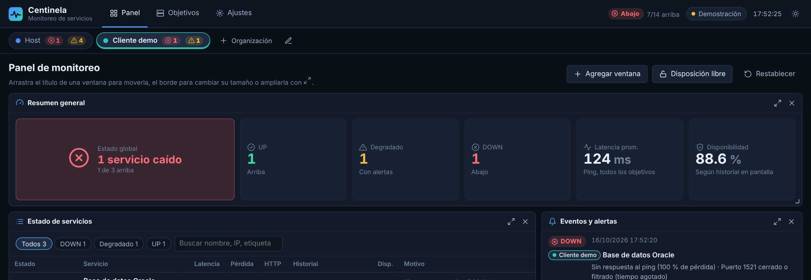

## 7.1 La barra de organizaciones

| Elemento | Qué hace |
|---|---|
| Pestaña de organización | Cambia el Panel y la sección Objetivos a esa organización. La pestaña activa se resalta con el color de la organización y el navegador la recuerda al recargar. |
| Insignias en la pestaña | Resumen sin abrir la organización: ícono y número de servicios DOWN (rojo), DEGRADADOS (ámbar) o, si todo está bien, cuántos están UP (verde). Siempre llevan ícono y número, no solo color. |
| + Organización | Abre el formulario para crear una organización nueva; al crearla, el panel pasa a ella. |
| Lápiz | Edita la organización activa: nombre, color y nota. Desde ahí también se elimina (excepto Host). |
| Indicador de la barra superior | Resume el estado de todas las organizaciones juntas (peor estado y cuántos servicios están arriba en total). |

## 7.2 Crear, editar y eliminar

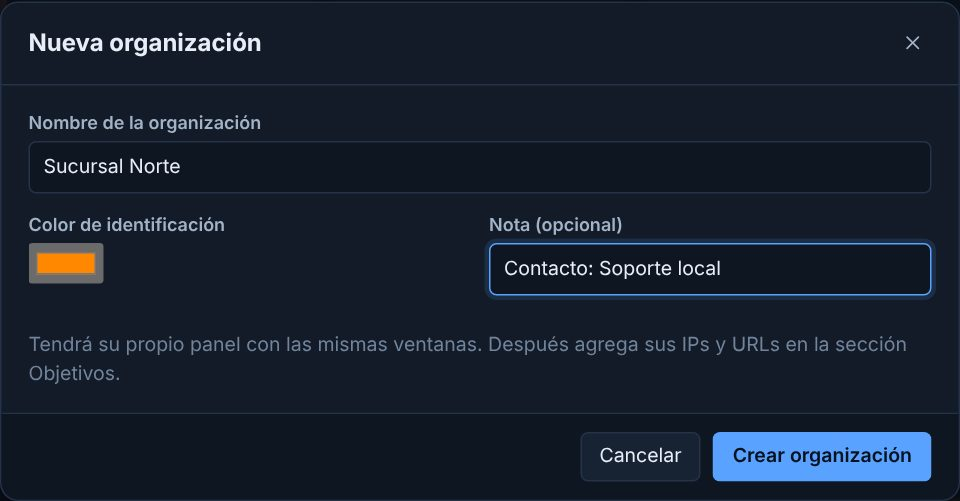

| Parámetro | Qué hace | Valores y límites | Cuándo / cómo usarlo |
|---|---|---|---|
| Nombre de la organización | Nombre de la pestaña y etiqueta que acompaña a cada alerta de esa organización. | Obligatorio. Hasta 60 caracteres. No se repite (sin distinguir mayúsculas). | El nombre que el operador reconoce al instante: “Cliente ACME”, “Sucursal Norte”. Aparecerá en la bitácora global. |
| Color de identificación | Color del punto de la pestaña, de su borde al estar activa y de la etiqueta en los eventos. | Cualquier color (formato #rrggbb). | Distinto para cada organización: sirve para reconocerla de reojo. No sustituye a los estados UP/DOWN, que usan sus propios colores reservados. |
| Nota | Texto libre que aparece al pasar el cursor sobre la pestaña. | Opcional. Hasta 200 caracteres. | Contacto de guardia, ubicación, número de contrato o cualquier dato útil. |

- Límites: hasta 50 organizaciones y 500 objetivos por organización.
- Eliminar una organización borra sus objetivos, su historial y su disposición de ventanas. Pide confirmación y no se puede deshacer. Si estabas viendo esa organización, el panel vuelve a Host.
- Orden: Host siempre es la primera pestaña; las demás siguen el orden de creación.

## 7.3 Qué es independiente y qué es global

| Elemento | Alcance | Detalle |
|---|---|---|
| Objetivos (IPs y URLs) | Por organización | Cada organización tiene su propia lista. Agregar, editar, importar o exportar en la sección Objetivos actúa sobre la organización activa (su nombre aparece junto al título). |
| Disposición de ventanas | Por organización | Cada una guarda sus ventanas, posiciones, tamaños y bloqueo. Una organización nueva arranca con la disposición predeterminada. |
| Eventos y alertas | Global | La bitácora reúne las caídas, degradaciones y recuperaciones de todas las organizaciones, y cada fila lleva la etiqueta de su organización (con su color). Al pulsar un evento de otra organización, el panel cambia a ella y enfoca ese servicio. |
| Indicador de la barra superior y título de la pestaña | Global | Cuentan los servicios de todas las organizaciones. |
| Umbrales, intervalo por defecto, tema, puntos de historial | Global | Son los de Ajustes y valen para todas las organizaciones. |
| Agentes de servidores | Por objetivo | El agente no sabe de organizaciones: se instala una vez en el servidor y el objetivo de cada organización guarda su puerto y su token. |
| Mediciones | Siempre activas | Todas las organizaciones se miden todo el tiempo, aunque no las estés viendo; por eso sus alertas llegan a la bitácora global. |

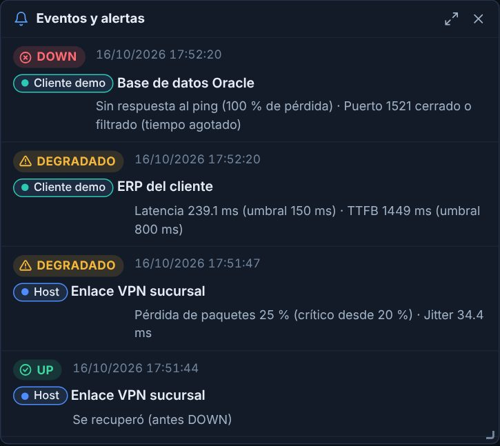

## 7.4 Carga y capacidad

Todas las organizaciones comparten el mismo planificador, por lo que sus objetivos se suman. Con el intervalo por defecto, un host y cinco organizaciones de 20 objetivos son 120 objetivos, unos 3 a 4 chequeos por segundo, muy por debajo de la capacidad del servidor.

| Aspecto | Cómo se maneja | Qué puedes ajustar |
|---|---|---|
| Mediciones simultáneas | Tope global compartido: 16 por defecto. Los objetivos que no caben esperan su turno. | Variable CENTINELA_CONCURRENCY (2 a 64). Súbela si ves que las gráficas se actualizan más despacio que el intervalo configurado. |
| Arranque escalonado | Los objetivos no arrancan todos en el mismo segundo. | — |
| Intervalo | Cada objetivo tiene su propio intervalo. | Usa 30–60 s en las organizaciones menos críticas para reducir carga. |
| Memoria | El historial de cada objetivo vive en memoria (Puntos de historial en Ajustes). | Con unos cientos de objetivos el consumo es de pocos MB. |
| Windows | Cada ping y tracert lanza un proceso del sistema, más lento que en Linux. | Es el primer punto que se nota si el número de objetivos crece mucho. |

> **Importante:** aislamiento solo visual. Separar por organizaciones no restringe el acceso: los usuarios y roles (capítulo 9) no se limitan por organización: quien entra al panel ve todas. Si distintas personas deben ver solo la suya, no se les debe dar acceso al mismo panel (ver capítulo 12).

## 7.5 Modo demostración

En demostración se simulan también las organizaciones: viene una organización de ejemplo (“Cliente demo”) para mostrar el selector y las alertas globales. Puedes crear, editar y eliminar organizaciones; todo se guarda en el navegador, igual que el resto de la demostración.

# 8. Sección Ajustes

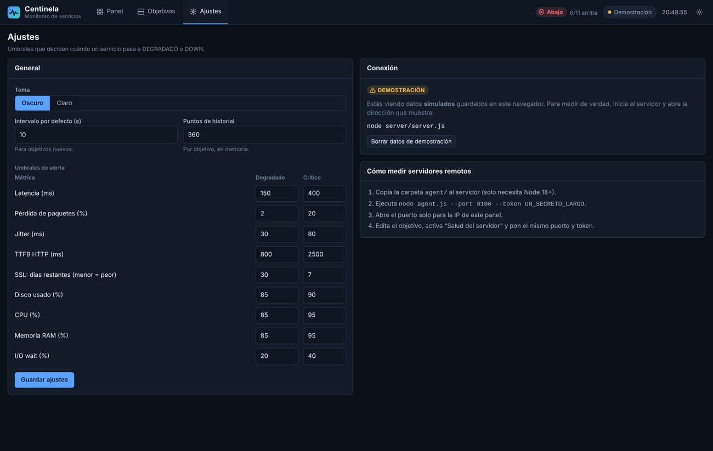

## 8.1 General

| Ajuste | Qué hace | Valores | Cuándo cambiarlo |
|---|---|---|---|
| Tema | Oscuro o claro; se aplica al instante y se recuerda. | Oscuro (por defecto) o Claro | Oscuro para salas de control con poca luz; claro para oficinas luminosas o para capturas e impresión. |
| Intervalo por defecto (s) | Valor inicial del campo “Medir cada” al crear objetivos nuevos. No modifica los objetivos que ya existen. | 2 a 3600. Por defecto 10. | Si vas a dar de alta muchos objetivos con el mismo ritmo. |
| Puntos de historial | Cuántas mediciones guarda cada objetivo en memoria para las gráficas y el historial de colores. | 30 a 2000. Por defecto 360. | Más puntos = más tiempo visible, pero más memoria. Tiempo cubierto = puntos × intervalo (2000 puntos a 30 s ≈ 16 h). Se pierde al reiniciar el servidor. |

## 8.2 Umbrales de alerta

Cada fila tiene dos valores: Degradado (aviso, color ámbar) y Crítico (rojo). Aplican a todos los objetivos. Se admiten números de 0 a 1 000 000.

| Métrica | Aviso / Crítico (por defecto) | Qué compara | Cuándo ajustarlo |
|---|---|---|---|
| Latencia (ms) | 150 / 400 | Latencia promedio de los 4 pings del ciclo. | Redes locales: baja a 20/80 para detectar cualquier degradación. Enlaces satelitales, VPN lejanas o servicios internacionales: sube a 300/800 para no vivir en alerta. |
| Pérdida de paquetes (%) | 2 / 20 | Porcentaje de los 4 paquetes perdidos en el ciclo. | Con 4 paquetes la pérdida solo puede ser 0, 25, 50, 75 o 100 %, así que un solo paquete perdido ya supera ambos umbrales. Si tu red tiene pérdidas aisladas tolerables, sube el aviso a 30 para reaccionar solo a pérdidas repetidas. |
| Jitter (ms) | 30 / 80 | Variación promedio entre respuestas consecutivas. | Voz sobre IP, videollamadas y streaming: baja a 20/50. Para servicios que no son en tiempo real puedes subirlo. |
| TTFB HTTP (ms) | 800 / 2500 | Tiempo hasta recibir el primer byte de la respuesta. | APIs rápidas: 300/1000. Aplicaciones pesadas o con consultas largas: 1500/4000. |
| SSL: días restantes | 30 / 7 | Días que faltan para vencer. Aviso cuando quedan ≤ 30 días; crítico con ≤ 7. Vencido = DOWN. | Si tus certificados se renuevan solos a los 30 días (por ejemplo Let’s Encrypt), pon el aviso en 14 para no recibir alertas normales. Si renuevas a mano y con trámites lentos, súbelo a 45–60. |
| Disco usado (%) | 85 / 90 | El disco más lleno que reporta el agente. | Bases de datos y logs: 80/90 para tener margen de reacción. Discos de solo lectura o de archivo: 95/98. |
| CPU (%) | 85 / 95 | Uso de CPU en el momento de la medición. | Servidores que trabajan por lotes y suben a 100 % normalmente: sube a 95/99 para evitar ruido. |
| Memoria RAM (%) | 85 / 95 | Memoria usada (en Linux, sin contar caché reutilizable). | Detectar fugas de memoria: baja el aviso a 80 para enterarte con anticipación. |
| I/O wait (%) | 20 / 40 | Porcentaje del tiempo de CPU esperando al disco (solo Linux). | Bases de datos con disco lento: baja a 10/25. Sistemas de respaldo que saturan el disco por diseño: sube. |

Reglas que aplica Ajustes al guardar (el formulario y el servidor las comprueban y muestran la lista de errores):

- El aviso debe ser menor que el crítico en cada métrica. En SSL es al revés: como se miden días restantes, el aviso debe ser mayor que el crítico (por ejemplo 30 / 7).
- Si el orden no se cumple, el mensaje nombra la métrica y los dos valores. En el formulario lleva la etiqueta con su unidad, por ejemplo `En "Latencia (ms)" el aviso (500) debe ser menor que el crítico (400).`; en SSL: `En "SSL: días restantes (menor = peor)" el aviso (7) debe ser mayor que el crítico (30): se avisa con más días de margen.` La API usa el mismo formato con el nombre de la métrica sin unidad (por ejemplo `En "Latencia" el aviso (500) debe ser menor que el crítico (400).`).
- Un campo vacío no se interpreta como 0: se omite y se conserva el valor anterior. Esto vale también para el intervalo por defecto y los puntos de historial.
- Los avisos de latencia, pérdida, jitter, TTFB, disco, CPU, RAM e I/O wait no pueden ser 0: un aviso en 0 dispararía alertas permanentes, y el servidor lo rechaza con el mensaje “debe ser mayor que 0”.
- Un valor no numérico o fuera de 0 a 1 000 000 se rechaza con un mensaje que nombra el umbral con su nombre en español (por ejemplo “Pérdida de paquetes (aviso)” o “SSL: días restantes (crítico)”). El intervalo y los puntos de historial, en cambio, se ajustan al límite permitido.

> **Nota:** después de cambiar umbrales pulsa Guardar ajustes. Los valores se guardan en data/settings.json y todos los paneles abiertos los reciben al instante. Si el servidor encuentra errores, no guarda nada y los muestra sobre el botón. Los usuarios con rol Lector ven los ajustes pero no pueden cambiarlos.

## 8.3 Conexión y datos de demostración

- El cuadro Conexión indica si estás En vivo (con el nombre, sistema y versión de Node del servidor) o en Demostración. Estos datos del equipo solo se entregan a los administradores; los demás roles ven el cuadro sin ese detalle.
- En demostración aparece Borrar datos de demostración: elimina objetivos, ajustes y disposición guardados en ese navegador y recarga la página. No afecta a un servidor real.
- El cuadro Cómo medir servidores remotos resume los pasos para instalar un agente: copiar agent/, ejecutarlo con `CENTINELA_AGENT_TOKEN=UN_SECRETO_LARGO node agent.js --port 9100 --host IP_DEL_SERVIDOR`, el paso opcional de cifrar con TLS (`--tls-cert` y `--tls-key`; el agente imprime la huella SHA-256 y, con TLS, esa huella es obligatoria en el objetivo), abrir el puerto solo a la IP del panel y activar “Salud del servidor” en el objetivo (capítulo 11).

# 9. Usuarios y acceso

Para entrar al panel hay que iniciar sesión con usuario y contraseña. Los usuarios los gestiona un administrador desde la sección Usuarios. Cada usuario tiene un rol que define qué puede hacer.

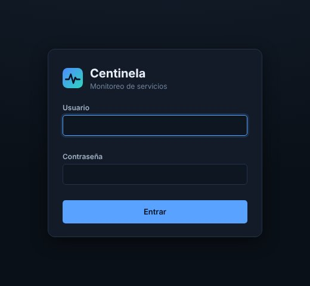

## 9.1 Usuario inicial

La primera vez que arranca el servidor (cuando no existe data/users.json) crea un administrador. Su nombre es `administrador` (o el de CENTINELA_ADMIN_USER). Ya no existe una contraseña fija: el servidor la determina así.

- Si defines CENTINELA_ADMIN_PASSWORD con 8 caracteres o más, se usa esa contraseña tal cual. No se te obliga a cambiarla (la elegiste tú), aunque se recomienda cambiarla por una que no esté escrita en ningún archivo.
- Si no la defines, el servidor genera una contraseña aleatoria de 16 caracteres (sin símbolos ambiguos como 0/O o 1/l) y la muestra una sola vez en el registro de arranque. Esa contraseña obliga a cambiarla en el primer acceso.
- Si defines una contraseña de menos de 8 caracteres, el servidor la acepta, avisa en la consola y también obliga a cambiarla al entrar.

En el registro de arranque (la consola con `node server/server.js`; en contenedor, `docker logs centinela` o `podman logs centinela`) la contraseña generada aparece así:

```
Centinela 2.2.0 → http://127.0.0.1:8080
Acceso: inicio de sesión activado (1 usuario(s))
Usuario inicial creado: administrador (deberá cambiar la contraseña al entrar)
============================================================
  CONTRASEÑA INICIAL DEL ADMINISTRADOR (se muestra UNA sola vez)
  Usuario:    administrador
  Contraseña: (16 caracteres aleatorios)
  Anótala ahora; deberás cambiarla al iniciar sesión.
============================================================
Datos en: /ruta/a/data  |  6 objetivos en 1 organización(es)
```

> **Importante:** anota la contraseña antes de cerrar la terminal: no se vuelve a mostrar. Se imprime una sola vez aunque el arranque falle (por ejemplo, por puerto ocupado) y, en contenedor, queda en `docker logs` o `podman logs` hasta que se roten los logs: cámbiala de inmediato y, si quieres, rota o limpia el log. Si la pierdes antes de entrar, borra data/users.json y arranca de nuevo (sección 9.6).

Cuando una cuenta está marcada como “debe cambiar la contraseña” (la generada, una débil, o un usuario creado con la casilla “Obligar a cambiar la contraseña al entrar”), el panel muestra un aviso ámbar (“Tu contraseña es temporal. Es la inicial o la asignó un administrador: cámbiala ahora…”) y, al iniciar sesión, una ventana “Debes cambiar tu contraseña” que no se puede cerrar: solo puedes cambiarla o cerrar sesión. Además, el servidor lo impone: mientras no la cambies, toda la API responde 403 con `mustChange`, salvo consultar tu sesión, cambiar la contraseña y cerrar sesión.

| Variable | Por defecto | Qué hace |
|---|---|---|
| CENTINELA_ADMIN_USER | administrador | Nombre del primer administrador. Solo se usa si todavía no existe data/users.json. |
| CENTINELA_ADMIN_PASSWORD | (vacía: aleatoria) | Contraseña del primer administrador, mínimo 8 caracteres, con el mismo alcance. En contenedor se define en un archivo .env (capítulo 14). |
| CENTINELA_AUTH | activada | El valor off desactiva por completo el inicio de sesión (todo el mundo entra como administrador). Solo para entornos aislados. |

## 9.2 Roles

| Rol | Puede | No puede |
|---|---|---|
| Administrador | Todo lo del operador y además crear, editar, deshabilitar y eliminar usuarios. | — |
| Operador | Ver el panel; agregar, editar y eliminar objetivos y organizaciones; importar y exportar; cambiar ajustes y la disposición de ventanas; medir ahora y ejecutar traceroute. | Gestionar usuarios (no ve la sección Usuarios). |
| Lector | Ver todos los paneles, estados, eventos y gráficas; ejecutar traceroute (solo sobre objetivos existentes) y “medir ahora”; cambiar su propia contraseña. | Cualquier modificación. No ve los botones de edición, las ventanas quedan fijas y el servidor rechaza los cambios aunque se intenten por otra vía. |

> **Nota:** los roles no se limitan por organización: todos los usuarios ven todas las organizaciones (capítulo 7).

## 9.3 La sección Usuarios (solo administradores)

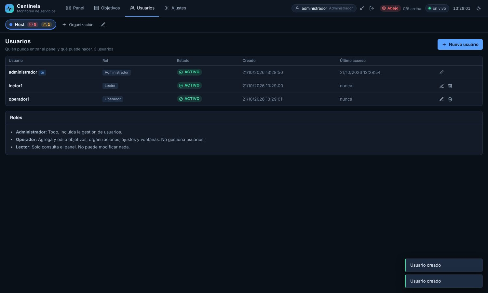

La columna Estado muestra la etiqueta ámbar “debe cambiar la contraseña” junto a los usuarios que tienen un cambio obligatorio pendiente.

| Parámetro | Qué hace | Valores y límites | Cuándo / cómo usarlo |
|---|---|---|---|
| Usuario | Nombre con el que inicia sesión (no distingue mayúsculas). | De 3 a 32 caracteres: letras, números y . _ @ -. No se repite. | Un usuario por persona: así sabes quién entró y puedes deshabilitarlo sin afectar a los demás. Evita cuentas compartidas. |
| Rol | Administrador, Operador o Lector (sección 9.2). | Uno de los tres. | Lector para quien solo vigila (pantallas de pared, gerencia); Operador para quien da de alta servicios; Administrador solo para quien gestiona accesos. |
| Contraseña | Se guarda cifrada (scrypt con sal); ni el administrador puede verla. | Mínimo 8 caracteres, máximo 200. | Larga y única. Al crear el usuario, entrégasela por un canal seguro y pídele que la cambie. |
| Nueva contraseña (al editar) | Restablece la contraseña de ese usuario y cierra sus sesiones abiertas. Si editas tu propio usuario, tu sesión actual no se cierra. | Vacía = no cambia. | Cuando alguien olvida su contraseña o sospechas que se filtró. |
| Obligar a cambiar la contraseña al entrar | Marca la cuenta como “debe cambiar la contraseña”: en su próximo inicio de sesión tendrá que definir una nueva antes de usar el panel. | Al crear un usuario viene desmarcada; al editar viene marcada, y solo se aplica si escribes una nueva contraseña. No aparece al editar tu propio usuario. Si la API recibe forceChange sin contraseña nueva, el usuario afectado deja de recibir datos en vivo hasta que la cambie. | Márcala cuando tú le asignas la contraseña (alta o restablecimiento), para que la persona la reemplace por una que solo ella conozca. Si la persona ya tiene el panel abierto, su pestaña también muestra la ventana “Debes cambiar tu contraseña” (no puede cerrarla; solo cambiar la contraseña o cerrar sesión), sin necesidad de cerrar sesión; mientras tanto el servidor le rechaza las peticiones con 403. |
| Deshabilitar usuario | Impide iniciar sesión y cierra sus sesiones, sin borrarlo. | No puedes deshabilitarte a ti mismo. | Personal temporalmente ausente o en revisión. Es reversible, a diferencia de eliminar. |
| Eliminar | Borra al usuario y cierra sus sesiones. | No puedes eliminarte a ti mismo. | Personal que ya no debe tener acceso. |

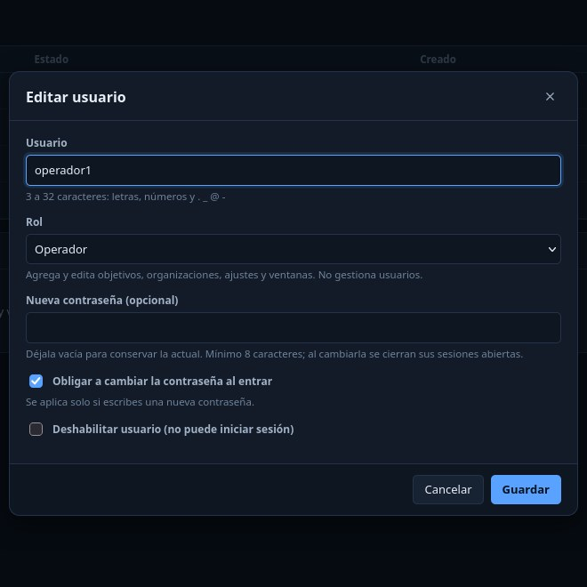

- Siempre debe quedar al menos un administrador activo: el sistema no permite eliminar, deshabilitar ni cambiar de rol al último.
- Último acceso: la tabla muestra cuándo inició sesión cada usuario por última vez.
- Se admiten hasta 200 usuarios.

## 9.4 Sesiones y contraseñas propias

- Cambiar mi contraseña: icono de llave en la barra superior. Pide la contraseña actual y la nueva dos veces (mínimo 8 caracteres, distinta de la actual) y cierra tus otras sesiones abiertas.
- Cerrar sesión: icono de salida junto a la llave.
- Duración: la sesión dura 12 horas desde la última actividad y, además, tiene una caducidad absoluta de 7 días: pasado ese tiempo debes iniciar sesión de nuevo aunque la hayas usado sin parar.
- Sesiones simultáneas: cada usuario puede tener hasta 10 sesiones abiertas (por ejemplo, en varios equipos); al abrir una más se cierra la más antigua. El servidor admite 500 sesiones en total.
- Cookie: se guarda en una cookie que el navegador no deja leer a los scripts (HttpOnly) y que no se envía desde otros sitios (SameSite=Strict). Con CENTINELA_COOKIE_SECURE=1 lleva además el atributo Secure (solo para uso con HTTPS).
- Flujos en vivo: cada pestaña abierta mantiene un flujo en vivo con el servidor. Se permiten hasta 5 por sesión y 15 por usuario; si abres más, el servidor expulsa el más antiguo: esa pestaña recibe un aviso y queda en pausa con la insignia “En vivo en otra pestaña”. No lo reabre sola; se reconecta al hacer clic en ella o cuando pasa a estar visible, si estaba oculta. El servidor admite además 200 flujos en total (el exceso recibe 429).
- Reinicio del servidor: las sesiones viven en memoria, así que al reiniciar el servidor o el contenedor todos deben iniciar sesión de nuevo.
- Sesión terminada: si el administrador te deshabilita o elimina, o cambia tu contraseña, el panel te devuelve al inicio de sesión.

## 9.5 Protección contra adivinar contraseñas

El servidor limita los intentos para frenar a quien pruebe contraseñas al azar. Los límites son estos:

| Situación | Límite | Qué ocurre |
|---|---|---|
| Inicio de sesión: mismo usuario desde la misma IP | 5 fallos | Ese inicio de sesión se bloquea durante 60 segundos (“Demasiados intentos. Espera N s.”, código 429). Mayúsculas y espacios en los extremos del usuario no cambian el contador: “Admin”, “admin” y “ admin ” cuentan como el mismo. |
| Inicio de sesión: la misma IP con cualquier usuario | Más de 20 fallos en 10 minutos | Se rechazan los intentos de esa IP (“Demasiados intentos desde esta dirección. Espera unos minutos.”, código 429) sin siquiera comprobar la contraseña. |
| Cambio de contraseña propia | 5 fallos al escribir la contraseña actual | El servidor responde 429, cierra tu sesión (“Demasiados intentos fallidos. Se cerró la sesión.”) y debes iniciar sesión de nuevo. |
| Cálculos de contraseña simultáneos | Máximo 4 a la vez en todo el servidor | Si el servidor está saturado responde 429 con “Servidor ocupado, intenta de nuevo en unos segundos.” Basta con reintentar. |

Cada intento se cuenta **antes** de comprobar la contraseña (y se descuenta si resulta correcta). Así, quien lance muchas peticiones a la vez no consigue más intentos que el límite: las que están en curso ya cuentan como fallos pendientes.

El mensaje de error del inicio de sesión no revela si el usuario existe: es el mismo para un usuario inexistente, una contraseña incorrecta o un usuario deshabilitado. Los fallos del inicio de sesión y del cambio de contraseña suman en el mismo contador. El contador de un usuario y una IP se reinicia con un acceso correcto, caduca a los 15 minutos si no llegó a bloquearse y se borra al reiniciar el servidor.

> **Nota:** el límite por IP se aplica a la dirección desde la que llega la conexión. Si pones un proxy inverso delante del panel, por defecto todos los usuarios se ven con la IP del proxy y comparten ese límite. Para que cada cliente tenga su propio contador, define CENTINELA_TRUST_PROXY con la IP del proxy y cumple los requisitos de la sección 12.1.

## 9.6 Si olvidaste la contraseña de todos los administradores

1. Detén el servidor (o el contenedor).
2. Borra el archivo users.json de la carpeta de datos (en el contenedor: en el volumen montado en /data).
3. Inicia de nuevo: se crea otra vez el administrador inicial. Si CENTINELA_ADMIN_PASSWORD está definida (mínimo 8 caracteres), se usa esa; si no, se genera una contraseña aleatoria nueva y se muestra una sola vez en el registro de arranque.
4. Entra, cambia la contraseña (es obligatorio si fue la aleatoria) y vuelve a crear los demás usuarios. Los objetivos, organizaciones y ajustes no se pierden.

> **Importante:** quien puede borrar archivos del servidor puede recuperar el acceso de esta forma; protege el acceso al servidor y a la carpeta de datos.

# 10. Catálogo de ventanas

Cada ventana indica qué muestra, qué necesita para tener datos, qué puedes configurarle y en qué situaciones conviene. Recuerda que todas se pueden mover, redimensionar, ampliar y quitar (capítulo 5); aquí solo se listan los parámetros propios de cada una.

## 10.1 Estado general

### 1. Resumen general

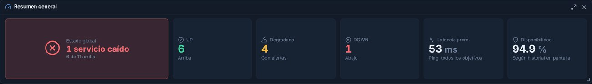

| Aspecto | Detalle |
|---|---|
| Qué muestra | Tarjeta de estado global (el peor estado de todos los servicios con un titular como “1 servicio caído”), contadores UP, Degradado y DOWN, latencia promedio de los pings de todos los objetivos y disponibilidad (porcentaje de mediciones del historial en pantalla que no fueron DOWN). |
| Requiere | Nada; usa todos los objetivos activos (los pausados no cuentan). |
| Parámetros | Ninguno propio. |
| Cuándo usarla | Siempre arriba: da la respuesta de un vistazo a “¿todo bien?”. Es la ventana principal de una pantalla de pared. |

### 2. Estado de servicios

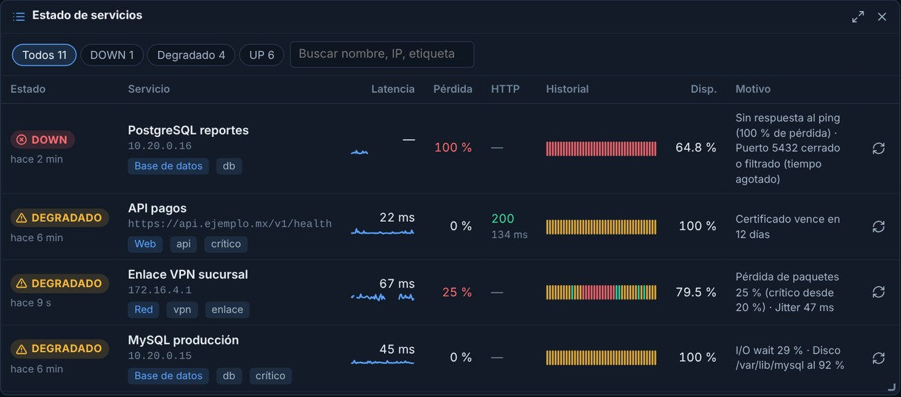

| Aspecto | Detalle |
|---|---|
| Qué muestra | Una fila por servicio: estado y desde cuándo, nombre, dirección, grupo y etiquetas, latencia con mini gráfica, pérdida, código HTTP y TTFB, historial (cada celda es una medición: verde UP, ámbar degradado, rojo DOWN), disponibilidad y el motivo del estado (hasta dos razones). |
| Parámetros | Filtros Todos / DOWN / Degradado / UP (con contador) y buscador por nombre, IP, grupo o etiqueta. Botón de flechas circulares = verificar ahora ese servicio. Clic en una fila = seleccionarlo para las ventanas en modo Automático. |
| Orden | DOWN primero, luego degradados, sin datos, UP y pausados; dentro de cada estado, alfabético. |
| Cuándo usarla | Es el tablero de trabajo: filtra a “DOWN” durante un incidente, o busca la etiqueta “crítico” para ver solo lo importante. Usa “verificar ahora” después de aplicar una corrección para confirmar la recuperación sin esperar el siguiente ciclo. |

### 3. Eventos y alertas

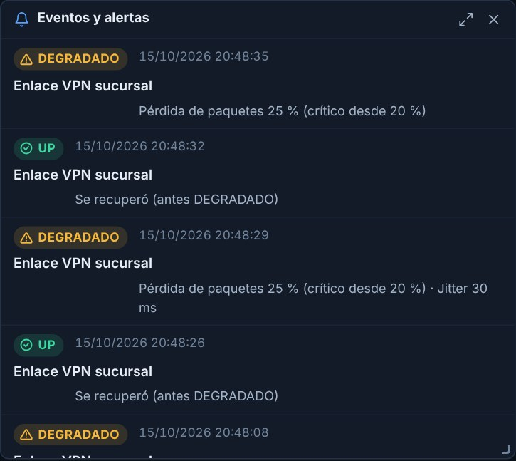

| Aspecto | Detalle |
|---|---|
| Qué muestra | Bitácora de cambios de estado, la más reciente primero (hasta 80 visibles; el servidor guarda 300): fecha y hora, servicio, el nuevo estado y el motivo (“Se recuperó”, “Puerto 5432 cerrado…”, “Certificado vence en 12 días”, “La verificación excedió el tiempo máximo”). |
| Parámetros | Clic en un evento = selecciona ese servicio. |
| Cuándo usarla | Para saber cuándo empezó un problema y con qué frecuencia ocurre (servicios que “parpadean”), y para reconstruir un incidente. Se reinicia al reiniciar el servidor. |

## 10.2 Red

### 4. Ping (PingPlotter)

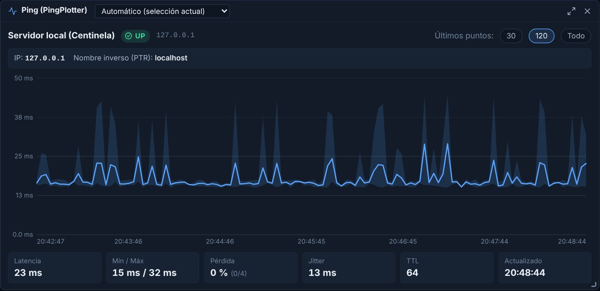

| Aspecto | Detalle |
|---|---|
| Qué muestra | Encabezado con nombre, estado y dirección; caja de resolución de nombres (para una URL: nombre → IP que resuelve, IPs adicionales y tiempo de consulta DNS; para una IP: nombre inverso PTR); 6 tarjetas: Latencia, Mín/Máx, Pérdida (perdidos/enviados), Jitter, TTL y hora de actualización; y la gráfica. |
| Cómo leer la gráfica | Línea azul = latencia promedio de cada ciclo. Banda azul clara = rango mínimo–máximo. Barras rojas = ciclos con pérdida de paquetes. Sombreado rojo = periodos en DOWN. Línea punteada ámbar = umbral de aviso de latencia. Los huecos son ciclos sin respuesta (la línea no se interpola). |
| Parámetros | Selector de objetivo; rango 30 / 120 / Todo. |
| Requiere | Objetivo con Ping activo. |
| Cuándo usarla | Para diagnosticar lentitud o intermitencia: picos aislados (congestión momentánea), meseta alta (ruta saturada) o barras rojas repetidas (enlace inestable). Úsala antes y después de un cambio de red para comparar. El TTL ayuda a deducir el sistema (≈64 Linux/Unix, ≈128 Windows) o cambios de ruta si varía. |

### 5. Latencia, pérdida, TTL y DNS

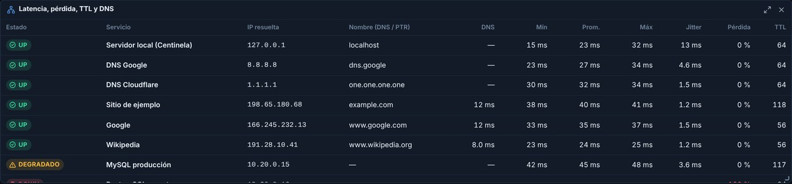

| Aspecto | Detalle |
|---|---|
| Qué muestra | Una fila por objetivo con IP resuelta, nombre (DNS directo o PTR), tiempo de DNS, latencia mín / prom. / máx, jitter, pérdida y TTL. Los valores se colorean ámbar o rojo según los umbrales. |
| Parámetros | Ninguno propio; clic en una fila selecciona el servicio. |
| Cuándo usarla | Para comparar todos los enlaces a la vez, descubrir a qué IP resuelve cada URL (por ejemplo tras un cambio de DNS o con balanceadores que rotan IPs) y detectar errores de DNS: si el nombre no se resuelve, aparece el error en rojo. |

### 6. Jitter (variación de latencia)

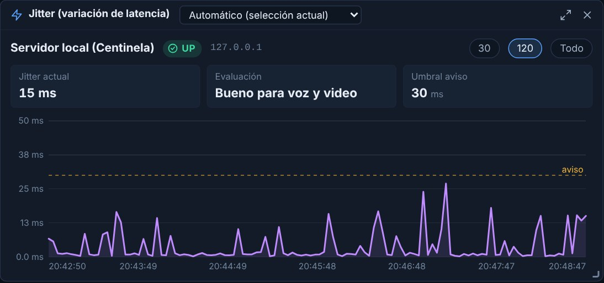

| Aspecto | Detalle |
|---|---|
| Qué muestra | Jitter actual, una evaluación (“Bueno / Marginal / Malo para voz y video”), el umbral de aviso y la gráfica de jitter con su línea de aviso. |
| Parámetros | Selector de objetivo; rango 30 / 120 / Todo. Los límites salen de Ajustes → Jitter. |
| Requiere | Objetivo con Ping activo. |
| Cuándo usarla | En servicios en tiempo real (VoIP, IVR, videollamadas, streaming), donde un jitter alto corta o distorsiona la comunicación aunque la latencia promedio parezca buena. |

### 7. Análisis de ruta (traceroute)

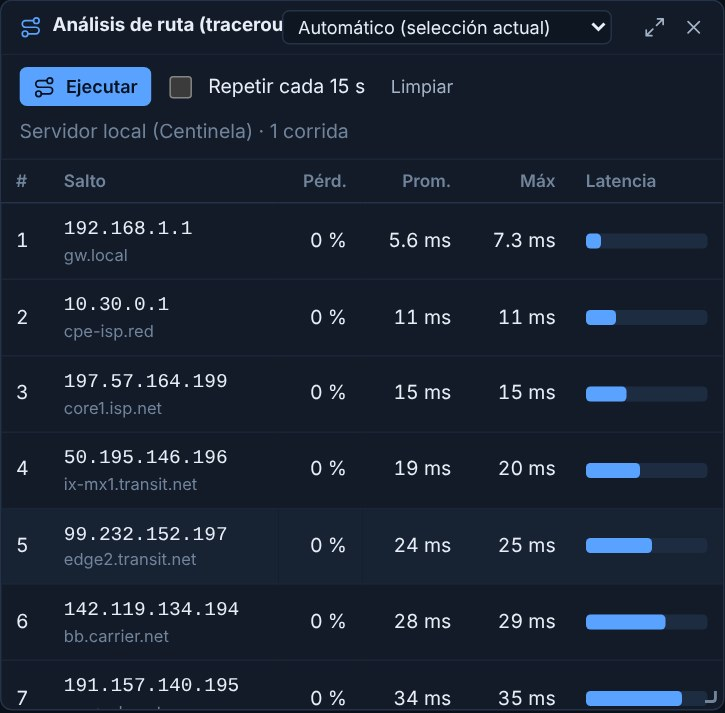

| Aspecto | Detalle |
|---|---|
| Qué muestra | Cada salto (hop) entre el servidor de monitoreo y el destino: número, IP y nombre, % de pérdida, latencia promedio y máxima y una barra de latencia (ámbar > 100 ms; roja > 250 ms o pérdida ≥ 30 %). Marca en rojo el “posible origen del problema”: el primer salto donde la latencia sube 80 ms o más respecto al anterior, o donde empieza una pérdida ≥ 30 % que continúa hasta el final. |
| Parámetros | Ejecutar: traza ahora (puede tardar hasta un minuto). Repetir cada 15 s: repite sin parar y acumula mediciones por salto (hasta 90) como PingPlotter, para ver pérdidas intermitentes. Limpiar: borra lo acumulado. Cambiar de objetivo reinicia el análisis. |
| Notas | Hasta 20 saltos. Un salto “sin respuesta” intermedio no es un problema si los siguientes sí responden: muchos routers no contestan ICMP. El servidor permite 3 traceroutes simultáneos en total y uno por usuario (si ya tienes uno en curso, responde 429). Requiere el comando traceroute/tracepath (Linux) o tracert (Windows). |
| Cuándo usarla | Cuando un servicio remoto está lento o caído y necesitas saber dónde está el problema: tu red local, tu proveedor (ISP), un punto de intercambio o el destino. Ideal ampliada y con “Repetir” activado durante un incidente. |

## 10.3 Aplicación (capa 7)

### 8. HTTP/HTTPS: código y TTFB

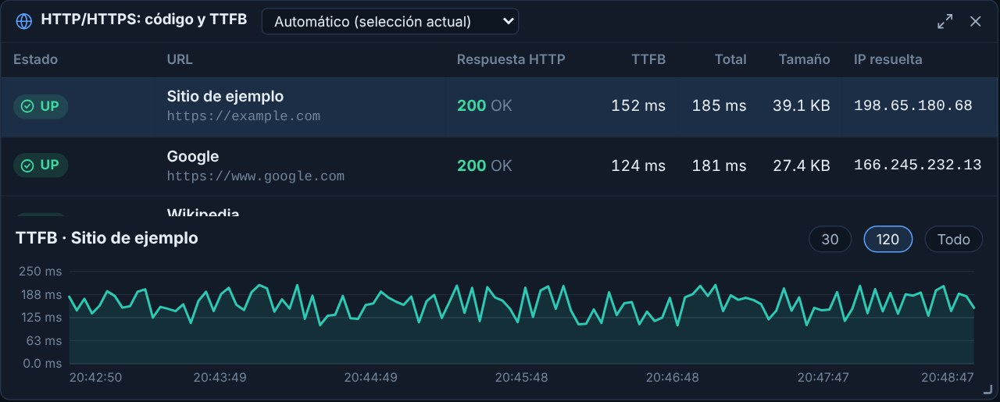

| Aspecto | Detalle |
|---|---|
| Qué muestra | Tabla de todas las URLs: estado, URL, código HTTP con su texto (verde si es el esperado, rojo si no; “error” si no hubo respuesta), redirecciones seguidas, aviso “sin texto esperado”, TTFB, tiempo total, tamaño e IP resuelta. Abajo, la gráfica de TTFB del objetivo seleccionado con su línea de aviso. |
| Parámetros | Selector de objetivo (qué URL se grafica); rango 30 / 120 / Todo; clic en una fila para graficarla. Los umbrales de TTFB salen de Ajustes. |
| Requiere | Objetivos tipo URL. |
| Cuándo usarla | Para distinguir “el servidor responde ping” de “la aplicación funciona”: detecta 500, 404, 503, páginas sin el texto esperado y degradación del tiempo de respuesta antes de que los usuarios se quejen. |

### 9. Certificados SSL/TLS

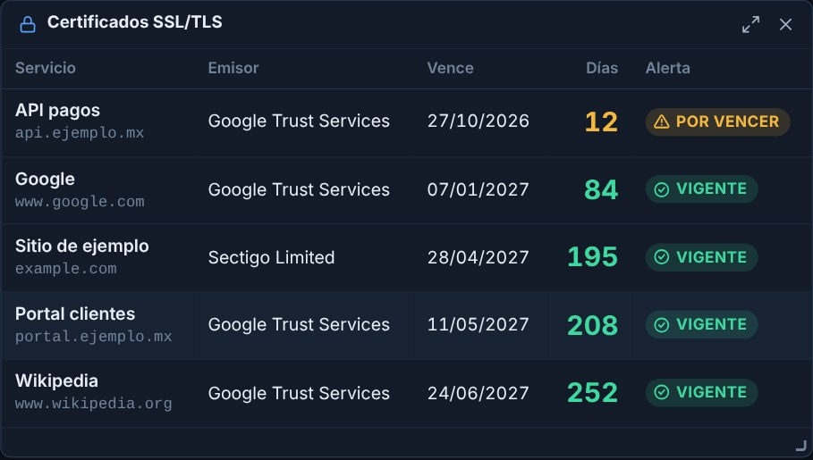

| Aspecto | Detalle |
|---|---|
| Qué muestra | Certificados ordenados del que vence antes al que vence después: servicio, emisor, fecha de vencimiento, días restantes (con color) y una etiqueta: VIGENTE, POR VENCER (≤ umbral de aviso), CRÍTICO (≤ umbral crítico), VENCIDO o SIN LECTURA. Indica “no confiable” si la cadena no es válida (autofirmado, CA interna, cadena incompleta). |
| Parámetros | Ninguno propio. Umbrales en Ajustes → SSL (30 / 7 días). |
| Requiere | Objetivos con la casilla de certificado SSL/TLS. |
| Cuándo usarla | Para no sorprenderte con un certificado vencido: una URL puede responder 200 y aun así mostrar una advertencia a los usuarios. Revísala en las revisiones semanales o déjala en el panel. |

### 10. Puertos TCP

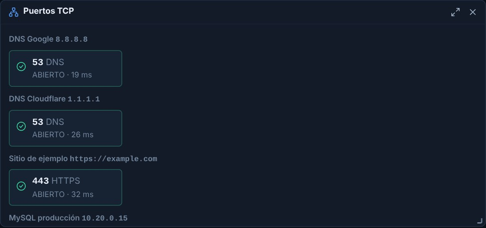

| Aspecto | Detalle |
|---|---|
| Qué muestra | Por cada objetivo con puertos configurados, una ficha por puerto con su número, el nombre del servicio conocido (HTTPS, MySQL, SSH…) y ABIERTO · tiempo de conexión o CERRADO · motivo (tiempo agotado, conexión rechazada). |
| Parámetros | Ninguno propio; los puertos se definen en el objetivo. |
| Cuándo usarla | Para comprobar que el servicio real escucha: base de datos (3306, 5432), correo (25/587), SSH, aplicaciones en 8080/8443. Un host puede responder ping y tener el puerto de la base de datos caído; aquí se ve. |

## 10.4 Infraestructura (requiere agente o 127.0.0.1)

### 11. CPU y memoria RAM

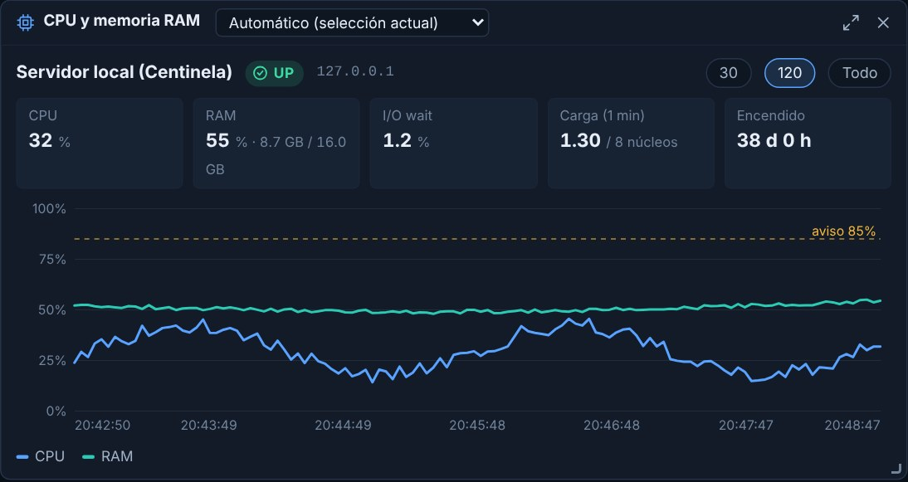

| Aspecto | Detalle |
|---|---|
| Qué muestra | Tarjetas de CPU %, RAM % (con MB usados/total), I/O wait, carga (1 min) sobre núcleos y tiempo encendido; gráfica de CPU (azul) y RAM (verde azulado) de 0 a 100 % con la línea de aviso de CPU. |
| Parámetros | Selector de objetivo; rango 30 / 120 / Todo. Umbrales en Ajustes (CPU, RAM, I/O wait). |
| Requiere | Objetivo con Salud del servidor (agente) activa. |
| Cuándo usarla | Para detectar picos de consumo (procesos descontrolados, lotes) y fugas de memoria (RAM que sube sin bajar). Si el servicio se degrada, aquí se ve si el equipo está saturado. |

### 12. Disco e I/O wait

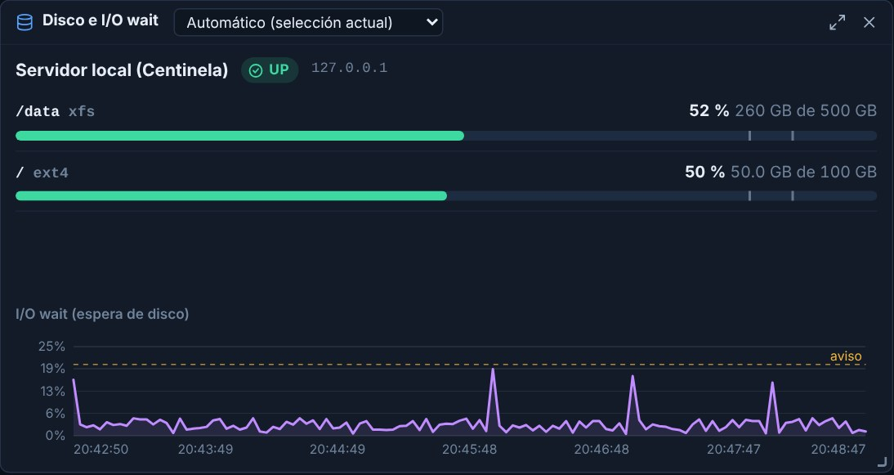

| Aspecto | Detalle |
|---|---|
| Qué muestra | Cada disco o partición (más lleno primero) con barra de uso, GB usados/total y marcas en los umbrales; etiqueta ALTO o CRÍTICO al superarlos. Debajo, gráfica de I/O wait (espera de disco). |
| Parámetros | Selector de objetivo. Umbrales de disco (85 / 90 %) e I/O wait (20 / 40 %) en Ajustes. |
| Requiere | Agente activo. I/O wait solo en Linux; en otros sistemas la gráfica indica que no está disponible. |
| Cuándo usarla | Un disco lleno detiene bases de datos y registros sin avisar: vigílalo con holgura. El I/O wait alto indica que el sistema o la base de datos están lentos por el disco, no por la CPU. |

### 13. Ancho de banda (bps)

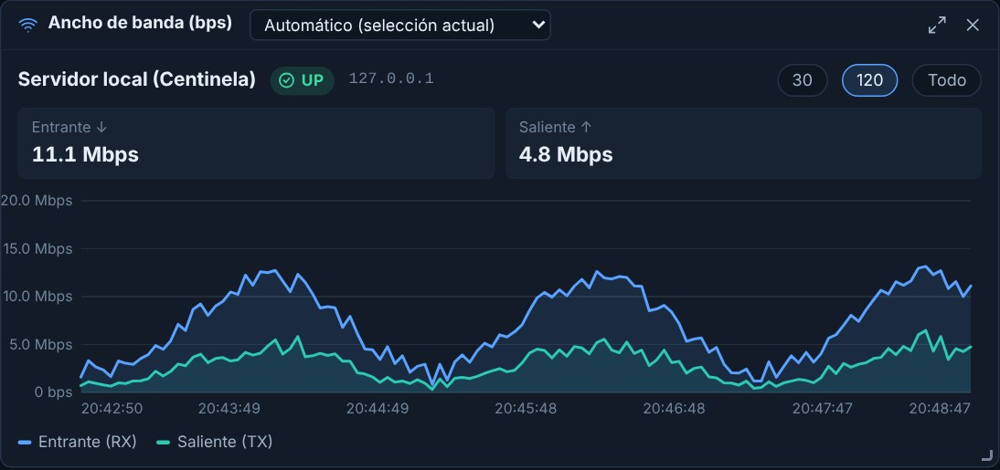

| Aspecto | Detalle |
|---|---|
| Qué muestra | Tráfico entrante (RX) y saliente (TX) de las interfaces de red, en bits por segundo, como valores actuales y gráfica de áreas. |
| Parámetros | Selector de objetivo; rango 30 / 120 / Todo. |
| Requiere | Agente activo en Linux. Se suman las interfaces reales (se excluyen loopback, docker, veth, br- y virbr). |
| Cuándo usarla | Para detectar saturación del enlace, copias de seguridad que ahogan la red o tráfico anormal (picos sostenidos de salida). |

### 14. Servicios del sistema

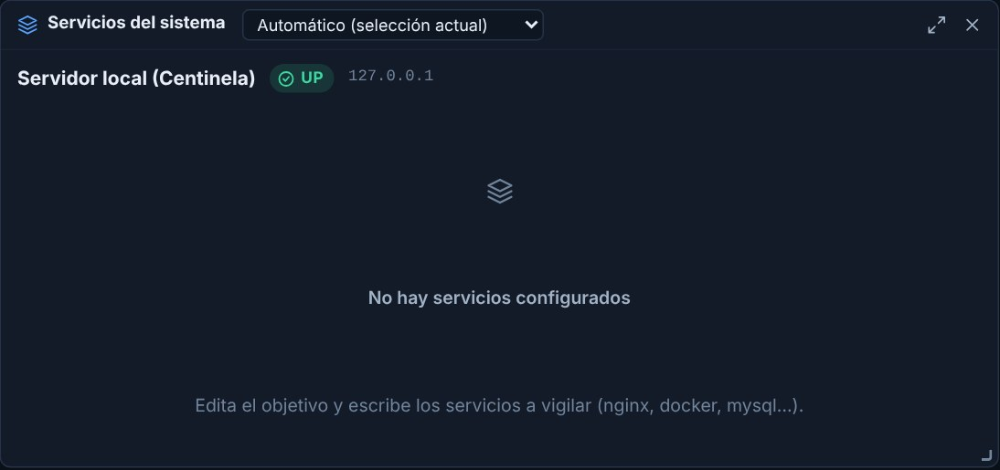

| Aspecto | Detalle |
|---|---|
| Qué muestra | Una ficha por cada servicio configurado en el objetivo: ENCENDIDO (verde) o APAGADO (rojo). Si uno está apagado el objetivo pasa a DOWN. |
| Parámetros | Selector de objetivo. La lista de servicios se edita en el objetivo (“Servicios a vigilar”). |
| Cómo se detecta | Linux: systemctl is-active y, si no es un servicio, un proceso con ese nombre. Windows: estado “Running” del servicio. macOS: proceso con ese nombre. |
| Cuándo usarla | Para servicios críticos que pueden detenerse aunque el servidor siga encendido: Apache/Nginx, Docker, MySQL/PostgreSQL, Tomcat, el spooler de impresión. |

# 11. El agente de servidores remotos

El agente es un programa muy pequeño (Node.js, sin dependencias) que se ejecuta en el servidor que quieres vigilar y entrega sus métricas al panel por HTTP o, de forma opcional, por HTTPS con la huella del certificado fijada (sección 11.4). Es necesario únicamente para ver CPU, RAM, disco, I/O wait, ancho de banda y servicios de equipos remotos. Ping, puertos, HTTP, SSL y DNS no lo necesitan.

## 11.1 Instalación paso a paso

1. Copia la carpeta agent/ (archivos agent.js y sysmetrics.js) al servidor remoto. Requiere Node 18+.
2. Genera un token largo y aleatorio. En Linux: `openssl rand -hex 24`.
3. Ejecuta el agente pasando el token por variable de entorno y fijando la IP de escucha: `CENTINELA_AGENT_TOKEN=EL_TOKEN node agent.js --port 9100 --host IP_DE_ESCUCHA`, donde IP_DE_ESCUCHA es la IP por la que te alcanza el panel. Debe imprimir “Agente Centinela escuchando en http://IP:9100 (token activo)” y, sin TLS, el aviso de que el token viaja en claro. Para cifrar la conexión, añade `--tls-cert` y `--tls-key` (sección 11.4).
4. Abre el puerto 9100 en el firewall solo para la IP del servidor de monitoreo.
5. En Centinela, edita el objetivo de ese servidor, activa “Medir CPU, RAM, disco…”, pon el mismo puerto y token y escribe los servicios a vigilar. Si el agente usa TLS, marca también “Conexión cifrada (TLS)” y pega la huella.
6. Verifica: en unos segundos las ventanas CPU y RAM, Disco, Ancho de banda y Servicios muestran datos.

En Windows (PowerShell) la variable se define antes de arrancar:

```
$env:CENTINELA_AGENT_TOKEN="EL_TOKEN"; node agent.js --port 9100 --host IP_DE_ESCUCHA
```

> **Consejo:** usa la variable CENTINELA_AGENT_TOKEN y no la opción `--token`: lo que se escribe en la línea de comandos es visible para cualquiera que liste los procesos del servidor (por ejemplo con `ps`). `--token` sigue funcionando, pero el agente avisa de ello al arrancar; si defines ambos, manda la variable de entorno.

> **Importante:** sin TLS el token viaja en claro por HTTP entre el panel y el agente. Limita el puerto del agente con el firewall a la IP del panel o usa una VLAN de gestión, o activa TLS (sección 11.4).

Escribir `CENTINELA_AGENT_TOKEN=... node agent.js` en la terminal deja el token en el historial del shell. En Linux, para un uso permanente, es mejor ejecutar el agente con systemd y un `EnvironmentFile=` (archivo con permiso 600):

```
# /etc/centinela-agent.env  (chmod 600, propietario root)
CENTINELA_AGENT_TOKEN=EL_TOKEN
CENTINELA_AGENT_HOST=IP_DE_ESCUCHA

# /etc/systemd/system/centinela-agent.service
[Unit]
Description=Agente de Centinela
After=network-online.target

[Service]
EnvironmentFile=/etc/centinela-agent.env
ExecStart=/usr/bin/node /opt/centinela/agent/agent.js --port 9100
Restart=on-failure
User=nobody

[Install]
WantedBy=multi-user.target
```

Actívalo con `sudo systemctl enable --now centinela-agent`.

## 11.2 Parámetros del agente

| Parámetro | Variable de entorno | Por defecto | Descripción y cuándo cambiarlo |
|---|---|---|---|
| --port | CENTINELA_AGENT_PORT | 9100 | Puerto de escucha. Cámbialo si está ocupado o por política de red; debe coincidir con el “Puerto del agente” del objetivo. |
| --host | CENTINELA_AGENT_HOST | 0.0.0.0 | Interfaz donde escucha. Pon la IP por la que te alcanza el panel (recomendado). 0.0.0.0 = todas las interfaces; si no indicas nada, el agente escucha en todas y lo avisa al arrancar. 127.0.0.1 = solo local. En una máquina con varias redes, pon la IP de la red de gestión para no exponerlo en las demás. |
| (sin opción; usa la variable) | CENTINELA_AGENT_TOKEN | (vacío) | Contraseña que debe enviar el panel. Es obligatoria si el agente no escucha en 127.0.0.1: sin token el agente se niega a arrancar. Preferible a la opción --token, que queda visible en la lista de procesos. |
| --token | (equivale a CENTINELA_AGENT_TOKEN) | (vacío) | Igual que la variable, pero visible en la lista de procesos. Úsala solo en pruebas. |
| --tls-cert | CENTINELA_AGENT_TLS_CERT | (vacío) | Ruta del certificado PEM. Con él el agente escucha por HTTPS. Debe indicarse junto con --tls-key: si falta uno de los dos, o no se pueden leer, el agente no arranca. |
| --tls-key | CENTINELA_AGENT_TLS_KEY | (vacío) | Ruta de la clave privada PEM del certificado. Protégela (permiso 600). |

Rutas del agente: GET /health (responde `{"ok":true}`) y GET /metrics?services=nginx,docker (métricas en JSON). Solo acepta GET y, si hay token, el encabezado Authorization: Bearer seguido del token. Un token incorrecto recibe 401. Para frenar a quien pruebe tokens, el agente permite hasta 10 fallos por minuto desde cada IP; superado el límite responde 429 (“demasiados intentos fallidos, espera un minuto”) hasta que pase el minuto. Una petición mal formada recibe 400 sin afectar al agente. Prueba manual:

```
curl -H "Authorization: Bearer EL_TOKEN" "http://IP_DEL_SERVIDOR:9100/metrics?services=nginx"
```

## 11.3 Qué mide en cada sistema operativo

| Métrica | Linux | Windows | macOS |
|---|---|---|---|
| CPU % | Sí | Sí | Sí |
| RAM % | Sí (memoria disponible) | Sí | Sí |
| Disco | Sí | Sí (PowerShell) | Sí |
| I/O wait | Sí | No | No |
| Ancho de banda | Sí | No | No |
| Servicios | systemctl y, si no, proceso | Estado del servicio (Get-Service) | Proceso por nombre |

> **Importante:** sin TLS, la comunicación panel ↔ agente es HTTP sin cifrar y el token viaja en ese tráfico. Úsala dentro de una red interna, una VPN o un túnel (por ejemplo SSH), nunca por Internet abierto; o activa TLS (sección 11.4).

> **Nota:** para dejar el agente funcionando permanentemente regístralo como servicio de tu sistema (systemd, tarea programada, administrador de servicios). Centinela no lo instala por ti.

## 11.4 Conexión cifrada (TLS) y huella del certificado

El agente puede escuchar por HTTPS. El panel no valida la cadena del certificado (un certificado autofirmado sirve): la autenticidad la da la **huella SHA-256**, que fijas en el objetivo. Antes de enviar el token, el panel comprueba que el certificado que presenta el agente tiene esa huella; si no coincide, cierra la conexión **sin enviar el token**, por lo que un servidor falso no puede obtenerlo.

**Paso 1. Generar el certificado.** En el servidor del agente, crea un certificado autofirmado (válido 825 días) y protege la clave:

```
openssl req -x509 -newkey rsa:2048 -nodes -keyout agent.key -out agent.crt -days 825 -subj "/CN=centinela-agent"
chmod 600 agent.key
```

**Paso 2. Arrancar el agente con TLS.** Pasa el certificado y la clave, por opción o por variable de entorno:

```
CENTINELA_AGENT_TOKEN=EL_TOKEN node agent.js --port 9100 --host IP_DE_ESCUCHA --tls-cert agent.crt --tls-key agent.key
```

Equivale a definir CENTINELA_AGENT_TLS_CERT=agent.crt y CENTINELA_AGENT_TLS_KEY=agent.key. El agente debe imprimir “Agente Centinela escuchando en https://IP:9100 (token activo)” y, justo debajo, la huella:

```
Huella SHA-256 del certificado (cópiala al dashboard): AA:BB:CC:...:99
```

**Paso 3. Configurar el objetivo.** En el panel, edita el objetivo, marca “Conexión cifrada (TLS)” y pega esa huella en “Huella SHA-256 del certificado”. Es obligatoria: sin ella no se puede guardar. Escribe de nuevo el token y guarda; en unos segundos las ventanas del agente muestran datos.

Mensajes que puedes ver en el objetivo (como motivo de “Agente sin respuesta”):

| Mensaje | Causa | Solución |
|---|---|---|
| Falta la huella TLS del agente | El objetivo tiene TLS activo pero sin huella (por ejemplo, guardado por una versión anterior). No se envía el token. | Edita el objetivo y pega la huella. |
| La huella TLS del agente no coincide (posible suplantación) | El certificado que presenta el agente no es el fijado: cambiaste el certificado del agente o hay otro equipo contestando en esa dirección. | Si renovaste el certificado, copia la huella nueva y reescribe el token. Si no lo hiciste, investiga quién responde en esa IP y puerto. |
| El agente tardó demasiado en responder | La consulta al agente superó el plazo absoluto de 10 s. | Revisa que el agente esté activo y la red entre ambos. |

> **Importante:** el token guardado se descarta cuando cambian la dirección, el puerto o la huella, o cuando se desactiva TLS (para que el secreto no viaje a otro destino o sin cifrar). Hay que volver a escribirlo en el formulario; el formulario lo avisa antes de guardar. Esto incluye renovar el certificado del agente: nueva huella, token de nuevo.

> **Nota:** con TLS, el agente de un objetivo cuya dirección es 127.0.0.1 o localhost no se consulta por red (se lee directamente), así que no hace falta TLS allí. Si no pasas --tls-cert y --tls-key, el agente sigue en HTTP como antes (compatible con los objetivos existentes).

# 12. Seguridad

| Tema | Cómo funciona | Qué debes hacer |
|---|---|---|
| Acceso al panel | Todo el panel y la API exigen inicio de sesión (capítulo 9). Sin servidor en marcha, la página abre en modo demostración con datos simulados. Por defecto escucha solo en 127.0.0.1; en contenedor, en todas las interfaces. No existe una contraseña inicial conocida: es la que defines o una aleatoria que se muestra una vez. | Define CENTINELA_ADMIN_PASSWORD o anota la aleatoria del registro y cámbiala en el primer acceso. Da a cada persona su usuario y el rol mínimo que necesita. Limita con el firewall qué redes llegan al puerto. Sin HTTPS las contraseñas viajan en claro por la red: úsalo solo en una red local de confianza o pon HTTPS delante. |
| Contraseñas | Se guardan con scrypt y sal aleatoria en users.json (permiso 600). Mínimo 8 caracteres. Las cuentas marcadas “debe cambiar la contraseña” solo pueden consultar su sesión, cambiarla o salir (el servidor responde 403 al resto). | Protege la carpeta de datos y sus respaldos. Elimina o deshabilita a quien ya no deba entrar. Nunca compartas una cuenta. |
| Sesiones | Cookie HttpOnly y SameSite=Strict. Caduca a las 12 h de inactividad y, en todo caso, a los 7 días. Máximo 10 sesiones por usuario y 500 en total. Se cierran al cambiar o restablecer la contraseña, deshabilitar o eliminar al usuario. Con CENTINELA_COOKIE_SECURE=1 añade el atributo Secure. | Activa CENTINELA_COOKIE_SECURE=1 solo si pones HTTPS (proxy con TLS) delante del panel. |
| Bloqueo de intentos | 5 fallos con el mismo usuario desde la misma IP bloquean 60 s (el usuario se compara sin mayúsculas ni espacios en los extremos). Más de 20 fallos desde una IP en 10 minutos dan 429. Cada intento se cuenta antes de verificar la contraseña, así que las ráfagas en paralelo no superan el límite. Al cambiar la contraseña, 5 fallos de la actual dan 429 y cierran la sesión. Como máximo 4 cálculos de contraseña a la vez; el exceso recibe 429 (“Servidor ocupado”). | Detrás de un proxy, el límite por IP es compartido por todos los usuarios salvo que definas CENTINELA_TRUST_PROXY (sección 12.1 y 9.5). |
| Roles | Administrador, Operador y Lector; el servidor aplica los permisos en cada petición, no solo la interfaz. | Lector para pantallas y consulta. Los roles no se limitan por organización. |
| Hosts permitidos (DNS rebinding) | Con CENTINELA_ALLOWED_HOSTS el servidor solo acepta peticiones cuyo encabezado Host esté en la lista; las demás reciben 421, y un Host mal formado, 400. localhost, 127.0.0.1 y ::1 siempre se aceptan (el healthcheck del contenedor sigue funcionando). Con CENTINELA_AUTH=off y sin la variable solo se aceptan localhost, el nombre del equipo y sus IP. | Recomendada en una LAN para frenar el DNS rebinding: pon la IP o el nombre con el que abres el panel (por ejemplo CENTINELA_ALLOWED_HOSTS=192.168.1.20,centinela.lan en el archivo .env del contenedor). |
| Alcance de las mediciones | El servidor hace ping, conexiones TCP y HTTP a lo que se le indique. | No lo expongas a redes no confiables: alguien podría usarlo para sondear tu red interna. |
| Tokens de agentes | Se guardan en data/targets.json y data/orgs/<id>/targets.json en texto plano (en Linux el archivo se crea con permiso 600). El navegador nunca los recibe. El token se descarta si cambia la dirección, el puerto o la huella TLS del objetivo, o si se desactiva TLS. | Protege la carpeta data/, no la subas a repositorios ni la compartas; usa un token distinto por servidor. La exportación del panel no los incluye. |
| Agente | Exige token si escucha fuera de 127.0.0.1; el token se pasa por CENTINELA_AGENT_TOKEN; limita a 10 fallos por minuto y por IP (429); solo atiende GET. Opcionalmente escucha por HTTPS (--tls-cert y --tls-key) y el panel solo envía el token si la huella SHA-256 del certificado coincide con la fijada en el objetivo. | Sin TLS el token viaja en claro por HTTP: escucha solo en la IP necesaria (--host), limita el puerto con el firewall a la IP del panel o usa una VLAN de gestión; mejor, activa TLS con huella fijada (sección 11.4). Para no dejar el token en el historial del shell, ejecútalo con systemd y EnvironmentFile= (sección 11.1). |
| Proxy inverso (IP del cliente) | Por defecto X-Forwarded-For se ignora. Con CENTINELA_TRUST_PROXY, solo las conexiones que llegan desde las IP listadas se interpretan con esa cabecera. | Sección 12.1. |
| Archivos de datos | La carpeta de datos se crea con permiso 700 y sus archivos con 600; cada guardado se escribe a disco antes de actualizar la memoria. | Conserva esos permisos al restaurar un respaldo. |
| Archivos expuestos | El servidor solo publica index.html, assets/ y js/. data/, server/ y agent/ nunca se sirven por HTTP. | — |
| Estado público | GET /api/health responde solo que el servidor está vivo, el modo y si exige inicio de sesión; no incluye la versión. El resto de la API exige sesión, y los datos del equipo servidor solo se entregan a administradores. | — |
| Comandos del sistema | Los hosts se validan estrictamente y ping/traceroute se ejecutan sin intérprete de comandos, por lo que no se pueden inyectar instrucciones. Los nombres de servicio deben empezar con letra o número. | — |
| Protección del navegador | Las peticiones POST, PUT y DELETE exigen Content-Type: application/json (si no, 415) y, si el navegador indica el origen, que sea el propio servidor (defensa contra CSRF); la política CSP solo permite scripts propios; los textos de usuario y los valores del agente y de HTTP se escapan antes de mostrarse. | Si automatizas la API con curl u otro cliente, envía siempre la cabecera Content-Type: application/json, incluso sin cuerpo. |
| Certificados al medir | El monitor no rechaza certificados inválidos para poder informarlos (vencido, autofirmado). | Es intencional: la medición no transmite datos sensibles. |
| Límites | Cuerpo de solicitud ≤ 512 KB, 50 organizaciones, 500 objetivos por organización, 200 usuarios, 3 traceroutes simultáneos (1 por usuario), 16 mediciones simultáneas (ajustable con CENTINELA_CONCURRENCY), plazo de 120 s por verificación (CENTINELA_CHECK_TIMEOUT_MS; una sonda huérfana se libera a los 2 × ese plazo), plazo de 10 s por consulta al agente, “verificar ahora” con un mínimo de 5 s por objetivo y un cupo de 3 simultáneas y 30 por minuto por usuario, y flujos en vivo: 5 por sesión, 15 por usuario y 200 en total. | — |

## 12.1 Proxy inverso y la IP real del cliente (CENTINELA_TRUST_PROXY)

Si pones un proxy inverso (nginx, Apache, Traefik) delante del panel, Centinela ve todas las conexiones como si vinieran del proxy. Consecuencias: el bloqueo de intentos por IP, el límite de flujos en vivo sin autenticación y el cupo de “verificar ahora” sin autenticación se comparten entre todos. Con CENTINELA_TRUST_PROXY el servidor usa la IP real de cada cliente.

Cómo decide la IP:

- Con la variable vacía (lo normal) X-Forwarded-For se ignora: nadie puede falsificar su IP con esa cabecera.
- Si la conexión llega desde una IP de la lista, el servidor lee X-Forwarded-For de derecha a izquierda y usa la primera entrada válida que no sea un proxy de confianza. Las entradas que no son IP se descartan; si no queda ninguna, usa la IP de la conexión.
- Si la conexión no viene de una IP de la lista, X-Forwarded-For se ignora aunque exista.
- Se aceptan entradas con puerto (10.0.0.7:5555) e IPv6 entre corchetes ([2001:db8::1]:443).

Formato: IP separadas por comas, por ejemplo `CENTINELA_TRUST_PROXY=127.0.0.1,10.0.0.5`. No admite rangos CIDR ni nombres; una entrada que no sea una IP se ignora y el servidor avisa al arrancar (`CENTINELA_TRUST_PROXY: entrada ignorada (no es una IP): ...`).

> **Importante:** tres requisitos del proxy. Si no se cumplen, la protección se debilita. (1) El proxy **debe añadir** la IP del cliente al **final** de X-Forwarded-For, sin reemplazar lo recibido; en nginx: `proxy_set_header X-Forwarded-For $proxy_add_x_forwarded_for;`. (2) El puerto de Centinela **no debe ser accesible saltándose el proxy** (firewall, o escucha solo en 127.0.0.1). (3) El proxy debe **conservar la cabecera Host** original (nginx: `proxy_set_header Host $host;`) para que CENTINELA_ALLOWED_HOSTS siga funcionando.

Ejemplo de arranque detrás de nginx en el mismo equipo:

```
CENTINELA_TRUST_PROXY=127.0.0.1 CENTINELA_COOKIE_SECURE=1 CENTINELA_ALLOWED_HOSTS=centinela.lan node server/server.js
```

> **Nota:** en contenedor, compose.yml ya pasa CENTINELA_TRUST_PROXY; defínela en .env. En la lista pon la IP con la que Centinela ve al proxy (la de origen de la conexión), que dentro de un contenedor no suele ser 127.0.0.1.

# 13. Archivos de datos y API

## 13.1 Archivos de la carpeta data/

| Archivo | Contenido | Notas |
|---|---|---|
| targets.json | Lista de objetivos del Host (organización principal). | Se crea con 6 ejemplos en el primer arranque. Respáldalo. |
| users.json | Usuarios: nombre, rol, contraseña cifrada (scrypt) y marca de cambio obligatorio. | Se crea con el administrador inicial. Es confidencial; para recuperar el acceso ver sección 9.6. |
| orgs.json | Lista de organizaciones (id, nombre, color, nota). La primera, “default”, es el Host. | Se crea sola. Los datos anteriores a esta función se conservan como Host sin migrar nada. |
| orgs/<id>/targets.json y layout.json | Objetivos y disposición de cada organización adicional. | Se crean al dar de alta la organización y se borran al eliminarla. |
| settings.json | Tema, intervalo por defecto, puntos de historial y umbrales. | Se crea con los valores de la sección 8. |
| layout.json | Ventanas del Panel del Host: tipo, posición, tamaño y configuración. | Máx. 60 ventanas. Para volver a la disposición original bórralo (con el servidor detenido) o usa “Restablecer”. |

La carpeta se crea con permiso 700 y los archivos con 600 (Linux/macOS).

> **Importante:** si editas estos archivos a mano, hazlo con el servidor detenido: se leen solo al arrancar y se sobrescriben al guardar. Si un JSON queda mal escrito, el servidor no arranca e indica el archivo; corrígelo o renómbralo para que se regenere.

## 13.2 Estructura de un objetivo (targets.json)

```
{
  "id": "t_9f3a1c2b7d",              // se genera solo
  "name": "Portal clientes",         // obligatorio, máx. 80
  "kind": "url",                     // "host" | "url"
  "address": "https://portal.empresa.com/login",
  "group": "Web",                    // opcional, máx. 40
  "tags": ["critico", "produccion"], // máx. 10, 24 c/u
  "intervalSec": 15,                 // 2 a 3600
  "enabled": true,
  "checks": {
    "ping": true,
    "ports": [443],                  // máx. 20, 1-65535
    "http": { "expectedStatus": "200-399", "timeoutMs": 8000,
              "method": "GET", "keyword": "", "browser": false },   // null si kind = "host"
    "ssl": true,
    "agent": { "enabled": false, "port": 9100, "token": "", "services": [],
               "tls": false, "fingerprint": "" }   // con tls = true la huella es obligatoria ("AA:BB:...", 64 hex)
  }
}
```

## 13.3 API REST

El propio panel usa esta API, y puedes usarla para integrarte con otros sistemas. Las solicitudes que modifican datos (POST, PUT, DELETE) deben llevar siempre la cabecera Content-Type: application/json, aunque no tengan cuerpo; si falta, el servidor responde 415. El cuerpo debe ser un objeto JSON (si no, 400).

| Método y ruta | Descripción |
|---|---|
| GET /api/health | Comprobación de vida pública: responde ok, el modo (live) y si exige inicio de sesión (auth). No incluye la versión. El resto de rutas devuelve 401 sin sesión y 403 si el rol no basta (los Lectores no pueden escribir; consulta “Códigos para rutas y métodos” más abajo). Si la cuenta debe cambiar la contraseña, devuelve 403 con mustChange: true salvo en las rutas de sesión. |
| GET /api/state?org={id} | Instantánea de una organización: objetivos, ajustes, últimos resultados e historial; además la lista de organizaciones, el estado compacto de todos los objetivos y los eventos globales. Sin org = Host. |
| POST /api/auth/login, /api/auth/logout | Iniciar y cerrar sesión (cookie). Login: {"username","password"}; responde 401 si es incorrecto y 429 al bloquearse (5 fallos de usuario+IP, más de 20 por IP en 10 minutos, o servidor ocupado). |
| GET /api/auth/me, POST /api/auth/password | Usuario actual (con mustChange) y, solo para administradores, datos del servidor / cambio de la contraseña propia ({"current","next"}); responde 429 y cierra la sesión tras 5 fallos de la contraseña actual. |
| GET, POST /api/users · PUT, DELETE /api/users/{id} | Gestión de usuarios (solo administrador; 403 para los demás). El alta y la edición admiten forceChange: true para obligar a cambiar la contraseña al entrar; disabled solo acepta true o false. |
| GET, POST /api/orgs | Listar organizaciones / crear una. Cuerpo: {"name","color","note"}. |
| PUT, DELETE /api/orgs/{id} | Editar o eliminar una organización (Host no se puede eliminar). |
| GET /api/stream | Flujo en vivo (Server-Sent Events) con los eventos result, event, targets, orgs y settings. Trae las mediciones y alertas de todas las organizaciones. Hasta 5 flujos por sesión y 15 por usuario (por IP con CENTINELA_AUTH=off); al superarlos se expulsa el más antiguo, que queda en pausa hasta que se reconecte con un clic o al volver a ser visible. El límite global es de 200 (429). |
| GET, POST /api/targets?org={id} | Listar objetivos de una organización / crear uno (devuelve 201 o 400 con la lista de errores). Sin org = Host. En checks.agent, tls (booleano) y fingerprint (huella SHA-256); con tls en true la huella es obligatoria (400 si falta o no es válida). |
| PUT /api/targets?org={id} | Reemplazar todos los objetivos de la organización (importación). Cuerpo: {"targets":[…]}. |
| PUT, DELETE /api/targets/{id} | Editar o eliminar un objetivo (404 si no existe). |
| POST /api/targets/{id}/check | Medir ahora ese objetivo y devolver el resultado. Si excede el plazo global (CENTINELA_CHECK_TIMEOUT_MS) responde 200 con el objetivo DOWN y el motivo “La verificación excedió el tiempo máximo”; si ya hay una verificación en curso de ese objetivo, 409. Responde 429 con la cabecera Retry-After si pasaron menos de 5 s desde la última verificación manual de ese objetivo o si el usuario (la IP, sin autenticación) ya tiene 3 simultáneas o 30 en el último minuto (“Demasiadas verificaciones manuales; espera un momento”). |
| POST /api/traceroute | Traceroute. Cuerpo: {"targetId":"…"} o {"address":"host"} (los Lectores solo con targetId). Responde 429 si ya tienes uno en curso o hay 3 en total. |
| GET, PUT /api/settings | Leer o guardar ajustes y umbrales. Si hay valores no válidos (fuera de rango, aviso mayor o igual que el crítico, avisos en 0), responde 400 con la lista errors. |
| GET, PUT /api/layout?org={id} | Leer o guardar la disposición del Panel de una organización. |

### Códigos para rutas y métodos

- **405:** si la ruta existe pero no admite el método usado (por ejemplo `DELETE /api/settings`), responde 405 con el cuerpo `{"error":"Método no permitido"}` y la cabecera `Allow` con los métodos que sí admite (por ejemplo `Allow: GET, HEAD, PUT`). Vale para todos los roles. Antes de esta versión, muchos de esos casos devolvían 404 o 403.
- **404:** una ruta que no existe responde 404 (`Ruta no encontrada`).
- **HEAD** equivale a GET en la API: responde 200 sin cuerpo y aparece en `Allow` justo después de GET. Excepción: `/api/stream`, donde HEAD responde 405 con `Allow: GET`.
- **Orden de las comprobaciones** (la primera que falla es la que responde): 415 (Content-Type), 403 de origen no permitido, rutas públicas, 401 sin sesión, 403 de cambio de contraseña pendiente, 403 de administrador en `/api/users*`, 405 y, por último, 404. Consecuencias:
  - Un anónimo siempre recibe 401: no averigua qué rutas ni métodos existen.
  - Un usuario que no es administrador recibe 403 en cualquier método de `/api/users*`, incluso uno no admitido.
  - Un Lector que escribe en una ruta inexistente recibe 403 “Tu usuario es de solo lectura”. En una ruta que existe pero no admite ese método recibe 405, no 403.

Además, el servidor responde 421 si el encabezado Host no está permitido (CENTINELA_ALLOWED_HOSTS) y 413 si el cuerpo supera 512 KB.

# 14. Despliegue en contenedor (Docker / Podman)

Centinela se puede ejecutar en un contenedor para tenerlo en un servidor de tu red local sin instalar Node.js en él. El proyecto incluye tres archivos en su carpeta principal: Dockerfile, compose.yml y .dockerignore; tú añades un cuarto, el archivo .env con la contraseña inicial (opcional). Sirven igual con Docker (docker compose) y con Podman (podman-compose o podman compose). La imagen se basa en node:22-bookworm-slim y el proceso corre con el usuario sin privilegios node.

## 14.1 Puesta en marcha

1. Copia la carpeta del proyecto al servidor que lo va a alojar (el que tiene Docker o Podman).
2. Crea, junto a compose.yml, un archivo `.env` con la contraseña inicial (mínimo 8 caracteres): `CENTINELA_ADMIN_PASSWORD=UnaContraseñaLarga`. Protégelo con `chmod 600 .env` y no lo subas a ningún repositorio. Si no lo creas, el servidor generará una contraseña aleatoria. En la misma `.env` se recomienda definir `CENTINELA_ALLOWED_HOSTS=192.168.1.20,centinela.lan` (la IP o el nombre con que abrirás el panel) para frenar el DNS rebinding; localhost, 127.0.0.1 y ::1 siempre se aceptan, así que la comprobación de salud sigue funcionando.
3. Desde esa carpeta ejecuta: `docker compose up -d --build` (con Podman: `podman-compose up -d --build`).
4. Abre http://IP-DEL-SERVIDOR:9595 desde cualquier equipo de la red. Entra con el usuario administrador y la contraseña del archivo .env. Si no la definiste, léela una sola vez en el registro: `docker logs centinela` (o `podman logs centinela`).
5. Si usaste la contraseña aleatoria, el panel te obliga a cambiarla al entrar. En cualquier caso, crea los usuarios que necesites en la sección Usuarios (llave en la barra superior para cambiar tu contraseña).
6. Abre el puerto 9595 en el firewall del servidor para las redes desde las que se usará el panel.

```
docker compose up -d --build            # construir e iniciar
docker compose logs -f                  # ver la bitácora del servidor
docker compose ps                       # estado (la columna "healthy" usa /api/health)
docker compose down                     # detener (los datos se conservan en el volumen)
docker compose down -v                  # detener Y BORRAR los datos (usuarios, objetivos, organizaciones)
```

> **Importante:** CENTINELA_ADMIN_PASSWORD (en .env) solo se usa la primera vez, cuando todavía no existe users.json en el volumen. Después, cambiarla en .env no cambia la contraseña de nadie.

## 14.2 Qué configura el compose.yml

| Parámetro | Valor por defecto | Para qué sirve y cuándo cambiarlo |
|---|---|---|
| ports | "9595:9595" | Publica el puerto 9595 en todas las interfaces del servidor, por lo que se abre desde cualquier IP de la red. Para limitarlo a una sola interfaz escribe la IP delante: "192.168.1.10:9595:9595". Para otro puerto cambia el primer número (por ejemplo "8080:9595"); el segundo es el interno. |
| PORT / HOST | 9595 / 0.0.0.0 | Puerto y dirección de escucha dentro del contenedor. No suelen tocarse: el contenedor debe escuchar en 0.0.0.0 para que el puerto publicado funcione. |
| CENTINELA_ADMIN_USER | administrador | Nombre del primer administrador. Solo se usa la primera vez, cuando aún no existe users.json en el volumen. |
| CENTINELA_ADMIN_PASSWORD | (se lee del archivo .env; vacía = aleatoria) | Contraseña del primer administrador (mínimo 8 caracteres). Ya no está escrita en el compose.yml: se toma de .env. Solo se usa la primera vez; después se gestiona en el panel y cambiar la variable no tiene efecto. |
| CENTINELA_ALLOWED_HOSTS | (se lee del archivo .env; vacía = sin filtro) | Nombres o IP, separados por comas, que el servidor acepta en la cabecera Host. Recomendada en LAN para frenar el DNS rebinding. localhost, 127.0.0.1 y ::1 siempre se aceptan (el healthcheck sigue funcionando). |
| CENTINELA_CONCURRENCY | 16 | Mediciones simultáneas (2 a 64). Súbela si monitoreas muchos objetivos (capítulo 7). |
| TZ | America/Mexico_City | Zona horaria del contenedor, para las horas de la bitácora del servidor. |
| volumes | centinela-data:/data | Volumen persistente con toda la configuración (targets, organizaciones, usuarios, ajustes). Sin él se perdería todo al recrear el contenedor. |
| cap_drop: ALL y cap_add: NET_RAW | activado | Endurecimiento: el contenedor pierde todas las capacidades del sistema salvo NET_RAW, que es necesaria: comprobado en laboratorio, sin ella el ping falla por el setcap del binario. También permite el traceroute. |
| security_opt: no-new-privileges | activado | Impide que un proceso del contenedor obtenga más privilegios de los que ya tiene. |
| read_only y tmpfs: /tmp | activado | El sistema de archivos del contenedor es de solo lectura; solo se puede escribir en /tmp (memoria) y en el volumen /data. |
| mem_limit y pids_limit | 512m / 256 | Tope de memoria (512 MB) y de procesos (256) del contenedor. Súbelos solo si monitoreas cientos de objetivos y lo ves justo. |
| sysctls: net.ipv4.ping_group_range | "0 65535" | Permite ICMP al usuario sin privilegios con el que corre Centinela dentro del contenedor. Se usa 65535 (y no 2147483647) para que también funcione con Podman sin root. Si tu motor rechaza este parámetro, quítalo: normalmente basta con NET_RAW. |
| restart | unless-stopped | El contenedor se levanta solo tras un reinicio del servidor. Con Podman sin root requiere activar podman-restart.service (sección 14.5). |
| healthcheck | cada 30 s | Consulta /api/health; el motor marca el contenedor como saludable o no. |

> **Nota:** en la red de un contenedor, la comprobación de salud y el panel usan el puerto interno 9595. Si publicas el panel con otro puerto en "ports", el healthcheck no cambia.

## 14.3 Datos, respaldos y actualizaciones

- Dónde están los datos: en el volumen centinela-data, montado en /data dentro del contenedor (targets.json, orgs.json, orgs/, users.json, settings.json, layout.json). La carpeta /data tiene permiso 700 y los archivos 600.
- Respaldo: `docker run --rm -v centinela_centinela-data:/data -v $PWD:/respaldo alpine tar czf /respaldo/centinela-data.tgz -C /data .` (el nombre real del volumen lo muestra docker volume ls). users.json contiene las contraseñas cifradas y los targets pueden incluir tokens de agentes: protege el respaldo.
- Carpeta del servidor en vez de volumen: cambia el volumen por una ruta, por ejemplo ./datos:/data. La carpeta debe permitir escritura al usuario “node” (uid 1000). En Podman con SELinux añade :Z al final.
- Actualizar: reemplaza los archivos del proyecto y ejecuta de nuevo docker compose up -d --build. Los datos del volumen se conservan.
- El historial de las gráficas vive en memoria y se reinicia con el contenedor, igual que sin contenedor.

## 14.4 Lo que cambia respecto a ejecutarlo directo

| Tema | Qué pasa en el contenedor | Qué hacer |
|---|---|---|
| 127.0.0.1 es el contenedor | Un objetivo con la dirección 127.0.0.1 (como el “Servidor local” de ejemplo) mide el propio contenedor, no el servidor que lo aloja. | Para medir el servidor anfitrión usa su IP de la red y, para CPU/RAM/disco, instala el agente en él (capítulo 11). Puedes eliminar el objetivo de ejemplo. |
| CPU, RAM, disco y servicios | El agente dentro de un contenedor ve el contenedor, no la máquina. | Ejecuta el agente de forma nativa en cada servidor (servicio de systemd o tarea programada), no dentro de un contenedor. |
| Ping y traceroute | Necesitan ICMP desde el contenedor. Con NET_RAW y el sysctl del compose deben funcionar en Docker y en Podman, con o sin root, también con el endurecimiento completo. | Si el panel dice “Ping no disponible”, revisa los registros del contenedor y estos dos parámetros. |
| Red del contenedor | Sale a tu red a través de la red del motor (NAT). Los equipos de la LAN y los de Internet se alcanzan normalmente. | En Linux, con network_mode: host el contenedor usa directamente la red del servidor (entonces 127.0.0.1 sí es el anfitrión y se ignora “ports”). No existe en Docker Desktop de Windows o Mac. |
| Windows y Mac (Docker Desktop) | Funciona, pero el contenedor corre dentro de una máquina virtual. | Para uso permanente en producción es preferible un servidor Linux. |
| Proxy inverso | No es necesario: el propio panel pide usuario y contraseña. | Solo si quieres HTTPS interno (Apache, nginx, Traefik): desactiva el almacenamiento en búfer de /api/stream, que es el flujo en vivo, y añade CENTINELA_COOKIE_SECURE=1 y CENTINELA_ALLOWED_HOSTS con el nombre público del panel. El proxy debe conservar la cabecera Host original (en nginx: proxy_set_header Host $host); si la reescribe a 127.0.0.1, el filtro de Host deja de proteger. Para que el bloqueo de intentos use la IP real de cada cliente, define CENTINELA_TRUST_PROXY (sección 12.1), que compose.yml ya pasa al contenedor desde .env. |
| Sin inicio de sesión | Con CENTINELA_AUTH=off el servidor solo acepta peticiones con Host de su propio equipo. | Si por algún motivo lo desactivas en contenedor (solo entornos aislados), define también CENTINELA_ALLOWED_HOSTS con la IP o el nombre con que abres el panel. |

## 14.5 Podman

- Los mismos archivos sirven: `podman-compose up -d --build` o `podman compose up -d --build`.
- Para que arranque con el servidor, genera una unidad de systemd con `podman generate systemd` o usa Quadlet; en modo sin root habilita `loginctl enable-linger` para tu usuario. Con `restart: unless-stopped` del compose.yml, en Podman sin root también debes activar el servicio de usuario que levanta los contenedores al arrancar el equipo (viene deshabilitado): `systemctl --user enable podman-restart.service` y `loginctl enable-linger $USER`.
- **No uses `podman restart centinela`** en Podman sin root: en el equipo de pruebas falla con `rootless netns: kill network process: permission denied` y deja el contenedor **detenido** (no es un fallo de Centinela). Reinicia con `podman-compose -p <proyecto> restart` (el contenedor queda healthy y /api/health responde) o con `podman stop centinela` seguido de `podman start centinela`. Si por error quedó detenido, `podman start centinela` lo levanta.
- En modo sin root, los puertos por debajo del 1024 están restringidos; el 9595 no tiene problema.
- Si Podman rechaza sysctls, quita ese bloque y asegúrate de mantener NET_RAW.
- Con Podman sin root el valor de ping_group_range debe ser "0 65535", el que trae el compose.yml; con el valor antiguo 2147483647 el contenedor no arrancaba (“Invalid argument”).

## 14.6 Problemas frecuentes en contenedor

| Síntoma | Causa probable | Solución |
|---|---|---|
| No abre desde otro equipo, pero sí desde el servidor | Firewall del servidor bloqueando 9595, o el puerto publicado solo en 127.0.0.1. | Abre el puerto en el firewall (por ejemplo ufw allow 9595/tcp o firewalld) y revisa “ports” en el compose. |
| “Ping no disponible en el servidor de monitoreo” | Falta NET_RAW o el sysctl, o el motor los rechazó. | Revisa que el compose los incluya y recrea el contenedor: docker compose up -d --force-recreate. |
| Al reiniciar se pierden usuarios y objetivos | No hay volumen o se usó down -v. | Mantén el volumen de /data y haz respaldos. |
| “EACCES: permission denied” al guardar en /data | La carpeta montada no permite escribir al usuario node (uid 1000). | Cambia su propietario: chown 1000:1000 ./datos (o usa el volumen nombrado). |
| El contenedor aparece “unhealthy” | El servidor no arrancó; suele ser un JSON de /data mal escrito. | Mira docker compose logs: indica el archivo a corregir. |
| No sé la contraseña del administrador | No definiste CENTINELA_ADMIN_PASSWORD en .env y no anotaste la aleatoria. | Búscala en el registro de la primera ejecución (docker logs centinela). Si ya no está, borra users.json del volumen y reinicia (sección 9.6). |
| Tras `podman restart centinela` el contenedor quedó detenido (“rootless netns: kill network process: permission denied”) | Fallo de Podman sin root en ese tipo de equipo, no de Centinela. | `podman start centinela` y, para reiniciar, usa `podman-compose -p <proyecto> restart` o `podman stop` + `podman start` (sección 14.5). |
| Tras reiniciar el servidor el contenedor no se levanta solo | `podman-restart.service` del usuario está deshabilitado (Podman sin root). | `systemctl --user enable podman-restart.service` y `loginctl enable-linger $USER` (sección 14.5). |
| Cambié CENTINELA_ADMIN_PASSWORD y no entra con la nueva | Esa variable solo crea el primer usuario. | Entra con la contraseña vigente y cámbiala en el panel, o consulta el capítulo 9 (“Si olvidaste la contraseña”). |

# 15. Recetas: configuraciones por situación

Cada receta indica cómo dar de alta el objetivo y qué ventanas conviene tener a la vista. Los valores son puntos de partida; ajústalos a tu red.

## 15.1 Sitio web público con HTTPS

| Aspecto | Configuración |
|---|---|
| Objetivo | Tipo URL: https://www.empresa.com |
| Verificaciones | Ping, puerto 443, HTTP 200-399, SSL activo. |
| Intervalo | 30 s (los sitios públicos no necesitan más). |
| Ventanas | HTTP/HTTPS, Certificados SSL/TLS, Estado de servicios. |
| Por qué | Detecta caída del sitio (código ≠ esperado), lentitud (TTFB) y vencimiento del certificado. |

## 15.2 API con autenticación

| Aspecto | Configuración |
|---|---|
| Objetivo | URL https://api.empresa.com/v1/health |
| Verificaciones | HTTP con códigos esperados 200-399,401 si la API responde 401 sin credenciales; texto esperado, por ejemplo status":"ok; SSL activo. |
| Intervalo / umbrales | 15 s. En Ajustes baja el TTFB a 300 / 1000 ms si la API debe ser rápida. |
| Ventanas | HTTP/HTTPS (gráfica de TTFB), Eventos. |

## 15.3 Servidor de base de datos

| Aspecto | Configuración |
|---|---|
| Objetivo | Tipo IP o host: 10.20.0.15 |
| Verificaciones | Ping; puerto 3306 (MySQL) o 5432 (PostgreSQL); agente con servicio mysqld / postgresql. |
| Intervalo / umbrales | 10 s. Disco 80 / 90 % y I/O wait 10 / 25 % para tener margen. |
| Ventanas | Puertos TCP, Disco e I/O wait, CPU y memoria RAM, Servicios del sistema. |
| Por qué | La base puede estar “viva” al ping y tener el puerto caído; los discos llenos y la espera de disco son sus causas de lentitud más comunes. |

## 15.4 Servidores de aplicaciones (Tomcat / WAS)

| Aspecto | Configuración |
|---|---|
| Objetivo | Un objetivo por servidor, con el mismo grupo (“WAS”) y etiqueta, para compararlos. |
| Verificaciones | URL de salud o login con texto esperado; puertos 8080 / 8443 (y 22 si quieres SSH); agente con servicio tomcat. |
| Intervalo / umbrales | 10 s. RAM aviso 80 % para detectar fugas de memoria antes de que se agote el heap. |
| Ventanas | Estado de servicios (filtra por la etiqueta), CPU y memoria RAM con una ventana por servidor (fija el objetivo en cada una), Servicios del sistema. |

## 15.5 Enlace VPN o sucursal remota

| Aspecto | Configuración |
|---|---|
| Objetivo | Tipo IP: dirección del router remoto o de un equipo detrás del enlace. |
| Verificaciones | Solo Ping. |
| Intervalo / umbrales | 5 s. Latencia 60 / 150 ms, jitter 20 / 50 ms y pérdida aviso 30 % para no alertar por un solo paquete perdido. |
| Ventanas | Ping (PingPlotter), Jitter, Análisis de ruta con “Repetir cada 15 s”. |
| Por qué | El traceroute acumulado muestra en qué salto (tu red, el ISP o el destino) se pierde o se encarece la ruta. |

## 15.6 Servicio de voz (VoIP, IVR, SIP)

| Aspecto | Configuración |
|---|---|
| Objetivo | IP del servidor o gateway de voz. |
| Verificaciones | Ping + puerto (por ejemplo 5060 SIP) + agente si lo administras. |
| Intervalo / umbrales | 5 s. Jitter 20 / 50 ms. Deja la pérdida en 2 / 20 %: en voz, un paquete perdido ya importa. |
| Ventanas | Jitter, Ping, Latencia/pérdida/TTL/DNS. |

## 15.7 Equipo que bloquea el ping

| Aspecto | Configuración |
|---|---|
| Objetivo | IP o URL del equipo. |
| Verificaciones | Desmarca Ping. Usa puertos (443, 22…) o HTTP. |
| Por qué | Evita notas de “sin respuesta ICMP” y mide el servicio de verdad. (Si dejas Ping activo y el equipo responde por puerto o HTTP, no se marca DOWN, pero la ventana de Ping quedará vacía.) |

## 15.8 Servidor DNS interno

| Aspecto | Configuración |
|---|---|
| Objetivo | IP del servidor DNS. |
| Verificaciones | Ping y puerto 53. |
| Ventanas | Latencia/pérdida/TTL/DNS (muestra el nombre inverso), Puertos TCP. |

## 15.9 Vigilar certificados de muchos sitios

| Aspecto | Configuración |
|---|---|
| Objetivo | Una URL https por sitio, con la casilla SSL activa. |
| Intervalo | 300 a 3600 s: los certificados cambian de día en día, no de segundo en segundo. |
| Ventanas | Certificados SSL/TLS ordenada por vencimiento. Ajusta el umbral de aviso según cómo renueves (sección 8.2). |

## 15.10 Pantalla de pared (NOC)

| Aspecto | Configuración |
|---|---|
| Disposición | Resumen general arriba, Estado de servicios y Eventos debajo, y 2–3 gráficas clave. Quita el resto. |
| Configuración | Tema oscuro, Disposición bloqueada, navegador en pantalla completa (F11). El título de la pestaña muestra “(n DOWN)” aunque la ventana esté en segundo plano. |
| Usuario | Crea un usuario con rol Lector para la pantalla: no puede modificar nada. Recuerda que la sesión caduca a las 12 h de inactividad y a los 7 días en total, así que alguien deberá iniciar sesión de nuevo de vez en cuando. Usa un usuario exclusivo para la pantalla: si el mismo usuario abre más de 15 flujos en vivo (o, sin autenticación, más de 5 desde la misma IP), la pantalla puede quedar en pausa “En vivo en otra pestaña” y no se recupera sola mientras esté visible. |
| Consejo | Usa etiquetas (“critico”) y el buscador de Estado de servicios para centrarte en lo que importa. |

## 15.11 Monitorear a varios clientes o sedes

| Aspecto | Configuración |
|---|---|
| Organizaciones | Deja tus propios equipos en Host y crea una organización por cliente o sede con “+ Organización” (capítulo 7). |
| Objetivos | Dentro de cada organización, agrega sus IPs y URLs en Objetivos. Si te dan una lista, impórtala como CSV estando en la pestaña correcta. |
| Ventanas | Cada organización guarda su propia disposición: deja en la de un cliente solo lo que le interesa y mantén Eventos abierto en Host para ver las alertas de todos. |
| Carga | Con decenas de objetivos por organización los valores por defecto bastan. Usa 30–60 s en las poco críticas y sube CENTINELA_CONCURRENCY si ves retrasos. |
| Por qué | Las alertas de todas las organizaciones llegan a la misma bitácora con su etiqueta; al pulsar una, el panel salta a esa organización. |

# 16. Solución de problemas

| Síntoma | Causa probable | Solución |
|---|---|---|
| No puedo entrar: “Usuario o contraseña incorrectos” | Datos mal escritos, usuario deshabilitado o contraseña cambiada. | Revisa mayúsculas y el nombre de usuario. Un administrador puede restablecerla en Usuarios. Si no queda ninguno, ver sección 9.6. |
| “Demasiados intentos. Espera N s.” | Se alcanzaron 5 fallos con ese usuario desde esa IP. | Espera el tiempo indicado (hasta un minuto) y vuelve a intentar con la contraseña correcta. |
| “Demasiados intentos desde esta dirección. Espera unos minutos.” | Más de 20 intentos fallidos desde esa IP en 10 minutos. | Espera unos minutos. Si varias personas comparten IP (proxy), pueden bloquearse entre sí (sección 9.5). |
| “Servidor ocupado, intenta de nuevo en unos segundos.” | Hay muchos inicios de sesión o cambios de contraseña a la vez (máximo 4 simultáneos). | Vuelve a intentarlo en unos segundos. |
| No sé la contraseña inicial del administrador | No definiste CENTINELA_ADMIN_PASSWORD y no anotaste la aleatoria del primer arranque. | Búscala en el registro de arranque (consola, docker logs centinela o podman logs centinela). Si ya no está, borra users.json y reinicia (sección 9.6). |
| “Debes cambiar tu contraseña” y no puedo cerrar la ventana | Tu cuenta tiene el cambio obligatorio pendiente. | Escribe la contraseña actual y una nueva (mínimo 8 caracteres, distinta). O cierra sesión con el botón de la ventana. |
| Al cambiar mi contraseña me cerró la sesión (“Demasiados intentos fallidos”) | Se escribieron mal 5 veces seguidas la contraseña actual. | Espera un minuto, inicia sesión y vuelve a intentarlo con cuidado. |
| El panel me pide iniciar sesión de nuevo | La sesión caducó (12 h sin uso o 7 días desde que entraste), se reinició el servidor, abriste una sesión número 11 con el mismo usuario o un administrador cambió tu contraseña o te deshabilitó. | Inicia sesión otra vez. Si ocurre seguido, revisa si el servidor o el contenedor se están reiniciando. |
| No veo la sección Usuarios, o no veo botones para editar | Tu rol es Operador o Lector. | Pide a un administrador que cambie tu rol si lo necesitas (sección 9.2). |
| “No se pudo cargar el panel” con botón Reintentar | El servidor respondió pero falló al cargar los datos (error interno o de red). | Pulsa Reintentar. Si persiste, revisa el registro del servidor. El panel no pasa a demostración por su cuenta. |
| Aparece “Demostración” aunque ejecuté el servidor | Abriste index.html con doble clic (archivo local) en lugar de la dirección del servidor, o el servidor no respondió a la comprobación inicial. | Abre la dirección que imprime el servidor, por defecto http://127.0.0.1:8080. |
| “Sin conexión con el servidor” | El servidor se detuvo o la red se cayó. | Reinicia el servidor. El panel se reconecta solo (con esperas crecientes de hasta 30 s) y recarga el estado; el historial previo se perdió si el servidor se reinició. |
| “Host no permitido” (error 421) | El nombre o la IP con que abres el panel no está en CENTINELA_ALLOWED_HOSTS. | Añade ese nombre o IP a la variable y reinicia, o abre el panel con uno de los permitidos. |
| Mi script o curl recibe 415 “Content-Type debe ser application/json” | Un POST, PUT o DELETE sin la cabecera JSON. | Añade -H "Content-Type: application/json", incluso sin cuerpo (sección 13.3). |
| Error EADDRINUSE al arrancar | El puerto está ocupado por otro programa. | Usa otro puerto: PORT=9000 node server/server.js. |
| El servidor no arranca y menciona un archivo de data/ | Un JSON está mal escrito. | Corrige el archivo o renómbralo para que se regenere. |
| “Ping no disponible en el servidor de monitoreo” | No existe el comando ping (contenedores mínimos) o no hay permiso para ICMP. | Instala ping (en Debian/Ubuntu: iputils-ping) o dale permiso ICMP al proceso. En contenedor revisa NET_RAW y ping_group_range (capítulo 14). Mientras tanto vigila con puertos o HTTP. |
| Traceroute: “No hay traceroute ni tracepath instalado” | Falta el comando en Linux. | Instálalo: sudo apt install traceroute. |
| Traceroute: “Ya tienes un traceroute en curso” | El servidor admite un traceroute a la vez por usuario (y 3 en total). | Espera a que termine el anterior. |
| Todo lo externo sale DOWN con “nombre no encontrado” | El servidor de monitoreo no tiene Internet o DNS. | Verifica la red y el DNS de ese equipo (no del tuyo). |
| Un objetivo sale DOWN con “La verificación excedió el tiempo máximo” | Sus sondas juntas tardaron más del plazo global (120 s por defecto). | Revisa si el destino o el agente están colgados. Si es normal que tarde, sube CENTINELA_CHECK_TIMEOUT_MS. |
| La URL abre en mi navegador (a veces en otra dirección) pero aquí sale DOWN con 403, 429 o 503 | El sitio rechaza a los monitores automáticos, o redirige a otro dominio y exige cookies o un navegador. | Edita el objetivo y activa “Identificarse como un navegador (Chrome)”. Si redirige a otra dirección, Centinela la sigue sola (hasta 10 saltos); para medir directamente el destino final, usa esa URL. |
| El ping falla pero la web funciona | Un firewall bloquea ICMP. | Desactiva Ping en el objetivo; deja puertos y HTTP. |
| Un servicio sano aparece DOWN por HTTP 401, 403 o 404 | Ese código no está entre los esperados. | Edita “Códigos HTTP esperados” (ej. 200-399,401) o apunta a una URL pública de salud. |
| Certificado “no confiable”, servicio DEGRADADO | Certificado autofirmado, de una CA interna o con la cadena incompleta. | Instala la cadena completa en el servidor, o acepta el aviso si es un entorno interno conocido. |
| “Agente sin respuesta (conexión rechazada / tiempo agotado)” | El agente no corre, el puerto es otro o el firewall lo bloquea. | Comprueba que el agente esté activo, el puerto del objetivo y la regla de firewall hacia el servidor de monitoreo. |
| “Agente sin respuesta (token rechazado por el agente)” | El token del objetivo no coincide con el del agente, o se descartó al cambiar la dirección, el puerto o la huella, o al desactivar TLS. | Edita el objetivo y escribe el token correcto (vacío conserva el anterior, salvo que hayas cambiado alguno de esos datos). |
| “Falta la huella TLS del agente” | El objetivo tiene “Conexión cifrada (TLS)” sin huella; el token no se envía. | Pega la huella SHA-256 que imprime el agente al arrancar (sección 11.4). |
| “La huella TLS del agente no coincide (posible suplantación)” | El certificado del agente cambió (renovación o reinstalación) o responde otro equipo en esa dirección. | Si fue un cambio tuyo, copia la huella nueva en el objetivo y reescribe el token; si no, investiga quién contesta en esa IP y puerto (sección 11.4). |
| “El agente tardó demasiado en responder” | La consulta al agente pasó el plazo absoluto de 10 s (agente o red muy lentos, o algo que acepta la conexión y no contesta). | Revisa el agente y la red entre ambos servidores. |
| El agente con TLS no arranca (“No se pudo cargar el certificado o la clave TLS”) o pide indicar cert y clave juntos | Falta --tls-cert o --tls-key, la ruta es incorrecta o la clave no corresponde al certificado. | Indica los dos archivos y comprueba que se generaron juntos (sección 11.4). |
| “verificar ahora” responde 429 (“Espera unos segundos…” o “Demasiadas verificaciones manuales; espera un momento”) | Menos de 5 s desde la última verificación manual de ese objetivo, o más de 3 simultáneas / 30 por minuto por usuario. | Espera el tiempo de la cabecera Retry-After y vuelve a intentarlo (sección 3.5). |
| Todos los usuarios detrás del proxy se bloquean a la vez | El servidor ve a todos con la IP del proxy. | Define CENTINELA_TRUST_PROXY con la IP del proxy y cumple los requisitos de la sección 12.1. |
| Al arrancar: “CENTINELA_TRUST_PROXY: entrada ignorada (no es una IP)” | La lista contiene un CIDR, un nombre u otro valor que no es una IP. | Escribe solo IP literales separadas por comas (no se admiten rangos). |
| La consola muestra “[scheduler] verificación huérfana: …” | Una verificación pasó el plazo global y su sonda sigue viva; mientras tanto baja la capacidad de mediciones simultáneas. | Revisa el destino o el agente del objetivo indicado. Se libera sola a los 2 × CENTINELA_CHECK_TIMEOUT_MS (sección 3.5). |
| Un usuario a quien obligué a cambiar la contraseña ve la ventana “Debes cambiar tu contraseña” con el panel ya abierto | Comportamiento esperado: el servidor le rechaza las peticiones (403) hasta que la cambie. | Debe escribir su contraseña actual y una nueva (sección 9.3). |
| El agente responde 429 (“demasiados intentos fallidos, espera un minuto”) | Hubo más de 10 peticiones con token incorrecto en un minuto desde esa IP. | Corrige el token del objetivo y espera un minuto. |
| El agente no arranca: “exige --token (o CENTINELA_AGENT_TOKEN)” | Escucha fuera de 127.0.0.1 sin token. | Define CENTINELA_AGENT_TOKEN antes de ejecutarlo. |
| Mi herramienta recibe 405 “Método no permitido” de la API | La ruta existe pero no admite ese método (antes podía verse como 404 o 403). | Mira la cabecera Allow de la respuesta y usa uno de esos métodos (sección 13.3). Una ruta que no existe responde 404. |
| Los ajustes no se guardan y aparece una lista de errores (por ejemplo `En "Latencia (ms)" el aviso (x) debe ser menor que el crítico (y).`) | Un aviso es mayor o igual que el crítico (en SSL, menor o igual), hay un aviso en 0 o un valor fuera de rango. | Corrige los valores que indica la lista (sección 8.2). Un campo vacío no es un error: conserva el valor anterior. |
| Las ventanas de CPU/Disco/Servicios dicen “No hay objetivos compatibles” | Ningún objetivo tiene el agente activo. | Activa “Salud del servidor” en un objetivo (127.0.0.1 no necesita instalar nada). |
| Una ventana dice “Esperando la primera medición” | Aún no termina el primer ciclo. | Espera un intervalo o usa “verificar ahora” en Estado de servicios. |
| Sin I/O wait ni ancho de banda | El servidor remoto es Windows o macOS. | Es una limitación: solo Linux entrega esas métricas. |
| Los cambios de disposición no se conservan | La disposición está bloqueada o el servidor no estaba accesible. | Desbloquea; si estás en demostración se guarda en ese navegador. |
| Una ventana muestra “Esta ventana tuvo un error” | Fallo al dibujar con datos inesperados. | Recarga la página; si persiste, quítala y agrégala de nuevo y revisa la consola del navegador (F12). |

# 17. Alcance y limitaciones

- Sin notificaciones externas: no envía correo, SMS ni mensajes. Las alertas son visuales (colores, insignias, eventos y título de la pestaña).
- Roles simples: administrador, operador y lector, sin permisos por organización: quien entra ve todas las organizaciones (capítulos 7 y 9). Un solo método de acceso (usuario y contraseña); no hay LDAP, doble factor ni HTTPS integrado (para HTTPS usa un proxy; capítulo 12).
- Historial en memoria: se pierde al reiniciar el servidor y no genera reportes de largo plazo. Configuración y disposición sí son permanentes.
- Sesiones en memoria: al reiniciar el servidor todos los usuarios deben iniciar sesión de nuevo.
- Umbrales globales: son los mismos para todos los objetivos.
- Un solo punto de medición: todo se mide desde el servidor donde corre Centinela.
- Ping de 4 paquetes por ciclo: la pérdida y el jitter tienen resolución limitada (ver sección 8.2). Para análisis finos usa la ventana de Traceroute con “Repetir”.
- Métricas dependientes del sistema: I/O wait y ancho de banda solo en Linux; el traceroute depende de los comandos del sistema.
- Agente: el cifrado TLS es opcional. Sin él, usa el agente solo en redes internas, VPN o túneles. Con TLS la autenticidad se basa en la huella fijada del certificado (no en una autoridad certificadora) y hay que actualizarla cuando se renueva el certificado.
- Límite por IP detrás de un proxy: por defecto el bloqueo por intentos fallidos se calcula por la IP de la conexión, así que todos los usuarios de un proxy la comparten. CENTINELA_TRUST_PROXY lo resuelve (solo IP literales, sin CIDR) si el proxy cumple los requisitos de la sección 12.1.
- Capacidad: hasta 50 organizaciones, 500 objetivos por organización, 200 usuarios, 16 mediciones simultáneas (ajustable) y 60 ventanas por Panel.
- No incluye SNMP ni lectura de equipos de red por otros protocolos: se miden por ping, puertos y HTTP.

# 18. Glosario

| Término | Significado |
|---|---|
| Latencia | Tiempo que tarda un paquete en ir y volver (ms). Menor es mejor. |
| Pérdida de paquetes | Porcentaje de paquetes que no regresan. Cualquier pérdida sostenida degrada voz, video y conexiones. |
| Jitter | Variación de la latencia entre paquetes consecutivos; alto = comunicación entrecortada. |
| TTL (Time To Live) | Contador que baja en cada salto; el valor recibido ayuda a deducir el sistema del destino y los saltos recorridos. |
| ICMP / ping | Protocolo de los mensajes de eco que usa el ping; muchos firewalls lo bloquean. |
| DNS / PTR | DNS convierte nombres en IP; el registro PTR hace lo inverso (de IP a nombre). |
| Traceroute / salto (hop) | Lista de los routers que atraviesa un paquete hasta el destino. |
| TCP / puerto | Conexión orientada a servicio; cada servicio escucha en un número de puerto (443 HTTPS, 3306 MySQL…). |
| Código HTTP | 200 correcto, 3xx redirección, 401/403 sin autorización, 404 no encontrado, 5xx error del servidor. |
| TTFB | Time To First Byte: tiempo hasta recibir el primer byte de la respuesta; mide lo que tarda el servidor en empezar a responder. |
| SSL/TLS | Cifrado de las conexiones https. El certificado caduca y debe renovarse. |
| I/O wait | Porcentaje de tiempo que la CPU espera a que el disco responda. |
| Agente | Programa en un servidor remoto que entrega sus métricas internas al panel. |
| Objetivo | Cada IP, host o URL monitoreada. |
| Disponibilidad | Porcentaje de mediciones del historial en que el servicio no estuvo DOWN. |
| SSE | Server-Sent Events: la forma en que el servidor empuja resultados al panel en tiempo real. |
| Sesión | Periodo en que tu navegador permanece identificado tras iniciar sesión; se guarda en una cookie y caduca por inactividad (12 h) o a los 7 días. |
| DNS rebinding | Ataque en el que un nombre de internet se hace apuntar a un equipo de tu red local; se frena con CENTINELA_ALLOWED_HOSTS. |
| CSRF | Ataque que hace que tu navegador envíe peticiones al panel sin que lo sepas; se frena exigiendo Content-Type: application/json y comprobando el origen. |
| Huella (fingerprint) | Resumen SHA-256 del certificado TLS del agente (64 caracteres hexadecimales). El panel la compara antes de enviar el token para confirmar que habla con el agente correcto. |
| Proxy de confianza | Proxy inverso cuya IP figura en CENTINELA_TRUST_PROXY; solo de él se acepta la cabecera X-Forwarded-For para conocer la IP real del cliente. |
| Verificación huérfana | Verificación cuya sonda sigue viva después de vencer el plazo global; reduce la capacidad de mediciones hasta que termina o se libera (2 × el plazo). |

# Anexo A. Referencia rápida de ventanas

| Ventana (tipo) | Objetivo | Requiere | Tamaño inicial (col × fil) | Mínimo |
|---|---|---|---|---|
| Resumen general (overview) | Todos | — | 12 × 5 | 4×3 |
| Estado de servicios (status-board) | Todos | — | 8 × 10 | 4×4 |
| Eventos y alertas (events) | Todos | — | 4 × 10 | 3×4 |
| Ping (ping-plotter) | Uno | Ping activo | 8 × 11 | 4×7 |
| Análisis de ruta (traceroute) | Uno | traceroute / tracert | 4 × 11 | 4×6 |
| Latencia, pérdida, TTL y DNS (net-table) | Todos | — | 12 × 8 | 5×4 |
| HTTP/HTTPS (http-monitor) | Todas las URLs + uno para la gráfica | Tipo URL | 7×8 | 4×5 |
| Certificados SSL/TLS (ssl-expiry) | Todos | SSL activo | 5×8 | 3×4 |
| Puertos TCP (ports) | Todos | Puertos definidos | 6×8 | 3×4 |
| Jitter (jitter) | Uno | Ping activo | 6×8 | 3×5 |
| CPU y memoria RAM (cpu-ram) | Uno | Agente | 6×9 | 4×6 |
| Disco e I/O wait (disk) | Uno | Agente | 6×9 | 3×5 |
| Ancho de banda (bandwidth) | Uno | Agente (Linux) | 6×8 | 4×5 |
| Servicios del sistema (services) | Uno | Agente + servicios | 6×8 | 3×4 |

La cuadrícula tiene 12 columnas; cada fila mide 34 px y el espacio entre ventanas es de 10 px.

# Anexo B. Dónde ver cada métrica

| Categoría | Métrica | Ventana | Cómo se activa |
|---|---|---|---|
| Aplicación | Código HTTP/HTTPS (200, 404, 500…) | HTTP/HTTPS; Estado de servicios | Objetivo URL; define los códigos esperados |
| Aplicación | TTFB | HTTP/HTTPS | Objetivo URL |
| Aplicación | Caducidad SSL/TLS | Certificados SSL/TLS | Casilla SSL |
| Aplicación | Puertos específicos | Puertos TCP | Campo de puertos |
| Infraestructura | CPU y RAM en el tiempo | CPU y memoria RAM | Agente |
| Infraestructura | Disco (alerta 85–90 %) | Disco e I/O wait | Agente |
| Infraestructura | I/O wait | Disco e I/O wait; CPU y RAM | Agente (Linux) |
| Infraestructura | Servicios encendidos/apagados | Servicios del sistema | Agente + lista de servicios |
| Red | Latencia, pérdida, TTL | Ping; Latencia, pérdida, TTL y DNS | Casilla Ping |
| Red | Resolución de nombres / IP resuelta | Ping; Latencia, pérdida, TTL y DNS; HTTP/HTTPS | Automático |
| Red | Jitter | Jitter; Ping | Casilla Ping |
| Red | Ancho de banda (bps) | Ancho de banda | Agente (Linux) |
| Red | Traceroute por saltos | Análisis de ruta | Botón Ejecutar |
| General | Estado UP / DEGRADADO / DOWN | Resumen; Estado de servicios; Eventos | Automático |

# Anexo C. Variables de entorno

| Variable | Dónde | Por defecto | Sección |
|---|---|---|---|
| PORT | Servidor | 8080 (9595 en contenedor) | 2.3 |
| HOST | Servidor | 127.0.0.1 (0.0.0.0 en contenedor) | 2.3 |
| CENTINELA_DATA | Servidor | carpeta data/ del proyecto | 2.3 |
| CENTINELA_AUTH | Servidor | activada (off la desactiva) | 2.3 |
| CENTINELA_ADMIN_USER | Servidor | administrador | 2.3, 9.1 |
| CENTINELA_ADMIN_PASSWORD | Servidor | vacía: aleatoria | 2.3, 9.1 |
| CENTINELA_ALLOWED_HOSTS | Servidor | vacía | 2.3, 12 |
| CENTINELA_COOKIE_SECURE | Servidor | desactivado (1 lo activa) | 2.3, 9.4 |
| CENTINELA_CONCURRENCY | Servidor | 16 (2 a 64) | 2.3, 7.4 |
| CENTINELA_CHECK_TIMEOUT_MS | Servidor | 120000 (mínimo 5000) | 2.3, 3.5 |
| CENTINELA_TRUST_PROXY | Servidor | vacía: X-Forwarded-For se ignora | 2.3, 12.1 |
| CENTINELA_AGENT_TOKEN | Agente | vacío | 11.2 |
| CENTINELA_AGENT_HOST | Agente | 0.0.0.0 | 11.2 |
| CENTINELA_AGENT_PORT | Agente | 9100 | 11.2 |
| CENTINELA_AGENT_TLS_CERT | Agente | vacío (HTTP) | 11.2, 11.4 |
| CENTINELA_AGENT_TLS_KEY | Agente | vacío (HTTP) | 11.2, 11.4 |

# Anexo D. Mensajes de error y códigos de respuesta

| Mensaje o código | Dónde aparece | Sección |
|---|---|---|
| 409 “Ya hay una verificación en curso para este objetivo” | “Verificar ahora” | 3.5 |
| 429 “Espera unos segundos antes de volver a verificar este objetivo” (Retry-After) | “Verificar ahora”: menos de 5 s en ese objetivo | 3.5 |
| 429 “Demasiadas verificaciones manuales; espera un momento” (Retry-After) | “Verificar ahora”: 3 simultáneas o 30 por minuto por usuario | 3.5 |
| “La verificación excedió el tiempo máximo” | Motivo de DOWN | 3.5 |
| “Con TLS activado, la huella SHA-256 del certificado del agente es obligatoria” | Guardar un objetivo con TLS sin huella | 6.3 |
| “Huella TLS no válida (64 caracteres hexadecimales)” | Guardar un objetivo con una huella mal escrita | 6.3 |
| “Falta la huella TLS del agente” | Motivo de “Agente sin respuesta” | 11.4 |
| “La huella TLS del agente no coincide (posible suplantación)” | Motivo de “Agente sin respuesta” | 11.4 |
| “El agente tardó demasiado en responder” | Motivo de “Agente sin respuesta” (plazo de 10 s) | 11.4 |
| “token rechazado por el agente” | Motivo de “Agente sin respuesta” (401 del agente) | 16 |
| “Demasiados intentos. Espera N s.” (429) | Inicio de sesión | 9.5 |
| “Demasiados intentos desde esta dirección. Espera unos minutos.” (429) | Inicio de sesión | 9.5 |
| “Servidor ocupado, intenta de nuevo en unos segundos.” (429) | Inicio de sesión y cambio de contraseña | 9.5 |
| 403 con mustChange | Cualquier ruta, mientras la contraseña deba cambiarse | 9.1 |
| 421 “Host no permitido” | Cabecera Host fuera de CENTINELA_ALLOWED_HOSTS | 12 |
| 415 Content-Type | POST, PUT o DELETE sin application/json | 13.3 |
| 405 “Método no permitido” (con cabecera Allow) | Ruta de la API que existe, usada con un método que no admite (antes, muchos casos daban 404 o 403) | 13.3 |
| 404 “Ruta no encontrada” | Ruta de la API que no existe | 13.3 |
| 405 con “Allow: GET” | HEAD sobre /api/stream (en el resto de rutas GET, HEAD responde 200 sin cuerpo) | 13.3 |
| 401 “Inicia sesión para continuar” | Cualquier ruta de la API sin sesión, exista o no el método (se comprueba antes que 403, 405 y 404) | 13.3 |
| 403 “Solo un administrador puede gestionar usuarios” | /api/users* con un rol que no es administrador, con cualquier método | 9.2, 13.3 |
| 403 “Tu usuario es de solo lectura” | Un Lector que escribe en una ruta inexistente o en una de sus rutas de escritura | 9.2, 13.3 |
| `En "Latencia (ms)" el aviso (x) debe ser menor que el crítico (y).` | Guardar Ajustes con el aviso mayor o igual que el crítico; en SSL: “…mayor que el crítico (y): se avisa con más días de margen.” | 8.2 |
| “CENTINELA_TRUST_PROXY: entrada ignorada (no es una IP)” | Consola del servidor al arrancar | 12.1 |
| “[scheduler] verificación huérfana: …” | Consola del servidor | 3.5 |
